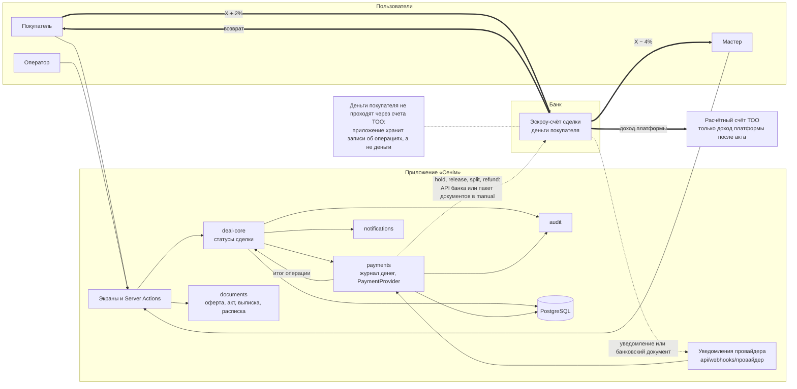
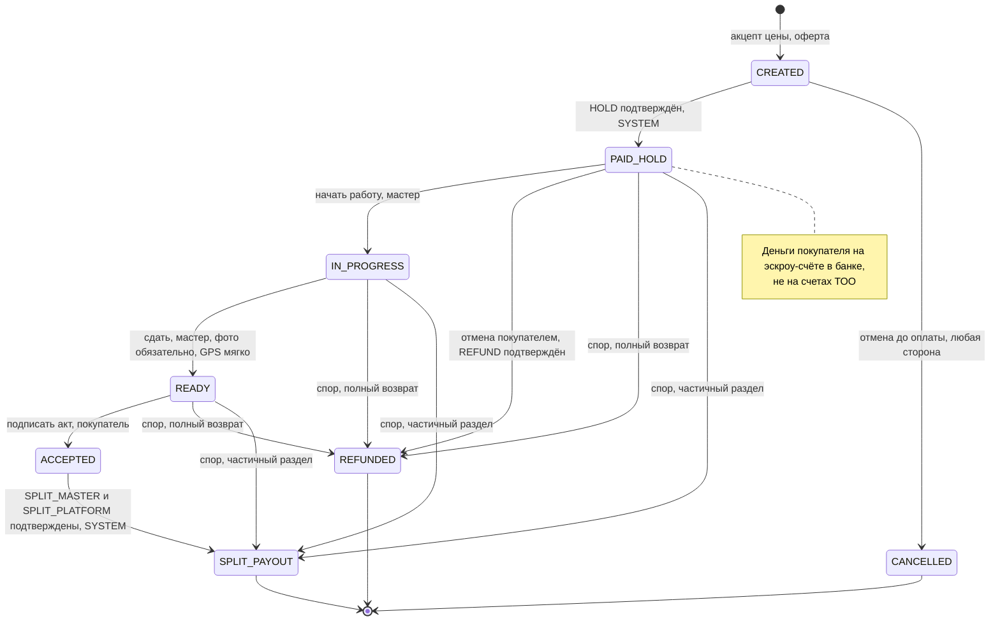

# 02. Архитектура

Модульный монолит на Next.js 16 (App Router, Server Actions), TypeScript, PostgreSQL через Prisma 7. Одно приложение, один деплой; модули разделены границами, которые проверяет линтер. Решение и его причины — [ADR-001](../adr/001-modular-monolith.md); модель денег, статусы и провайдеры — [ADR-009](../adr/009-tz-v1-money-model.md).

## Стек

| Слой | Что используется |
|---|---|
| Приложение | Next.js 16, React 19, TypeScript 5, Tailwind CSS 4; PWA (манифест, сервис-воркер, web push) |
| Данные | PostgreSQL 17 (локально — Docker, порт 5442), Prisma 7 с `@prisma/adapter-pg`; клиент генерируется в `src/generated/prisma` |
| Проверка входа | zod 4 — на каждом входе на сервер и для переменных окружения |
| Деньги | `BigInt`, тиыны; формулы — одна функция `computeDealMoney` |
| Документы | `pdf-lib` + `@pdf-lib/fontkit` (кириллица), SHA-256 байтов PDF |
| Фото | `sharp`: пережатие в JPEG без метаданных |
| Тесты | Vitest (модульные, property-тесты fast-check, интеграционные на отдельной БД), Playwright (сквозные сценарии) |
| CI | GitHub Actions: `npm ci`, `typecheck`, `lint`, `test` |

## Структура кода

```
src/app/                    маршруты и экраны, без бизнес-логики
src/modules/<имя>/          модуль; наружу — только index.ts (и client.ts для клиентских компонентов)
src/verticals/furniture/    всё мебельное: типы, стили, правила сегмента
src/platform/               db, env (zod, контуры APP_ENV), features (флаги), errors, logger, crypto, jobs, rate-limit, action
src/config/brand.ts         название продукта, подпись, цвета — одно место
src/ui/                     дизайн-токены и базовые компоненты
src/i18n/ru/                тексты интерфейса по зонам
src/jobs.ts                 сборка обработчиков фоновых задач из модулей
```

Правила границ (`eslint.config.mjs`, `no-restricted-imports`):

- импорт из другого модуля — только через его `index.ts`;
- модули не импортируют экраны (`src/app`);
- `deal-core` не импортирует `src/verticals`: ядро сделки не знает, что это мебель.

Межмодульные вызовы — функции из `index.ts`; транзакция передаётся параметром `tx`. Действие, затрагивающее несколько модулей, фиксируется целиком или не фиксируется вовсе.

## Модули

| Модуль | Ответственность |
|---|---|
| `identity` | Вход по SMS-коду, сессии, роли и проверки прав, регистрация мастера, KYC-статус, ФИО и ИИН покупателя, демо-персоны |
| `companies` | Профиль мастера, реквизиты выплаты (KZ IBAN, зашифрован), Instagram, режим показа имени, чат с маской контактов до оферты |
| `requests` | Заказ (стиль и тип комнаты, «Для продвинутых»), отклики, торг раундами цен (`PriceProposal`), акцепт → сделка |
| `deal-core` | Сделка и её статусная машина (ТЗ п. 9), оферта, оплата, сдача с фото и GPS, акт, выплата, отмена, спор, «Ход работ», публичная проекция (фундамент витрины). Не знает про мебель |
| `payments` | Формулы денег (`money.ts`), интерфейс `PaymentProvider` и провайдеры, журнал денег и его проекции (блок денег, история денег, выписка), приём уведомлений провайдера |
| `documents` | PDF оферты, акта приёмки, выписки по деньгам и расписки на раскрытие; хэши; собственноручная подпись; ЭЦП (`SignatureProvider`) и её проверка на сервере |
| `files` | `StorageProvider` (`local`, `s3`, `vercel-blob`), загрузка по подписанной ссылке, фото сдачи, сканы банковских документов, KYC-документы |
| `notifications` | Уведомления в приложении, web push, SMS, e-mail акта; уведомление обеим сторонам на каждое изменение денег |
| `operator` | Модерация и KYC, кнопки `manual`-провайдера с банковскими документами, пакет на раскрытие, споры, журнал аудита, отчёт по схеме 2% + 4%, флаги (только чтение) |
| `audit` | Журнал событий только на добавление: кто, что, когда, откуда |
| `ai` | Помощник и подсказки ИИ — под флагом `ai`, по умолчанию выключен |

`payments` не импортирует `deal-core`: об итоге операции журнала он сообщает через обработчик, который передаёт ядро сделки. Провайдера можно заменить, не трогая ядро.

## Компоненты и потоки данных



Двойные стрелки — движение денег; оно идёт только в банке. Пунктир — распоряжения и уведомления.

Основные потоки:

1. **Торг → сделка.** Акцепт встречной цены в `requests` в одной транзакции фиксирует X, вызывает `deal-core.createDeal`: сделка в `CREATED` с суммами `computeDealMoney(X)`, провайдером из `PAYMENT_PROVIDER` и PDF оферты.
2. **Оферта → оплата.** Вторая подпись оферты заполняет `Deal.signedAt` (открывает контакты) и создаёт операцию `HOLD` в `PENDING`. Провайдер получает `hold` с ключом `hold:<dealId>`.
3. **Итог операции → статус.** Итог приходит от провайдера (ответ, уведомление, `getStatus`) или от оператора (`manual`). Обработчик в одной транзакции переводит операцию журнала из `PENDING` в итог, сделку — в следующий статус, пишет аудит и уведомляет обе стороны.
4. **Акт → выплата.** Подпись акта покупателем: `READY → ACCEPTED`, операции `RELEASE`, `SPLIT_MASTER`, `SPLIT_PLATFORM` в `PENDING`. Подтверждение обеих частей раздела: `ACCEPTED → SPLIT_PAYOUT`.
5. **Спор.** Открытие пишет `FREEZE`, решение — `UNFREEZE` и операции исхода.
6. **Уведомления.** `notifications.notify` вызывается в той же транзакции, что и изменение; push и SMS отправляет фоновая задача.

## Правила изменения состояния

Каждое действие, меняющее сделку, заказ или журнал денег (`CLAUDE.md`, «Definition of Done»):

1. Вход на сервер разбирается zod-схемой (`action()` из `src/platform/action.ts`); первая строка обработчика — `requireUser(...роли)`.
2. Изменение — через сервис модуля в `transaction()`.
3. Переход ищется в таблице переходов (`from`, `to`, кто, условие). Нет строки — «сейчас нельзя»; не та роль — «не ваше действие».
4. Условное обновление `updateMany({ where: { id, status: <ожидаемый> } })` + `expectOneUpdated()` или `SELECT … FOR UPDATE`. Двойной клик даёт один переход.
5. В той же транзакции — `recordAudit()` (кто, что, когда, откуда) и уведомления.

## Статусная машина сделки (ТЗ п. 9)

Таблица переходов — данные в коде `deal-core`. Тест на каждый разрешённый и каждый запрещённый переход идёт на реальной тестовой БД.



- `CREATED` включает подписание оферты: оплата доступна, когда оферту подписали обе стороны.
- `CREATED → PAID_HOLD` и `ACCEPTED → SPLIT_PAYOUT` выполняет обработчик подтверждения операции журнала, а не кнопка стороны.
- Конечные статусы: `SPLIT_PAYOUT`, `CANCELLED`, `REFUNDED`.

### Спор

`Dispute` открывает любая сторона в `PAID_HOLD`, `IN_PROGRESS` или `READY`. Одновременно открыт не больше одного спора на сделку (частичный уникальный индекс `Dispute_one_open_per_deal`). Пока спор открыт, все переходы сделки, кроме решения спора, запрещены. Решает оператор; подсказка ИИ — только под флагом `ai`.

| Итог | Статус сделки после | Операции журнала |
|---|---|---|
| `CONTINUE` — продолжить работу | статус на момент открытия | `UNFREEZE` |
| `FULL_REFUND` — полный возврат | `REFUNDED` | `UNFREEZE`, `REFUND` на всё оплаченное |
| `PARTIAL_SPLIT` — мастеру Y из X | `SPLIT_PAYOUT` | `UNFREEZE`, `RELEASE`, `SPLIT_MASTER`, `SPLIT_PLATFORM` (формула от Y), `REFUND` остатка |

## Журнал денег и его проекции

`MoneyTransaction` — единственный источник правды о деньгах. Из него строятся:

- **блок денег** — первый блок карточки сделки у покупателя и мастера (ТЗ п. 4.1, 4.2);
- **история денег** — таймлайн «Зарезервировано → Удержано на время спора → Выплачено» со ссылками на документы (ТЗ п. 4.3);
- **выписка по деньгам** — PDF (`MONEY_STATEMENT`);
- **отчёт оператора** — по схеме 2% + 4%.

Типы, статусы, ключи и защита журнала — [03-escrow-integration.md](03-escrow-integration.md), разделы 2 и 6.

## Данные

Таблицы, важные для банка (`prisma/schema.prisma`):

| Таблица | Назначение | Ограничения |
|---|---|---|
| `Deal` | Сделка: цена X и производные суммы в тиынах, провайдер, статус, время каждого шага, GPS сдачи, публичный идентификатор | CHECK `Deal_money_formula`: `buyerTotal = price + protection`, `guarantee = price − payout`, `buyerTotal = payout + platformIncome` |
| `MoneyTransaction` | Журнал денег: тип, статус, сумма в тиынах, ключ, провайдер, признак теста, родительская операция, спор, номер у банка, документ-основание, реквизиты и скан банковского документа, кто запросил и подтвердил | `idempotencyKey` уникален; сумма ≥ 0; триггер `money_transaction_no_delete_rewrite` — только добавление, итог меняется только из `PENDING` |
| `PaymentWebhookEvent` | Входящие уведомления провайдера: провайдер, тело, время приёма и обработки, ошибка | `externalEventId` уникален |
| `Dispute` | Спор: статус сделки при открытии, причина, позиции сторон, итог, доля мастера в тиынах, обоснование | один открытый на сделку; доля мастера только при `PARTIAL_SPLIT` |
| `Document`, `Signature`, `HandSignature` | Документы, ЭЦП и собственноручные подписи (хэш документа, время, IP, устройство) | одна собственноручная подпись стороны на документ |
| `AuditEvent` | Журнал аудита: кто, что, над чем, до и после, `scope`, IP, устройство | только добавление (триггер), сквозной номер `seq` |

Все суммы сделки — `BigInt` в тиынах. Суммы вне платёжного пути (справочник цен материалов и сценарии под флагом `preContractFlows`) хранятся в целых тенге и в деньги сделки не входят.

## Фоновые задачи

Очередь — таблица `Job` (`src/platform/jobs`). Задача ставится в той же транзакции, что и изменение, которое её порождает; повторная постановка с тем же `dedupeKey` не создаёт дубль. Задачи забираются атомарно (`FOR UPDATE SKIP LOCKED`); при ошибке — повтор с растущей паузой. Все обработчики идемпотентны.

Для денег очередь нужна на случай сбоя: повтор вызова провайдера с тем же ключом и опрос `getStatus` для операций, долго ждущих итога. Отправка push и SMS тоже идёт через очередь. Запуск — `GET /api/cron/run` с `Authorization: Bearer <CRON_SECRET>` по расписанию хостинга (для рабочего режима — не реже раза в 15 минут) или локально `npm run jobs`.

## Окружения (`APP_ENV`)

| | `dev` | `staging` | `prod` (пилот) |
|---|---|---|---|
| Платёжный провайдер по умолчанию | `mock` | `freedompay` (песочница) | `manual` (Freedom Bank) |
| Моки SMS, подписи, платежей | разрешены | разрешены | **запрещены** проверкой `env.ts` |
| `freedompay` | запрещён | разрешён | **запрещён** |
| `DEMO_MODE` | можно | можно | **запрещён** |
| Данные | тестовые | тестовые | реальные, только в облаке в РК ([04](04-security-and-data.md), раздел 10) |

Код один для всех контуров; различаются только переменные окружения (полный список — `.env.example` и раздел «Переменные окружения» в `README.md`). При ошибке конфигурации приложение не стартует и перечисляет все проблемы.
