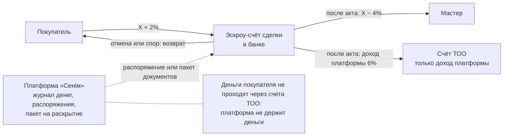
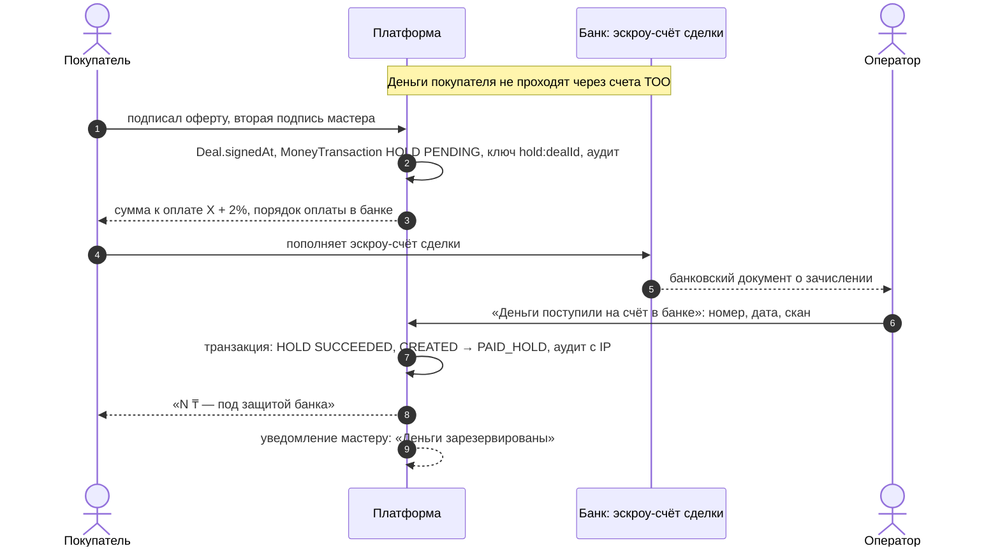
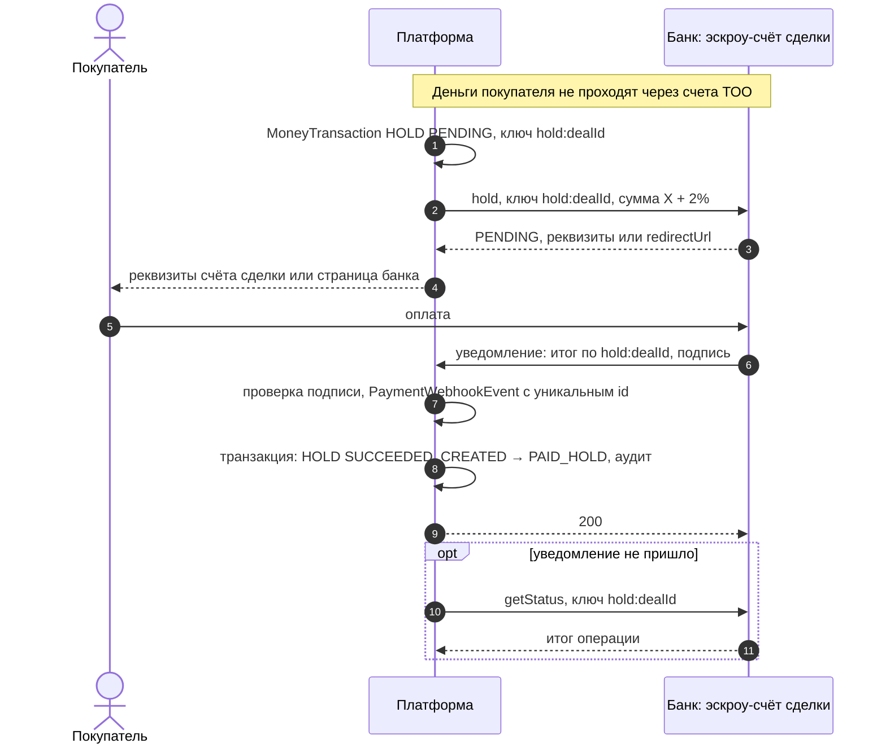
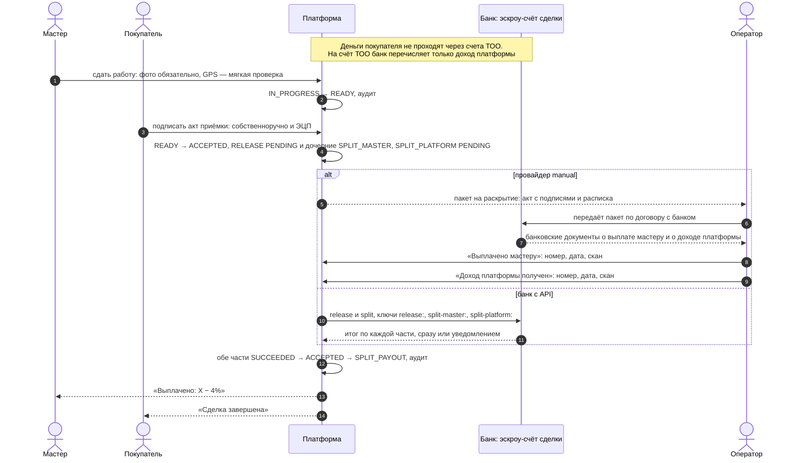
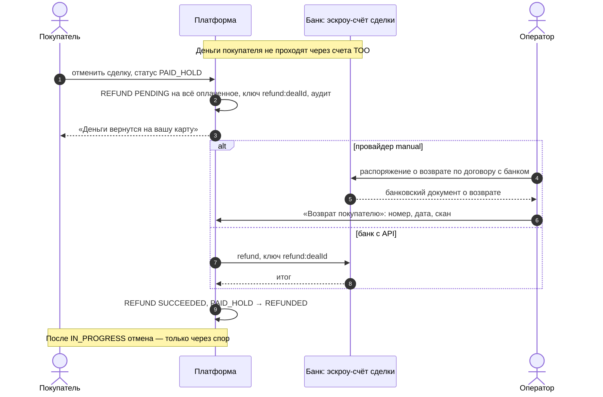
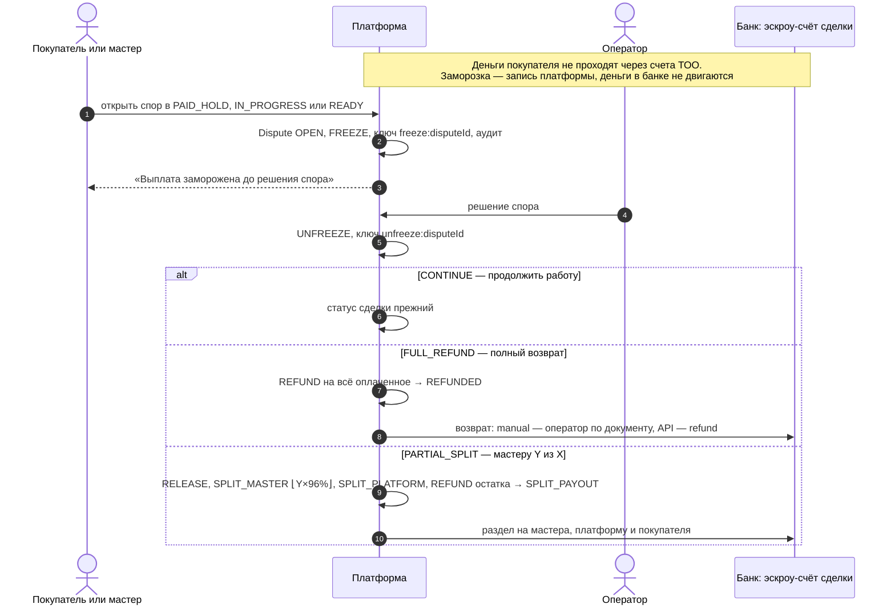

# 03. Интеграция с банком: наши требования

Документ описывает, как платформа работает с деньгами сделки и что ей нужно от банка. **Здесь нет утверждений о конкретном API Freedom Bank или другого банка.** Описаны только наши требования и точка подключения в коде: интерфейс `PaymentProvider`. Что известно о банках, — в [06-bank-api-landscape.md](06-bank-api-landscape.md). Предлагаемый контракт с банком — в [openapi.yaml](openapi.yaml), он помечен «предложение платформы, не API банка». Решение — [ADR-009](../adr/009-tz-v1-money-model.md).

## 0. Железное правило

**Деньги клиентов никогда не проходят через счета ТОО.** Деньги покупателя лежат на эскроу-счёте сделки в банке. Банк выплачивает с этого счёта мастеру и возвращает покупателю. Платформа деньги не держит: она фиксирует операции в журнале и передаёт банку распоряжения или пакет документов. На счёт ТОО поступает только доход платформы, который банк раскрывает со счёта сделки после подписанного акта.

## 1. Модель денег

Одна оплата покупателя в начале и одна выплата мастеру в конце. Авансов и оплат по этапам нет. Формулы (ТЗ п. 6) — одна функция `computeDealMoney` в `src/modules/payments/money.ts`.

| Величина | Формула | Пример: X = 1 500 000 ₸ |
|---|---|---|
| Цена по оферте | X, фиксируется акцептом в торге | 1 500 000 ₸ |
| Защита сделки 2% (платит покупатель) | ⌈X × 2%⌉, вверх до тиына | 30 000 ₸ |
| **К оплате покупателем** (поступает на эскроу-счёт) | X + защита | **1 530 000 ₸** |
| Гарантия оплаты и клиента 4% (удерживается из X) | X − выплата | 60 000 ₸ |
| **К выплате мастеру** | ⌊X × 96%⌋, вниз до тиына | **1 440 000 ₸** |
| **Доход платформы** | оплачено − выплата (поглощает округление) | **90 000 ₸** |

- Все суммы сделки — **тиыны, целые числа** (`BigInt`, `*Tiyn`). Дробей и float нет.
- Инвариант «оплачено = выплата мастеру + доход платформы» верен до тиына. Его проверяют property-тест на случайных X (`money.test.ts`, fast-check) и CHECK-ограничение `Deal_money_formula` в базе.
- Суммы фиксируются в сделке при акцепте (`Deal.priceTiyn`, `protectionTiyn`, `buyerTotalTiyn`, `guaranteeTiyn`, `payoutTiyn`, `platformIncomeTiyn`). Покупатель и мастер видят их до подтверждения оплаты.

**Движение денег по исходам сделки:**

| Исход | Покупателю (возврат) | Мастеру | Платформе |
|---|---|---|---|
| Акт подписан | — | X − 4% | 2% + 4% от X |
| Отмена покупателем после оплаты (`PAID_HOLD`) | всё оплаченное, X + 2% | — | 0 |
| Спор: полный возврат | всё оплаченное, X + 2% | — | 0 |
| Спор: мастеру часть Y из X | остаток | ⌊Y × 96%⌋ | ⌈Y × 2%⌉ + гарантия от Y |
| Спор: продолжить работу | — (деньги остаются на счёте) | — | — |

Пример частичного раздела: X = 1 500 000 ₸, мастеру присуждено Y = 1 000 000 ₸. Мастер получает 960 000 ₸, платформа — 60 000 ₸, покупателю возвращается 1 530 000 − 960 000 − 60 000 = 510 000 ₸ (`computeSplit`, тот же модуль).



## 2. Журнал денег — единственный источник правды

Каждое движение денег — строка `MoneyTransaction` (`prisma/schema.prisma`). Блок денег в карточке сделки, история денег, выписка по деньгам (PDF) и отчёт оператора строятся из журнала, а не из статуса сделки. Статус сделки следует за журналом.

| Тип | Сумма | Что значит | Движет деньги в банке |
|---|---|---|---|
| `HOLD` | к оплате покупателем | деньги покупателя поступили на эскроу-счёт сделки | да |
| `FREEZE` | к выплате мастеру | выплата заморожена на время спора | **нет**: платформа просто не отправляет распоряжение |
| `UNFREEZE` | к выплате мастеру | спор решён, заморозка снята | нет |
| `RELEASE` | `SPLIT_MASTER` + `SPLIT_PLATFORM` | распоряжение о раскрытии счёта; разбивка — дочерние операции (`parentId`) | да |
| `SPLIT_MASTER` | выплата мастеру | банк выплатил мастеру | да |
| `SPLIT_PLATFORM` | доход платформы | банк перечислил доход платформы на счёт ТОО | да |
| `REFUND` | возврат | банк вернул деньги покупателю | да |

- **Статусы операции:** `PENDING → SUCCEEDED | FAILED`. Остаток на счёте сделки = `HOLD − SPLIT_MASTER − SPLIT_PLATFORM − REFUND` по подтверждённым операциям.
- **Только добавление.** Триггер `money_transaction_no_delete_rewrite` (миграция `20261105100000_tz_v1_money_model`) запрещает `DELETE` и изменение сделки, типа, суммы, провайдера, ключа, номера `seq` и времени создания. У операции меняется только итог, и только из `PENDING`. Завершённую операцию переписать нельзя даже прямым SQL через подключение приложения.
- **Что хранится по операции:** провайдер, признак тестовой операции (`isTest`), номер операции у банка (`externalRef`), документ-основание (`basisDocumentId`: оферта для `HOLD`, акт приёмки для `RELEASE`/`SPLIT_*`), реквизиты банковского документа (`bankDocNumber`, `bankDocDate`) и его скан (`bankDocFileId`), кто запросил (`actorId`) и кто подтвердил (`confirmedById`), текст ошибки, время итога (`settledAt`).

## 3. Точка подключения: `PaymentProvider`

Контракт — `src/modules/payments/provider.ts`. Ядро сделки (`deal-core`) пишет операцию в журнал и вызывает провайдера с тем же ключом идемпотентности. Банк не вшит в бизнес-логику: провайдер выбирается переменной `PAYMENT_PROVIDER` (по умолчанию — по `APP_ENV`) и фиксируется в сделке при её создании (`Deal.paymentProvider`). Смена провайдера влияет только на новые сделки.

```ts
export interface PaymentProvider {
  readonly name: PaymentProviderName;
  readonly isTest: boolean; // тестовые деньги: интерфейс помечает «тестовый платёж»
  hold(request: HoldRequest): Promise<ProviderResult>;
  release(request: ReleaseRequest): Promise<ProviderResult>;
  split(request: SplitRequest): Promise<{ master: ProviderResult; platform: ProviderResult }>;
  refund(request: RefundRequest): Promise<ProviderResult>;
  getStatus(request: StatusRequest): Promise<ProviderResult>;
  handleWebhook(input: WebhookInput): Promise<WebhookResult>;
}

export type ProviderResult =
  | { status: "SUCCEEDED"; externalRef: string }
  | { status: "PENDING"; externalRef?: string; redirectUrl?: string } // итог позже
  | { status: "FAILED"; error: string };
```

Каждый запрос несёт `dealId`, `idempotencyKey` и `amountTiyn`. `hold` дополнительно передаёт назначение платежа без персональных данных («Сделка №17») и адрес возврата со страницы банка. `split` передаёт получателя выплаты: IBAN мастера (хранится зашифрованным и расшифровывается только для передачи провайдеру) и наименование. `refund` передаёт основание. Карточные данные через сервер платформы не проходят: `hold` может вернуть ссылку на страницу банка или провайдера (`redirectUrl`).

| Провайдер | `PAYMENT_PROVIDER` | Окружение | Поведение |
|---|---|---|---|
| `mock` | `mock` | `dev`, демо | Подтверждает операции сразу. В интерфейсе каждая операция помечена «тестовый платёж». Запрещён при `APP_ENV=prod` |
| `manual` | `manual` | `prod`: пилот, Freedom Bank | Банк без API. Операции создаются в `PENDING`, оператор подтверждает каждую по банковскому документу (раздел 4) |
| `freedompay` | `freedompay` | только `staging` | Песочница Freedom Pay. При другом `APP_ENV` приложение не стартует. Подробно — [07-freedompay-integration.md](07-freedompay-integration.md), ограничения — [06](06-bank-api-landscape.md) |
| `bcc` | — | — | Только интерфейс и TODO до документации банка. В `PaymentProviderName` пока не заведён |

По умолчанию (`DEFAULT_PAYMENT_PROVIDER` в `src/platform/env.ts`): `dev` → `mock`, `staging` → `freedompay`, `prod` → `manual`.

**Подключение банка с API** — это новый файл провайдера, реализующий `PaymentProvider` по спецификации банка, плюс его учётные данные в `src/platform/env.ts`. Журнал, статусная машина, блок денег, кнопки оператора и экраны не меняются.

## 4. Провайдер `manual` — мост к эскроу Freedom Bank

У Freedom Bank эскроу-продукт без API: трёхсторонний договор, открытие и обслуживание 0 ₸, раскрытие по расписке ([06](06-bank-api-landscape.md)). Пилот идёт на `manual` с реальными деньгами в банке. Платформа деньги не двигает и не держит: она фиксирует, что сделал банк, по банковским документам.

### Кнопки оператора

| Кнопка | Операция журнала | Когда доступна | Что меняется в сделке |
|---|---|---|---|
| «Деньги поступили на счёт в банке» | `HOLD` → `SUCCEEDED` | оферта подписана обеими сторонами, операция `HOLD` в `PENDING` | `CREATED → PAID_HOLD` |
| «Выплачено мастеру» | `SPLIT_MASTER` → `SUCCEEDED` | акт подписан, пакет на раскрытие сформирован | когда подтверждены обе части раздела: `ACCEPTED → SPLIT_PAYOUT` |
| «Доход платформы получен» | `SPLIT_PLATFORM` → `SUCCEEDED` | то же | то же |
| «Возврат покупателю» | `REFUND` → `SUCCEEDED` | отмена после оплаты или решение спора с возвратом | `→ REFUNDED` (или часть раздела по спору) |

Требования к каждому подтверждению:

1. **Номер и дата банковского документа** и **скан** (файл с назначением `BANK_DOCUMENT`) — обязательны. Они сохраняются в операции (`bankDocNumber`, `bankDocDate`, `bankDocFileId`), скан привязан к одной операции.
2. **Только из `PENDING`.** Подтвердить можно только ожидающую операцию. Повторное нажатие не создаёт второго подтверждения: условное обновление по статусу и триггер журнала.
3. **Аудит.** Запись в журнале аудита в той же транзакции: кто (оператор), что (операция и документ), когда, откуда (IP и устройство).
4. **Уведомление обеим сторонам** о каждом изменении денег: в приложении и web push.

Ошибочное подтверждение исправить правкой нельзя: журнал только на добавление. Порядок исправления (корректирующая операция и её документ) не определён — открытый вопрос, см. раздел 11.

### Пакет на раскрытие

После подписания акта приёмки платформа формирует пакет для банка:

- **акт приёмки** (`ACCEPTANCE_ACT`, PDF) с подписями: покупатель — собственноручно и ЭЦП, мастер — ЭЦП; в акте фото сдачи и GPS-отметка;
- **расписка на раскрытие** (`RELEASE_RECEIPT`, PDF) с суммами раздела: мастеру X − 4%, платформе 6% от X. **Шаблон требует юридической проверки** и в таком виде помечен в документе.

Пакет передаётся в банк вне платформы, по порядку, установленному договором с банком. Пока открыт спор, пакет не формируется (`FREEZE`).

## 5. Операции, нужные от банка с API

Если у банка появится API (БЦК, Freedom Bank в будущем или другой банк), нам нужны операции ниже. Это **наши требования**, а не описание API банка.

| # | Операция | Метод `PaymentProvider` | Когда вызывает платформа | Что ждём от банка |
|---|---|---|---|---|
| 1 | Открыть эскроу-счёт сделки и получить реквизиты или ссылку на оплату | `hold` | Оферта подписана обеими сторонами | Номер счёта или операции у банка, реквизиты для пополнения или `redirectUrl`; итог — `PENDING` до поступления денег |
| 2 | Уведомление о поступлении денег на счёт | вебхук → `handleWebhook` | Покупатель пополнил счёт | Событие с нашим ключом `hold:<dealId>`, суммой, номером операции банка и временем |
| 3 | Распоряжение о раскрытии | `release` | Покупатель подписал акт, спора нет | Принято или отклонено, номер операции |
| 4 | Раздел раскрытия на мастера и платформу | `split` | В том же действии, что и `release` | Итог по каждой части отдельно: мастеру и платформе |
| 5 | Возврат покупателю | `refund` | Отмена после оплаты; решение спора | Итог, номер операции |
| 6 | Статус операции по нашему ключу | `getStatus` | Операция долго в `PENDING`, уведомление не пришло | Текущий итог операции |
| 7 | Уведомление об итоге операции | вебхук → `handleWebhook` | Банк завершил операцию, принятую в `PENDING` | Событие с нашим ключом, итогом и номером операции банка |
| 8 | Выписка по счёту сделки | — (сверка) | Сверка журнала с банком | Движения по счёту с номерами операций и нашими ключами |

Требования к операциям:

1. **Идемпотентность по нашему ключу.** Повтор с тем же ключом возвращает итог уже выполненной операции и не двигает деньги второй раз. Ключ должен действовать всё время жизни счёта.
2. **Окончательный отказ отличается от временного сбоя.** Отказ (недостаточно средств, неверные реквизиты, счёт закрыт) — `FAILED`. Таймаут, перегрузка и 5xx — «итог неизвестен»: мы повторяем с тем же ключом или спрашиваем `getStatus`.
3. **Номер операции банка** в ответе, в уведомлении и в выписке.
4. **Уведомление об итоге** каждой операции, принятой в `PENDING`, и о каждом поступлении денег. Повторная доставка — с тем же идентификатором события.
5. **Раздел на двух получателей** (мастер и счёт ТОО для дохода платформы) и, при споре, на трёх (плюс возврат покупателю).
6. **Получатели.** Возврат — плательщику. Выплата — мастеру по реквизитам, которые передаёт `split` (IBAN мастера проверяется по контрольной сумме KZ IBAN при вводе). Доход платформы — на расчётный счёт ТОО.

## 6. Идемпотентность на нашей стороне

У каждой операции журнала уникальный `idempotencyKey` (уникальный индекс `MoneyTransaction_idempotencyKey_key`). Повторный запрос с тем же ключом не создаёт вторую операцию и не отправляет второе распоряжение. Тот же ключ передаётся банку.

| Ключ | Операция |
|---|---|
| `hold:<dealId>` | оплата покупателя на эскроу-счёт |
| `release:<dealId>` | распоряжение о раскрытии |
| `split-master:<dealId>` | выплата мастеру |
| `split-platform:<dealId>` | доход платформы |
| `refund:<dealId>` | возврат покупателю |
| `freeze:<disputeId>` | заморозка выплаты при открытии спора |
| `unfreeze:<disputeId>` | снятие заморозки при решении спора |

Ключи состоят из префикса и идентификатора (`cuid`), символы `[a-z0-9:-]`. Если у банка свои ограничения на длину или набор символов, адаптер преобразует ключ детерминированно.

Двойной клик и параллельные запросы дают один переход и одну операцию. Переход выполняется условным обновлением по ожидаемому статусу (`updateMany` + `expectOneUpdated`) или под блокировкой строки сделки. Это требование проекта к каждому переходу и тесту гонки (`CLAUDE.md`, «Definition of Done»).

## 7. Подписи запросов

### Входящие: банк → платформа

Уведомления провайдера принимает `handleWebhook`: он проверяет подпись, разбирает тело и возвращает итог операции журнала или отказ. Событие записывается в `PaymentWebhookEvent` с уникальным `externalEventId`: повторная доставка не обрабатывается дважды. Неверная подпись — ответ 4xx, событие не сохраняется. Путь уведомлений для банка с API — `POST /api/webhooks/<провайдер>`; маршрут добавляется вместе с адаптером банка.

Если у банка нет своей схемы подписи, предлагаем схему, уже реализованную в проекте (`src/modules/payments/webhook-signature.ts`):

| Элемент | Значение |
|---|---|
| Заголовок времени | `x-senim-timestamp`: Unix-время в секундах |
| Заголовок подписи | `x-senim-signature`: `v1=<hex(HMAC-SHA256(secret, "<timestamp>.<тело запроса>"))>` |
| Секрет | общий секрет, выданный банку, 32+ символа; хранится в переменной окружения |
| Что подписывается | метка времени, точка и тело запроса **байт в байт, как отправлено** |
| Окно времени | ±5 минут от времени сервера |
| Сравнение | за постоянное время (`timingSafeEqual`) |
| Повторная доставка | с новой меткой времени и подписью, идентификатор события прежний |
| Размер тела | до 64 КБ |

Если у банка своя схема (ЭЦП юрлица, асимметричная подпись, взаимный TLS), она реализуется в `handleWebhook` провайдера банка, остальной код не меняется. У Freedom Pay своя подпись `pg_sig` — см. [07](07-freedompay-integration.md). Ограничение по IP-адресам банка настраивается на уровне хостинга.

### Исходящие: платформа → банк

Клиента API банка пока нет: формат авторизации определит спецификация банка. Наши требования к каналу:

- только TLS; учётные данные (токен, сертификат клиента, ключ ЭЦП юрлица) — в переменных окружения или хранилище секретов облака, не в коде;
- каждый вызов несёт ключ идемпотентности операции;
- таймаут, обрыв соединения и 5xx — «итог неизвестен»: операция остаётся `PENDING`, повтор идёт с тем же ключом;
- постоянный исходящий IP рабочего окружения, если банк требует белый список.

## 8. Соответствие статусов

### Итог провайдера → журнал

| Провайдер сообщил | `ProviderResult` | `MoneyTransaction.status` | Дальше |
|---|---|---|---|
| Операция исполнена | `SUCCEEDED` + номер | `SUCCEEDED`, `externalRef`, `settledAt` | Переход сделки по таблице ниже, уведомление сторонам |
| Принята, итог позже | `PENDING` (+ номер, ссылка на оплату) | остаётся `PENDING` | Ждём уведомление, кнопку оператора (`manual`) или `getStatus` |
| Окончательный отказ | `FAILED` + причина | `FAILED`, `error` | Запись в аудит, уведомление операторам; сделка не переходит |
| Временный сбой | исключение адаптера | остаётся `PENDING` | Повтор с тем же ключом |

### Журнал → статус сделки (ТЗ п. 9)

| Статус сделки | Журнал | Блок денег у покупателя (ТЗ п. 4.1) |
|---|---|---|
| `CREATED` | нет подтверждённого `HOLD` | серый: «Ожидает оплаты — деньги ещё не внесены» |
| `PAID_HOLD` | `HOLD` `SUCCEEDED` | зелёный: «N ₸ — под защитой банка. Недоступны мастеру до вашей подписи акта», дата и номер операции |
| `IN_PROGRESS`, `READY` | `HOLD` `SUCCEEDED` | то же |
| любой из трёх выше, открыт спор | плюс `FREEZE` без `UNFREEZE` | жёлтый: «Выплата заморожена до решения спора» |
| `ACCEPTED` | `RELEASE`, `SPLIT_MASTER`, `SPLIT_PLATFORM` в `PENDING` | зелёный до подтверждения выплаты |
| `SPLIT_PAYOUT` | `SPLIT_MASTER` и `SPLIT_PLATFORM` `SUCCEEDED` | «Сделка завершена. Выплачено мастеру: … · Защита сделки: …» |
| `REFUNDED` | `REFUND` `SUCCEEDED` | деньги возвращены покупателю |
| `CANCELLED` | денег не было | — |

Переходы `CREATED → PAID_HOLD` и `ACCEPTED → SPLIT_PAYOUT` выполняет обработчик подтверждения операции журнала, а не кнопка стороны (ADR-009, раздел 2). Переходы строго последовательные, перескоки отвергаются кодом. Таблица переходов — в [02-architecture.md](02-architecture.md).

## 9. Обработка сбоев

| Ситуация | Что делает платформа |
|---|---|
| Банк недоступен при вызове | Операция остаётся `PENDING`; повтор с тем же ключом фоновой задачей |
| Банк принял операцию, уведомление потерялось | Опрос `getStatus` по ключу; банк возвращает итог, а не исполняет операцию второй раз |
| Банк отклонил операцию | `FAILED`, аудит, уведомление операторам со ссылкой на сделку; сделка не переходит |
| Повторная доставка уведомления | `PaymentWebhookEvent.externalEventId` уникален: событие не обрабатывается второй раз |
| Неверная подпись или просроченная метка времени | Отказ 4xx, событие не сохраняется |
| Ошибка при обработке уведомления | Транзакция откатывается вместе с записью события; ответ не 2xx, банк доставляет снова |
| Двойной клик, параллельные запросы | Условное обновление по статусу: один переход, одна операция |
| Открыт спор | `FREEZE`: выплата и все переходы, кроме решения спора, заблокированы; пакет на раскрытие не формируется |
| `manual`: оператор подтвердил не ту операцию | Изменить нельзя (журнал только на добавление); порядок исправления — открытый вопрос (раздел 11) |
| Холд у платёжной организации истекает раньше конца заказа | Поэтому `freedompay` только в staging ([06](06-bank-api-landscape.md)) |

Ошибки пишутся в лог без персональных данных и реквизитов ([04](04-security-and-data.md), раздел «Логи»). IBAN мастера в журнал и логи не пишется.

## 10. Диаграммы последовательности

### Оплата покупателя (`HOLD`), провайдер `manual`



### Оплата покупателя (`HOLD`), банк с API



### Выплата после подписанного акта (`RELEASE` → `SPLIT_MASTER` + `SPLIT_PLATFORM`)



### Отмена покупателем после оплаты (`REFUND`)



### Спор: заморозка и решение



## 11. Что сделать при подключении банка с API

1. Получить спецификацию API и доступ к тестовому контуру ([06](06-bank-api-landscape.md), «Типовой путь»).
2. Добавить имя провайдера в `PaymentProviderName` и `PAYMENT_PROVIDER`, учётные данные — в `src/platform/env.ts` и `.env.example`.
3. Реализовать `PaymentProvider` по спецификации банка: вызовы, авторизация, перевод статусов банка в `ProviderResult` (раздел 8), проверка подписи в `handleWebhook`.
4. Добавить маршрут уведомлений `/api/webhooks/<провайдер>`.
5. Покрыть адаптер тестами на поддельном клиенте банка и пройти полную сделку, отмену и спор на тестовом контуре банка.
6. Включить провайдера для новых сделок; идущие сделки остаются на своём провайдере.

**Открытые вопросы на нашей стороне:** как исправлять ошибочное подтверждение оператора в `manual` (журнал только на добавление); каким ключом повторять операцию после окончательного отказа банка (ключи в ADR-009 по одному на сделку); как сверять журнал с выпиской банка в `manual`.

## 12. Вопросы к банку

Список — в [06-bank-api-landscape.md](06-bank-api-landscape.md), раздел «Вопросы к банку».
