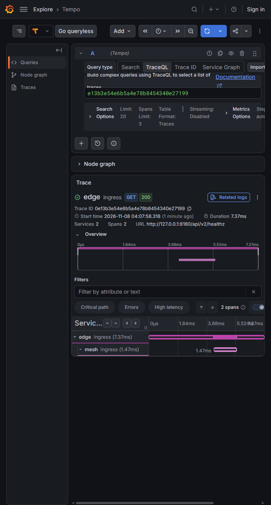
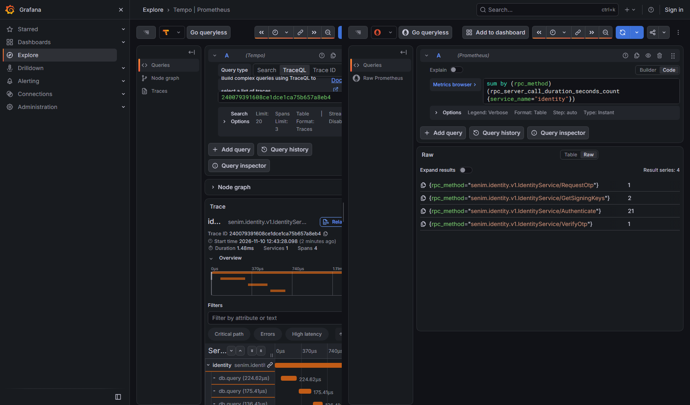

# Прогресс: платформа v2

## Репозиторий и CI

Удалённый репозиторий — `github.com/CemeteryPlaya/senim-platform` (приватный, создан владельцем 09.11.2026), `main` отправлен туда 09.11.2026.

Первый прогон CI (`c4e5ab4`, run 42619829699) — красный:

| Задача | Итог |
|---|---|
| proto, go (`-race`, govulncheck), образ identity | зелёные; `go` в job — 1.27.3 из toolchain |
| web | 2 из 2271 тестов: «двойная оплата» и «две встречные цены». На медленном раннере вызовы не перекрылись. Оплата: повтор после `PAID_HOLD` получал CONFLICT вместо той же операции — исправлено (`86262b8`). Торг: вторая цена законно становилась встречной — тест переписан на инвариант, индекс проверен отдельно |
| образ web | critical CVE-2026-5450 в glibc Debian 12 (bookworm, «won't fix») — база сменена на `node:24-trixie-slim` (`8256429`) |
| smoke | не запускался (ждёт образы) |

Повторный прогон (`8256429`, run 42689679917, 10.11.2026) — **все 6 задач зелёные**, включая образ web (скан без critical) и дымовой тест `smoke` на живом стенде в CI.

Предупреждения прогона (на потом): actions `checkout@v4`, `setup-go@v5`, `setup-node@v4`, `scan-action@v6`, `build-push-action@v6`, `setup-buildx-action@v3` написаны под Node 20 и запускаются принудительно на Node 24 — обновить мажоры; у job `go` не восстановился кэш (`tar` exit 2), на итог не влияет.

## План 1 «Фундамент» — готов, кроме шага за владельцем

Репозиторий `D:\senim-platform`, ветка `main`, 14 задач плана, все прошли ревью.

### Что сделано

| Область | Итог |
|---|---|
| Репозиторий и web | Старый web перенесён в `apps/web` с полной историей (418 коммитов). Правила для агентов (`CLAUDE.md`), ADR-010 про микросервисы и gRPC. |
| Конфигурация | `pkg/config`: окружения dev/staging/prod, секреты только в base64, в prod запрещены моки и DEMO_MODE, ключи должны различаться. |
| Логи | `pkg/logging`: JSON, `trace_id`, маскирование ИИН, IBAN, телефонов и чувствительных ключей, в том числе внутри вложенных структур. |
| Контракты | `buf`: Go и TypeScript из одних `.proto`, общий `ErrorDetail`, конверт событий `Envelope`, health-протокол gRPC для web. |
| mTLS | `pkg/tlsx` и `tools/devcerts`: свой dev-CA, сертификат на каждый сервис, клиент без сертификата и чужой CA отклоняются. |
| Каркас сервиса | `pkg/server`: gRPC по mTLS, health, `/healthz` и `/readyz`, плавная остановка с паузой для балансировщика, перехват паник, OpenTelemetry. |
| Роли БД | `pkg/dbx`: на каждый сервис своя база и две роли (owner для миграций, app для работы). App-роль не умеет DDL и TRUNCATE; журнальные таблицы только на добавление; чужая база недоступна. Миграции goose. |
| События | `pkg/outbox`, `pkg/inbox`: событие пишется в той же транзакции, релей публикует в JetStream, потребитель обрабатывает без двойного эффекта. Проверено падением посреди публикации и двумя релеями сразу. |
| Каркас identity | `services/identity`: serve, migrate, healthcheck, образ distroless 38 МБ. |
| Web → mesh | `apps/web/src/platform/rpc.ts`: gRPC-клиент по mTLS, дедлайн 5 с, вне dev только https. Проверка пути `/api/v2/healthz`. |
| Стенд | `docker compose` (профили core, full, storage): Postgres, NATS, 2 реплики identity, Envoy mesh (балансировка, ретраи, список разрешённых клиентов), Envoy edge (заголовки безопасности, лимит запросов), web. В `full` ещё Grafana/Tempo и ClamAV. Дымовой тест на Go. |
| CI | `.github/workflows/v2.yml`: proto, Go с `-race`, web, сборка образов с SBOM и сканом, дымовой тест. |

### Чем проверено

Тесты (Windows, `go test ./...`, без `-race`: на этой машине нет gcc):

- `pkg/config` 18 тестов, `pkg/logging` 18, `pkg/tlsx` 7, `tools/devcerts` 3, `pkg/server` 12 и больше.
- `pkg/dbx` 13 тестов на настоящем Postgres 17 (testcontainers), `tools/dbinit` 1.
- `pkg/outbox` 8 и `pkg/inbox` 7: на настоящих Postgres и NATS.
- `services/identity` 2 теста: поднимается по mTLS, health SERVING, таблицы доступны app-роли.
- `apps/web`: 46 тестов по `rpc`, `env`, `healthz`; typecheck и lint чистые.
- `go vet ./...`, `go tool golangci-lint run ./...` и `buf lint`: 0 замечаний. `govulncheck`: 0 достижимых уязвимостей.
- `actionlint` по workflow CI: без замечаний. Конфиги Envoy (edge и mesh): `--mode validate` OK.

Дымовой тест на живом стенде (через временный обход, см. «Ждёт владельца»):

- 20 запросов через mesh: 20/20 успешны, по 10 на каждую из двух реплик identity.
- Клиент без сертификата отклонён (`tls: certificate required`), с сертификатом web принят, с сертификатом edge отклонён.
- Профиль `full` проходит тот же тест.

Память в простое, `docker stats`:

| Профиль | Итого | Бюджет |
|---|---|---|
| core | 272 МиБ | 3 ГБ |
| full | около 2,33 ГиБ | 6 ГБ |

В core: identity около 8 МиБ на реплику, mesh 18, edge 17, web 107, postgres 30, nats 5.

Трассировка в Grafana: в трассе пути два спана — edge (корень) и mesh. «identity» на снимке — только имя апстрим-кластера в спане mesh, а не спан самого identity: health (единственный RPC identity) из трассировки исключён. Спан RPC identity и метрика `rpc.server.duration` в Grafana не проверены (в Tempo видны лишь отдельные корневые спаны `db.query` релея outbox) — проверить на первом настоящем RPC плана 2. У web пока нет своего OTel, поэтому его спана тоже нет.

### Решения, принятые контроллером (без вашего ответа)

| Решение | Цена, если ошибся |
|---|---|
| Метод выполнения: subagent-driven (вы дали добро, метод не выбирали). | Больше токенов. |
| Работа прямо в `main` нового репозитория, без пуша. | Позже вынести в ветку. |
| Health-протокол: вендорим `proto/thirdparty/grpc/health/v1/health.proto` и генерируем только для TS второй конфигурацией `buf.gen.thirdparty.yaml`; в Go используется `connectrpc.com/grpchealth`. | Небольшая перегенерация. |
| `dev.vars` с паролями БД создаёт задача 7, задача 11 дополняет. | Ничего. |
| `dbx.Migrate(ctx, ownerDSN, service, migrations, platformSchemas...)`; `outbox.Schema` и `inbox.Schema` — экспортируемые SQL-строки, применяются до миграций сервиса. | Придётся переделать API миграций в плане 2. |
| Health-вызов из web ставит заголовок `x-senim-target: identity`. | Ничего. |
| `v2:test` = `go test ./...` без `-race` (на Windows нет gcc); `-race` гоняет CI. | Гонки найдёт CI, а не локальный запуск. |
| Директива `go` в `go.mod` = 1.26.7 (минимум, который требуют инструменты), а не 1.25 из спеки. | Ничего. |
| `next typegen` должен идти перед `typecheck` в `apps/web` (и в CI). | Красный CI, если забыть. |
| Образ identity 38 МБ вместо 30 МБ из плана; бюджет теперь до 40 МБ на Go-сервис. | Ничего по функциям. |
| Удостоверение вызывающего — XFCC от mesh и `AllowedPeers` (ADR-011) — сделано до плана 2; таблица прав «кто какой метод» — план 3 (первые методы с деньгами). | Если пропустить таблицу прав: один взломанный сервис может звать любой метод другого. |
| Отдельный MinIO вынесен из `core` в профиль `storage`; образ S3 выберет план 4 (файлы). | Ничего для плана 1. |
| Трассировка в Grafana для плана 1: edge → mesh (identity — только имя апстрима в спане mesh); OTel в web позже. | В трассе пути нет спанов web и identity; спан RPC и метрики Go-сервиса не проверены до плана 2. |
| Для https-only mesh staging приравнен к prod. | Ничего. |

### Отложенные мелочи

Финальная волна исправлений (после финального ревью, до плана 2) — сделано:

- Удостоверение сервиса через mesh (ADR-011): mesh передаёт вызывающего в XFCC, сервис принимает TLS только от `AllowedPeers` (identity — mesh и он сам), `server.Caller(ctx)`; edge больше не получает сертификат CA.
- NATS (ADR-012): TLS с клиентским сертификатом, учётная запись на сервис, публикация только в `senim.<сервис>.>`; конфиг генерирует `tools/natsconf`; inbox отвергает событие, если источник конверта не совпадает с субъектом.
- Готовность identity — только база; NATS и релей — в лог при смене состояния и в метрики `senim.outbox.pending` / `senim.outbox.oldest_age` (видны в Prometheus профиля full). Тест identity доказывает, что релей подключён: обрыв NATS — `/readyz` 200, возврат — событие уходит в поток.
- `/api/v2/healthz` — 503 без SERVING; у кластеров mesh нет «режима паники»; потолок сообщения 4 МиБ в сервисах и на mesh; явный `POOL_MAX_CONNS` (4) и тайм-ауты роли `<svc>_app` (15 с / 30 с); OTLP-эндпоинт — URL; `toolchain go1.27.3` и образ на том же патче; единый список сервисов `tools/services` с тестом конфигов; `buf breaking` на push сравнивает с коммитом до пуша.
- MUST-FIX из журнала: `DEMO_MODE` через `strconv.ParseBool`, `Distinct` по байтам, стабильный тест маски, маркер append-only ловит регистр и опечатки, health — NotFound на чужое имя, детали инвариантов в `CLAUDE.md`.
- Документация: правило «Unavailable только без побочного эффекта» (`pkg/server`), границы «ровно один раз» у inbox (`pkg/inbox`).

Существующий dev-стенд после этой волны: `npm run v2:down`, удалить тома `senim-v2_pg-data` и `senim-v2_nats-data`, затем `npm run v2:certs` и `npm run v2:up` — иначе роли `<svc>_app` останутся без тайм-аутов, а NATS не получит сертификат `nats`.

В план 2 (решение контроллера):

- ~~Конфиг сервиса в prod: `sslmode=verify-full` для Postgres и TLS для OTLP (M3).~~ Сделано в плане 2 (Task 3).
- ~~Права app-роли на DELETE и EXECUTE (маркер или отдельная роль для очистки, M7).~~ Сделано в плане 2 (Task 2, маркер `senim:app-delete`; очистка — Task 10). Право EXECUTE (крайний случай для функций расширений) этим не закрыто.
- ~~`pkg/rpcclient` — Go-клиент mesh (mTLS из `TLS_*`, дедлайн, traceparent).~~ Сделано в плане 2 (Task 8).
- Потоки JetStream в prod создаёт инфраструктура, а не сервис: сейчас у сервиса есть `STREAM.CREATE|UPDATE` на свой поток (план 7; до него — защита в inbox по имени потока). Перенесено в план 7: без прод-инфраструктуры решать нечем.
- ~~Первый запуск CI: убедиться, что `go version` в job печатает 1.27.3 (иначе задать `go-version: 1.27.3`), и что `-race` зелёный.~~ Проверено 10.11.2026: 1.27.3, `-race` зелёный.
- События, частично: очистка опубликованного outbox identity сделана (план 2, Task 10). `MaxDeliver`/`BackOff`, путь в мёртвые письма, очистка потока и inbox, права консьюмеров NATS в `tools/natsconf` перенесены в план 6: потребителей событий пока нет (первый — аудит).
- ~~Спан RPC identity и метрика `rpc.server.duration` в Grafana.~~ Проверено в плане 2: спаны RPC и метрика есть (метрика называется `rpc_server_call_duration_seconds`); спан identity — отдельная трасса со ссылкой на спан mesh, а не потомок (см. раздел «План 2»).

Позже:

- Config: нет тестов staging; слабая проверка в тесте с не-base64; не документирована неоднозначность raw/base64 в dev; ошибка провайдера выводит значение.
- Logging: исключение для ключей `*_id` пропускает любое значение; `[]byte` не сканируется; паника в пользовательском `MarshalJSON` не ловится; `remoteaddr`/`ipaddr` строчными не ловятся.
- Proto: вендорный `health.proto` — урезанная копия, перевзять точно из апстрима; thirdparty линтится слабым правилом и не исключён из `breaking`; `echo.proto` генерируется и в `apps/web/src/gen`; `.gitattributes` не знает `*.woff2`, `*.heic`, `*.ico`, `*.webp`; README уже называет минимум Go 1.26.7 и toolchain.
- mTLS: на каждом сертификате IP SAN 127.0.0.1; вывод devcerts не атомарный; тесты TLS сверяют строки, а не типы; `MkdirAll` не ужимает права существующего каталога; не проверяется парность ключа и сертификата CA.
- Server: `ready()` без кэша; общий `shutCtx` у probe-сервера; гонка за свободный порт в тестах; `DrainDelay == 0` нельзя задать явно; проверка дренажа с запасом 400 мс может мигать в CI; нет теста фильтра трассировки health.
- dbx и outbox: платформенные схемы применяются до advisory-блокировки; крайний случай `REVOKE EXECUTE` на функциях расширений; `CREATE TABLE IF NOT EXISTS` не умеет менять колонки (нужны `ALTER ... ADD COLUMN IF NOT EXISTS`).
- identity: `.dockerignore` без `*.vars.local`, `**/*.pem`, `**/*.key`, `deploy`; остановка телеметрии без таймаута; старт без NATS невозможен (`EnsureStream` при запуске; после старта сбой NATS готовность не снимает); неиспользуемые поля `Env`/`Stream`; пакет назван `internal`, тест лежит не на месте; базовые образы без привязки к digest.
- web: проверка https через `startsWith` в двух местах (сделать общую функцию с разбором URL); старый web работает под owner-ролью `web` без деления на app/owner; тест https в rpc читает файлы-заглушки; 4 предупреждения lint о лишних `eslint-disable` в сгенерированном `src/gen`.
- CI: `scan-action` v6 → v7 и `only-fixed: true`; триггер push без фильтра веток даёт двойные запуски; smoke пересобирает образы; нет `timeout-minutes`; исключение G304 глобальное; actions закреплены на мажорах, а не на SHA.

### Ждёт владельца

1. Docker Desktop перезапущен владельцем 08.11.2026; живой стенд с настоящими bind mounts проходит `npm run v2:certs && npm run v2:up && npm run v2:smoke` (в финальной волне — с чистыми томами `pg-data` и `nats-data`). Проверка из чистого клона git по-прежнему не делалась.
2. ~~Создать удалённый репозиторий на GitHub и сделать пуш.~~ Сделано 09.11.2026; итог CI — раздел «Репозиторий и CI».

Из чистого клона уже проверено без Docker: `go build ./...`, `go vet ./...`, `npm run v2:lint` (0 замечаний), `go test` для `pkg/config`, `pkg/logging`, `pkg/tlsx`, `pkg/server`, `tools/...` — всё зелёное. Тесты с testcontainers (dbx, outbox, inbox, identity) в клоне не запускались; они зелёные на задачах 7–9.

## План фронтенда v2 «B + A» — готов, кроме шагов за владельцем

План `docs/superpowers/plans/2026-11-08-frontend-v2.md` (в `mvp-scale-arna`), спека `docs/superpowers/specs/2026-11-08-frontend-v2-design.md`, макеты `docs/design/v2/b-plus-a.html` и `master-screens.html`. Работа — в `apps/web`, ветка `main`, 11 задач, каждая прошла ревью. Новых экранов и серверной логики почти нет: это смена вида. Деньги, статусы, маскирование контактов, флаги — без изменений.

### Что сделано

| Задача | Коммиты | Итог |
|---|---|---|
| 0. Исправление установки PWA | `1a3d088` | Подтянуто из `mvp-scale-arna` (ветка `fix/pwa-install`, в её `main` ещё не влита). |
| 1. Токены | `1a3d088..9a7b746` | Серый фон `#f3f5f7` и белые карточки; `sunken` темнее фона; пары контраста в тесте. |
| 2. Навигация по ролям | `9a7b746..69c1cf0` | `navFor`: вкладки заказчика «Главная / Сделки / + Заявка / Чат / Профиль», мастера «Заявки / Заказы / Чат / Финансы / Профиль», замерщика, оператора (без вкладок, группы разделов). |
| 3. Каркас | `69c1cf0..4c2fd06` | Боковое меню 240 px на десктопе, нижняя панель с подписями и действием роли на телефоне и планшете, `StickyAction` (одно действие экрана; фокус не уходит под кнопку). |
| 4. Компоненты I | `4c2fd06..098704a` | Плитки категорий, плашка защиты денег, «метка — значение», сводка плитками, чипы фильтров. |
| 5. Компоненты II | `098704a..a6ab274` | Карточка работы и заявки, ход сделки из 5 шагов (шаг — по статусу сделки; серый вид при открытом споре — по данным спора, в списках — `hasOpenDispute`), зеркальный расчёт мастера, отметка о подписи ЭЦП, полноэкранный шаг. |
| 6. Вкладка «Чат» | `a6ab274..fad4c0b` | Список диалогов по откликам и сделкам, маска контактов до оферты сохраняется. |
| 7. Экраны заказчика | `fad4c0b..cc206ca` | Главная, мастер заявки шагами, заявки и отклики, экран сделки с одной заливной кнопкой шага. |
| 8. Экраны мастера | `cc206ca..51746ac` | Входящие со сводкой, заявка с откликом и «Вы получите», заказы, финансы по месяцам. |
| 9. Замерщик и оператор | `51746ac..2acf0f4` | Сводка и очереди оператора без заливных кнопок, таблицы прокручиваются внутри, меню по группам; экраны замерщика (за флагом). |
| 10. Гость, вход, служебные | `2acf0f4..0310f1f` | Лендинг, вход и регистрация шагами, профиль, уведомления, документы по ссылке, витрина компонентов; защита от «кракозябр» в исходниках (тест). |
| 11. Финальная проверка | `0310f1f..4a8e07d` | Общий проход по отложенным пунктам (ниже) и отчёт. |
| Ревью всей ветки | `bb84fb0..` | Одна заливная кнопка на экране отклика («Отправить» чата — обводкой) и на телефоне («+ Заявка» панели — обведённая); `hasOpenDispute` в списке сделок; `aria-current` у кнопки действия в боковом меню; мёртвый код; одно число сделок на странице мастера; e2e фокуса на экране отклика. |

Задача 11 исправила то, что ревью задач 7–10 отложили на общий проход: контакты на экране сделки показываются один раз; заголовок «Моя сделка» выглядит как ссылка; плашка защиты на узком экране ставит значок над текстом; в плитках-сводках «₸» не отрывается от суммы; шапка на 320 px и 200 % не наезжает на логотип; полноэкранный шаг не растягивается на десктопе; у оператора на `/deals` и `/deals/[id]` подсвечены «Сделки», боковое меню плотнее; на главных оператора и замерщика нет «Назад», которая вела по кругу; заголовки лендинга и экранов на 320 px и 200 % не рвутся посреди слова.

### Чем проверено

Финальный прогон 09.11.2026 на `main` после правок по ревью ветки (Windows, Postgres `senim-pg` на 5442, базы `senim_v2web_test` и `senim_v2web_e2e`):

- `npm run check` в `apps/web` (typecheck + lint + все тесты vitest, unit и интеграционные на настоящей базе): typecheck и lint без ошибок, **186 файлов, 2271 тест — все зелёные** (из них unit — 1551).
- `npm run test:e2e` (Playwright, Pixel 7 + Desktop Chrome): **147 сценариев — 144 прошли, 3 пропущены** (по замыслу: два новых — только для телефона, один прежний), 0 упавших; 77 на телефоне, 70 на десктопе; 20,8 мин.
- Клавиатура и шрифт 200 % (главная заказчика, сделка, отклик мастера, оператор/деньги; 390×844 и 1440×900): Tab проходит от «Перейти к содержанию» до подвала, фокус всегда виден и не уходит под нижнюю панель или закреплённую кнопку, прокрутки вбок нет.
- Снимки 390×844 и 1440×900 ключевых экранов сверены с макетами; отчёты и снимки задач — в `mvp-scale-arna/.superpowers/sdd/2026-11-08-frontend-v2/`.

### Принятые отличия от макетов

- Кнопка в боковом меню («+ Заявка») мятная, а «+ Заявка» нижней панели — обведённая (белая с зелёной рамкой), а не заливные: заливная главная кнопка на экране одна — у самой страницы.
- «Войти» гостя на десктопе — в боковом меню, не в шапке (иначе их две).
- Поиска «Поиск работ и мастеров» в шапке нет: поиска в продукте нет.
- Переключатель роли «Мастер ▾» — на странице «Профиль», не в шапке.
- Главная заказчика: сверху приветствие и «Оставить заявку», есть блок «Мои заявки»; чипы — диапазоны цены (чипов «Проверенные» и «Рядом» нет — нет данных).
- Карточка работы — страница исполнителя с закреплённой «Хочу похожее»; число сделок — строкой «Сделок на платформе», без отдельного бейджа.
- Мастер: нет чипа «Рядом» и «Заказчик №…» (нет данных). Строка «+18 % к октябрю» в финансах есть (`versusPrevious`), но в демо-данных нет выплат прошлого месяца — на демо её не видно.
- На телефоне ход сделки — пять полосок и строка «Шаг N из 5: …»; подписи шагов — с ширины 34rem.
- На 390 px при 200 % и на 320 px название в шапке скрыто визуально (остаётся в имени ссылки), правая часть шапки может уйти второй строкой.
- Текст, кнопки и контраст крупнее макета: основной текст 18 px, кнопки 56 px, контраст ≥ 4,5:1 (правила проекта).

### Ждёт владельца

1. ~~Создать удалённый репозиторий на GitHub и сделать пуш.~~ Сделано 09.11.2026; итог CI — раздел «Репозиторий и CI».
2. Влить `fix/pwa-install` в `main` репозитория `mvp-scale-arna` (здесь исправление уже подтянуто — коммит `1a3d088`): тогда следующие `git subtree pull` из `main` пойдут без расхождений.
3. Проверить установку PWA на настоящих телефонах: Android (Chrome — пункт «Установить приложение» и системный диалог) и iPhone (Safari — подсказка «Поделиться → На экран „Домой“»). Автотесты эмулируют только Chromium.
4. Решено контроллером на ревью ветки (можно отменить): «+ Заявка» в нижней панели заказчика — обведённая «таблетка» (белая, рамка 2 px, зелёные «+» и подпись), чтобы на телефоне рядом с главной кнопкой экрана не было второй заливной. Вернуть заливку как в макете — в `apps/web/src/app/_shell/ShellNav.tsx` (`TabCell`) заменить `border-2 border-primary bg-surface text-primary` на `bg-primary text-on-primary` и снять проверку «заливная зелёная кнопка на экране одна» в `e2e/30-shell.spec.ts`.
5. Экраны замерщика за флагом `preContractFlows` (в e2e он выключен): проверены снимками в задаче 9 на отдельном сервере с включённым флагом, e2e на них нет. Когда флаг будут включать — добавить e2e замерщика.
6. Подтвердить исключение из правила «„Назад“ видна всегда»: на главных экранах ролей (`/`, `/executor/requests`, `/operator`, `/measurer`) «Назад» нет — возвращаться некуда (кнопка вела на `/`, а оттуда сразу обратно); переходы — через меню каркаса. Если нужно иначе — решить, куда она должна вести.
7. Действия торга (принять цену, предложить свою) на экране отклика у заказчика и на заявке у мастера стоят в блоке «Цена», а не в закреплённом слоте `StickyAction`: на телефоне главная кнопка торга не закреплена у нижнего края. Отложено — решить, нужно ли закреплять.
8. Из `apps/web/docs/OWNER_TODO.md`, что касается интерфейса: №15 (загрузка фото с настоящего iPhone, HEIC), №27 (экран сделки с TalkBack и VoiceOver), №13 (настоящие фото для лендинга), №24 (итоговое название — `src/config/brand.ts`). Остальные пункты файла (банк, SMS, ЭЦП, хостинг, юрист) — без изменений.

## План 2 «identity» — готов, кроме шагов за владельцем

План `docs/superpowers/plans/2026-11-10-platform-v2-02-identity.md`, решение — ADR-013. Go-сервис `identity` владеет пользователями, кодами входа, сессиями, ролями и внутренним токеном; `web` входит, выходит, переключает и выдаёт роли только через gRPC. 15 задач, 24 коммита до итогового (`2f7d9d4..6715c66`), каждая прошла ревью.

### Что сделано

| Область | Итог |
|---|---|
| Контракт | `senim.identity.v1.IdentityService`: `RequestOtp`, `VerifyOtp`, `Authenticate`, `SignOut`, `SignOutEverywhere`, `SwitchRole`, `GrantRole`, `GetSigningKeys`, демо-методы; события аудита `senim.events.v1`; коды ошибок в `ErrorDetail` (добавлены `invalid_request`, `auth_unavailable`). |
| Идемпотентность | `pkg/idem`: ключ и результат хранятся, повтор даёт тот же ответ; `Lookup` ждёт вызов в полёте; право app-роли на DELETE только по маркеру в схеме (M7 плана 1). |
| Хранилище и конфиг | Схема пользователей, сессий, кодов, лимитов; роли БД; строгий конфиг prod: `sslmode=verify-full`, TLS для OTLP, проверка DSN через `pgconn` (M3 плана 1). |
| Вход по коду | Код 6 цифр, 5 минут, 5 попыток; лимиты на номер, IP, префикс и общий потолок; `VerifyOtp` идемпотентен при обрыве связи; доставка — только мок (`OtpSender`). |
| Сессии и роли | Простой 30 минут, 7 суток абсолютно (сотрудник 8 часов); выход, выход везде, смена и выдача роли; отозванная роль не действует даже в помнящей её сессии. |
| Внутренний токен | JWT EdDSA, 5 минут, `kid`; публикация ключей `GetSigningKeys`; прежний ключ на время ротации. |
| Клиент и проверка | `pkg/rpcclient` (mTLS, дедлайн, traceparent), `pkg/authz` (проверка токена по ключам identity, обновление без блокировки проверок). |
| Демо | Сид персон и «Сбросить демо» только при `DEMO_MODE`, только от `web`. |
| Сроки хранения | Очистка кодов, сессий, лимитов, идемпотентности и опубликованного outbox под advisory-блокировкой; метрика `senim.retention.deleted`. |
| Сборка и mesh | Образ, compose, маршрут через mesh, дымовой тест входа на живом стенде; CI с `-race` зелёный. |
| Web | Клиент identity, проекция пользователя в `User` старой базы, вход, выход, роли и демо через gRPC; плашка «сервис недоступен» вместо английской страницы; подделка identity в тестах; старый код `Session`/`OtpCode` убран. |
| E2E | Весь набор e2e идёт против стенда v2; сид и «Сбросить демо» через identity. |

### Чем проверено

- `go vet ./...`, `go tool golangci-lint run ./...`, `go tool buf lint` — 0 замечаний. `go test ./...` — все пакеты зелёные (304 функции `Test…` без `TestMain` в `pkg`, `services`, `tools` на `7da9d47` — подсчёт `git grep "^func Test"`; на настоящих Postgres 17 и NATS через testcontainers, без `-race`; `-race` — в CI). `govulncheck`: 0 достижимых уязвимостей.
- `npm --prefix apps/web run check`: typecheck и lint чистые, vitest — **191 файл, 2383 теста, все зелёные** (на настоящей базе `senim_v2web_test`).
- E2E против стенда v2 (коммит `6715c66`, Task 14): **147 сценариев — 144 прошли, 3 пропущены (по замыслу), 0 упавших**, 20,8 мин. Заново на финальном коммите не гонялся: после Task 14 менялись только тексты, env и шаблоны уведомлений.
- Дымовой тест `npm run v2:smoke` на живом стенде профиля `full` (`npm run v2:up:full`): PASS (10 функций `Test…` с тегом `smoke` в `test/smoke` — тот же подсчёт: вход через mesh, балансировка `Authenticate` по репликам, edge не может звать identity, прямой вызов web мимо mesh отвергнут, вызывающий переживает mesh, клиент без сертификата и NATS без учётной записи отклонены, лимит сообщения, бюджет памяти core).
- CI: run 42754996097 на `f52c54a` — 6 из 6 зелёные (go с `-race`, smoke входа); прогон на финальном `main` — после пуша контроллером.
- Память identity в простое: 10,4 и 10,9 МиБ на реплику (бюджет 64 МиБ), весь `core` 220,7 МиБ (бюджет 3 ГБ).

Трассировка в Grafana (профиль `full`, после дымового теста; закрывает пункт «Спан RPC identity и метрика» плана 1):

- Спаны RPC identity есть: `senim.identity.v1.IdentityService/Authenticate` (а также `RequestOtp`, `VerifyOtp`, `GetSigningKeys`), у каждого дочерние `db.query` (у `Authenticate` три, всего в трассе 4 спана, около 1,5 мс).
- Метрика есть, но называется `rpc_server_call_duration_seconds` (`_count`, `_sum`, `_bucket`; `service_name="identity"`, `rpc_method="senim.identity.v1.IdentityService/…"`), а не `rpc.server.duration`: так её отдаёт otelconnect. На снимке счётчик по методам: `Authenticate` 21, `GetSigningKeys` 2, `RequestOtp` 1, `VerifyOtp` 1.
- Спаны mesh и identity лежат в **разных трассах**: поиск «mesh и identity в одной трассе» даёт 0. Спан identity — корень новой трассы со ссылкой (span link) на спан mesh `ingress` (проверено: идентификатор ссылки совпадает со спаном mesh в Tempo). Причина: серверный перехватчик otelconnect без `WithTrustRemote` не делает входящий контекст родителем, а только ссылается на него. Единой трассы edge → mesh → identity пока нет; чтобы получить её, нужен `WithTrustRemote` в `pkg/server` (внутри mesh это допустимо, на публичной границе — нет) и OTel в `web`. Не делалось: вне объёма задачи.
- Спана `web` по-прежнему нет (у web нет OTel).

### Решения, принятые контроллером (без вашего ответа)

| Решение | Цена, если ошибся |
|---|---|
| Работа прямо в `main` без worktree; пуш после Task 11 и в конце плана. | Откат плана — диапазоном `git revert`; возможный красный CI посреди плана. |
| `idem.Lookup` ждёт незавершённый вызов с тем же ключом (своя короткая транзакция, сигнатура с `*pgxpool.Pool`). | Лишняя короткая транзакция на каждый изменяющий вызов; `Lookup` нельзя звать, держа транзакцию `Do` (второе соединение пула). |
| Новый код `invalid_request` (пустой или длинный ключ, неразборчивый `client_ip`). | Ещё один код в таблице web. |
| После отказа по лимиту — повторный `Lookup` и сохранённый ответ; порядок «Lookup, лимиты, Do» оставлен. | Редкий ложный «слишком часто» при гонке одного ключа внутри окна лимитов. |
| `SignOutEverywhere` для известной, но истёкшей сессии — успех без изменений; web сначала проверяет сессию. | При прямом вызове без проверки «выход везде» молча ничего не делает. |
| `rpcclient.New` возвращает `*connect.Client`; `authz.Interceptor` — `connect.ServerInterceptor`; код `auth_unavailable`, когда ключей нет и identity недоступен; `Verifier.WithClock` для тестов. | Интерфейсы плана в документе устарели. |
| Task 10 может менять `pkg/outbox` (маркер app-delete в `outbox.Schema`). | Ноль. |
| `V2_ENABLED` не обязателен в `env.ts`: `identity()` без флага падает с понятной ошибкой. | Неверно настроенный стенд узнаёт о проблеме при первом входе, а не при старте. |
| Подделка identity временно читала старую таблицу `Session` (до Task 13, убрано). | Ничего после Task 13. |
| В корневом layout `UNAVAILABLE` от identity — гость с плашкой «сервис недоступен», cookie не трогать; плюс `app/global-error.tsx` на русском. | На время сбоя вошедший видит шапку гостя. |
| `GrantRole` в регистрации исполнителя — случайный `idempotency_key`; выдача роли идемпотентна по смыслу. | Ноль (план был неверен: фиксированный ключ давал `idempotency_key_reused`). |
| Прежняя сессия браузера отзывается после успешного `VerifyOtp`, не до. | Ноль (план был неверен: неверный код не должен выбрасывать из сессии). |
| `signOutEverywhere` для гостя — успех без вызова и удаление cookie. | Гость не видит «войдите» при прямом вызове. |
| Трейлер `Co-Authored-By` пишет модель, делавшая коммит (у исполнителей — Sonnet). | Ноль. |
| Вход по Telegram Gateway и SMS — план 6 (`notify`); в плане 2 только мок, прод не стартует. | Пилот ждёт план 6. |
| ПДн, KYC, согласия и 2FA операторов — план 2б до плана 3. | Деньги оператора в плане 3 без повторной 2FA, если 2б пропустить. |
| Ротация ключа подписи: сначала публиковать новый публичный ключ, потом подписывать. | Иначе проверяющий видит неизвестный `kid` (для плана 7). |

### Отложенные мелочи

Контракт и ядро:

- У `Authenticate` и `GetSigningKeys` нет `NO_SIDE_EFFECTS`; `RoleSwitched.from` — ключевое слово Python (события `identity` — см. «До плана 6»).
- `pkg/idem`: `DELETE` заявки после SQL-ошибки в `fn` молча падает (25P02) без теста; `Lookup` на каждый промах делает INSERT и ROLLBACK; `waitLockWaiters` считает любые ожидания в базе.
- Схема (CHECK ролей — см. «Следующая миграция identity»): нет положительного теста полной prod-конфигурации; нечитаемый `sslrootcert` даёт сообщение про «полную проверку» вместо причины.

Обработчики identity:

- Блок `Lookup`, `InTx`/`Do`, ошибки повторён в трёх файлах; ветка повторного `Lookup` после лимита не покрыта тестом; `VerifyOtp` не проверяет формат кода (паритет со старым `otp.ts`).
- Нет тестов: отсутствие токена в логах; подпись только текущим ключом при заданном прежнем.
- Токен: проверка «ключ не задан» недостижима (`Public()` паникует раньше); `issueAccessToken` читает часы второй раз (`exp < iat` в гонке); проверка «сид не в ответе» почти ничего не доказывает.
- `authz`: поддельный `kid` в стационарном режиме даёт `Unavailable` (Envoy ретраит дважды, метрику `auth_unavailable` можно накрутить) — см. «До плана 3».
- Демо: `TestDemoRequiresWebCaller` проверяет только `ResetDemo`; повтор `ResetDemo` и `SeedUsers` после выключения `DemoMode` не доказан; подтесты игнорируют свой `t`; `SeedUsers` блокирует строки в порядке запроса (взаимоблокировка двух сидов).
- Сроки хранения: нет теста `retentionLoop`; индексы под очистку неполные; тест сверки схем не сравнивает индексы и умолчания; `CREATE INDEX` на большом outbox блокирует запись (для prod-выката).
- Smoke и сборка: `randomPhone` с префиксом `+770000` упирается в потолок 50 в сутки (после ~50 запусков на одном стенде); таблица разрешённых вызывающих продублирована в тесте; `operator` дважды в списке.
- Дрейф `go tool sqlc generate` теперь ловит CI (шаг «Код sqlc актуален»); `TestVerifyConcurrentSameKeyWaitsForFirstCall` ждёт через `sleep`.

Web:

- Оболочка не отличает «identity лежит» от «web сломан» (оба `UNAVAILABLE`). Главная и `/login` после финального ревью берут пользователя через `getShellUser` (сбой и конфликт проекции — гость); остальные открытые гостю страницы, читающие пользователя сами (`/inspiration/[id]`, `/register/executor`), при сбое по-прежнему падают в `error.tsx`.
- `asBrowser` в тестах: запись cookie идёт в общий jar, чтение из своего; нет теста «Сбросить демо» при недоступном `SignOut`; `seedCall` подсказывает «запустите стенд» на любую не-RPC ошибку; `playwright.config` читает умолчания из `*.vars.example`; JSDoc `seed.ts`; `const user = { id }` в `seedExecutors`.
- Упоминания `startSession` остались в `apps/web/docs/adr/004` и `apps/web/.claude/agents` (поддерево демо, не трогали). Переменные `OTP_DAILY_*` убраны из `env.ts` и README; в файле-примере переменных `apps/web` (хук закрывает путь) и в `apps/web/docs/bank/04-security-and-data.md` (поддерево демо) они остались.

### До плана 3

- `WithTrustRemote` в `pkg/server` — включить вместе со срезанием `traceparent`/`tracestate`/`baggage` на edge (`early_header_mutation_extensions` в HCM) и тестом «входящий `traceparent` — родитель серверного спана»: тогда edge → mesh → identity — одна трасса, а снаружи родителя не подсунуть.
- `pkg/authz`: неизвестный `kid` при наличии кэша ключей — `token_invalid` (`Unavailable` — только когда ключей нет совсем); предельный возраст устаревших ключей.
- `identity` импортирует `tools/services` (список для `GetSigningKeys`) — перенести список сервисов в `pkg/`.

### До плана 6

- `Send` кода идёт внутри транзакции — перевести на outbox или отправку после коммита.
- Проверять `V2_ENABLED`/`MESH_*` вне dev при старте web (`instrumentation.ts`), а не при первом входе.
- События `identity`: `OtpGlobalLimitReached.date` — `Timestamp` для календарного дня (лучше `"YYYY-MM-DD"`); `events/v1` импортирует `identity/v1` ради `Role` (риск цикла) — решить до первого потребителя.

### Следующая миграция identity (план 2б)

- ~~CHECK на дубли ролей и на `sessions.active_role`.~~ Сделано в плане 2б (Task 2, миграция `0003_constraints.sql`: `users_roles_distinct`, `sessions_active_role_known`).
- ~~Тесты: заблокированный в `SwitchRole`/`GrantRole`; `GrantRole` с отозванной или простаивающей сессией.~~ Сделано в плане 2б (Task 2, `roles_test.go`). Заблокированный получает `session_invalid`, а не `user_blocked`: блокировка гасит все сессии, как в `Authenticate`; `user_blocked` — только при входе по коду.

### Ждёт владельца

1. ~~План 2б (ПДн в `identity`, KYC, согласия, 2FA операторов) — до плана 3; подтвердить порядок.~~ Подтверждено владельцем 10.11.2026, выполнено — раздел «План 2б».
2. Пилотный вход: Telegram Gateway и SMS появляются в плане 6 (`notify`), до него прод-вход заблокирован проверкой конфига. Нужны договор и токен провайдера.
3. Проверить вручную сессию с 30 минутами простоя до пилота: автотесты проверяют границу на часах, но не живое ожидание в браузере.
4. Пуш и прогон CI на финальном `main` — после финального ревью (делает контроллер).
5. Путь блокировки из identity в `User.blockedAt` старой базы: событие и потребитель в web — в каком плане (2б или 6). В плане 2б не делалось — остаётся (план 6).

## План 2б «ПДн, KYC, согласия и 2FA операторов» — готов, кроме шагов за владельцем

План `docs/superpowers/plans/2026-11-10-platform-v2-02b-pii-consents-2fa.md`, решение — ADR-014. `identity` владеет ФИО, ИИН, контактами, реквизитами исполнителя и IBAN (конвертное шифрование с `kid`), KYC, согласиями и второй ступенью входа операторов; `web` пишет ПДн через gRPC, хранит только проекцию с последними 4 символами и читает открытые значения только через `RevealPartyDetails`. 16 задач, 28 коммитов до итогового (`7ed7792..d3b8a13`, подсчёт `git log --oneline`), каждая задача прошла ревью.

### Что сделано

| Область | Итог |
|---|---|
| Контракт | 21 новый RPC `IdentityService` (было 11, стало 32 — подсчёт строк `rpc` в `identity.proto`): 2FA (3), ПДн (8), KYC (3), согласия (6), демо `SeedConsents`; `Session.mfa_required`/`mfa_verified_at`, `Authenticate.consents`; 29 новых кодов ошибок; события `MfaEnrolled`, `MfaReset`, `KycReviewed`, `ConsentGranted`, `ConsentRevocationRequested`, `ConsentRevocationResolved`. |
| Долг плана 2 | Миграция `0003`: CHECK на повтор ролей и роль сессии; тесты блокировки и отозванной или простаивающей сессии в `SwitchRole`/`GrantRole`. |
| `pkg/pii` | Конверт AES-256-GCM с `kid`, AAD с `user_id` (пустой отклоняется), слепой индекс HMAC-SHA256 по доменам, строгий конфиг ключей вне dev; маскирование ключей ПДн в `pkg/logging`. |
| 2FA | TOTP (RFC 6238) для `OPERATOR`: подключение по сессии входа, проверка, повтор кода и лимит попыток, `identity mfa-reset`; операторские методы без 2FA — `mfa_required`. Web: экран `/operator/mfa` с QR, отказ любой операторской сессии без 2FA, повторный код перед денежными действиями (`MFA_STEP_UP_WINDOW`, 5 мин). |
| Личность и контакты | `persons` (`0005`): ФИО, ИИН (шифр, индекс, last4), Instagram, e-mail; лимит 5 попыток ИИН в час; проекция в `User`. |
| Реквизиты и IBAN | `parties` (`0006`): форма, название, БИН/ИИН, подписант, IBAN; `RegisterParty` (перезапись до KYC), `ProvisionExecutor`, `SetPayoutIban` (`changed`), `VerifySignerIin` со стороной подписи, `RevealPartyDetails` с аудитом `pii.revealed`, `identity rewrap-pii` и проверка `kid` при старте. Web: регистрация исполнителя, смена счёта, договор, подпись, расписка и выплата — через identity. |
| KYC | Подача, очередь и решение оператора в identity (переходы, причина 3–500 символов, до 4 файлов каждого вида); файлы — в `web`, ссылки на них с аудитом `pii.kyc_file_link_issued`. |
| Согласия | `consents` и `consent_revocations` (`0007`–`0009`): согласие на ПДн после входа (канал по способу открытия сессии: `otp_session` — вход кодом, `demo` — демо-вход, `0010`), `BANK_TRANSFER` на сделку (оферта мастера, оплата покупателя; оплата без обоих — отказ), отзыв — заявка со сроком 15 рабочих дней, очередь оператора; записи неизменяемы, признак демо — в самой записи. Web: экран `/consent` с возвратом на прежнюю страницу, «Мои данные», очередь отзывов, черновики текстов в `i18n/ru/consent.ts`. |
| Демо и e2e | Сид шлёт ФИО, ИИН, реквизиты, KYC с файлами и согласия в identity (`SeedUsers`, `SeedParty`, `SeedConsents`); обход оплаты без согласия банку удалён; «Сбросить демо» чистит 2FA, согласия и заявки демо-персон. |

### Чем проверено

Финальный прогон 11.11.2026 на `d3b8a13` плюс правки документов (Task 16; Windows, Docker Desktop):

- `go vet ./...`, `go tool golangci-lint run ./...` (0 issues), `go tool buf lint` — без замечаний. `go test ./...` — 18 пакетов `ok`, 0 `FAIL` (на настоящих Postgres 17 и NATS через testcontainers, без `-race`). Функций `Test…` без `TestMain` в `pkg`, `services`, `tools`: 423 на `d3b8a13` против 308 на `7ed7792` (подсчёт `git grep "^func Test"`, как в «Плане 2»).
- CI с `-race`: run 42925271998 на `79255f6` — 6 из 6 зелёные (после исправления гонки в тестовом harness; прогон 42922136589 на `2555601` был красным только по `-race`). Прогон на финальном `main` — после пуша контроллером.
- `npm run check` в `apps/web` (база `senim_v2web_test`): typecheck и lint чистые, vitest — **206 файлов, 2617 тестов, все зелёные**, 477 с.
- E2E против стенда v2 (коммит `d3b8a13`, Task 15): **151 сценарий — 148 прошли, 3 пропущены (по замыслу), 0 упавших**, 22,7 мин. На итоговом коммите заново не гонялся: после Task 15 менялись только документы.
- Стенд `BUILDX_BAKE_ENTITLEMENTS_FS=0 npm run v2:up` (профиль `core`) и `npm run v2:smoke`: PASS, 10 функций `Test…` с тегом `smoke` (вход через mesh, балансировка, edge не зовёт identity, прямой вызов мимо mesh отвергнут, вызывающий переживает mesh, клиент без сертификата и NATS без учётной записи отклонены, лимит сообщения, бюджет памяти core; список — `go test -v`).
- Волна правок финального ревью (11.11.2026, коммиты `43e218f`, `5f283d7`, `82d4150` и этот документ): `go test ./services/identity/... ./pkg/...` — ok; `npm run check` — 206 файлов, 2623 теста зелёные; e2e `10-operator-approve` против стенда v2 (миграция `0010` применена) — 6 из 6; полный e2e не перегонялся.
- Память в простое после дымового теста, `docker stats --no-stream`: identity 12,4 и 14,0 МиБ на реплику (бюджет 64 МБ; в плане 2 — 10,4 и 10,9), весь `core` 218,6 МиБ (сумма семи контейнеров; бюджет 3 ГБ). Стенд остановлен `npm run v2:down`.

### Решения, принятые контроллером (без вашего ответа)

| Решение | Цена, если ошибся |
|---|---|
| Работа прямо в `main` без worktree; пуш после Task 9 и в конце плана. | Откат плана — диапазоном `git revert`; красный CI посреди плана (случился: гонка в тестовом harness, исправлено `79255f6`). |
| `MFA_STEP_UP_WINDOW` не в конфиге identity: окно живёт в env `web`, в плане 3 — в конфиге `deal`. | Значение задано в двух местах. |
| Граница окна 5 мин проверяется в vitest, а не в e2e: часы Playwright не двигают серверное время. | Границу окна в браузере не проверяем. |
| Заблокированный в `SwitchRole`/`GrantRole` — `session_invalid`, а не `user_blocked`. | Web показывает «войдите» вместо «заблокирован» на этих двух действиях. |
| «Сбросить демо» удаляет и 2FA; `mfa-reset` работает рабочей ролью с маркером app-delete. | На демо-стенде после сброса операторам заново подключать TOTP; рабочая роль может удалить фактор. |
| TOTP: верный код возвращает потраченную попытку; повтор `StartTotpEnrollment` после подтверждения — `mfa_already_enrolled`; сессия и роль проверяются до поиска сохранённого ответа по ключу; `mfa-reset` без фактора — код выхода 1. | Повтор `StartTotpEnrollment` после истечения сессии даёт `session_invalid`, а не сохранённый ответ. |
| Демо-оператор при `DEMO_MODE` не вводит повторный код. | На демо-стенде повторная 2FA не показывается. |
| Операторская сессия без 2FA получает отказ на любой странице и в любом действии, а не только на экранах оператора. | Шире брифа; экран `/operator/mfa` обязан идти мимо этой проверки. |
| `UpdateContacts` задаёт полное состояние контактов. | Забытое поле в web сотрёт контакт. |
| Формат ИИН проверяется до лимита попыток (неверный формат попытку не тратит). | Лимит чуть мягче старого web. |
| Лимит перебора занятых БИН/ИИН исполнителя (5 в час) остаётся в `web`. | При компрометации web перебор без лимита. |
| `VerifySignerIin` получает сторону подписи: клиент сверяется с ИИН личности, исполнитель — с подписантом или БИН/ИИН; `ProvisionExecutor` отказывает заблокированному. | Добавление поля в контракт; исполнитель без стороны получает `matches=false`. |
| `RevealPartyDetails` раскрывает от имени сервиса, если сессии нет (подпись, сид, фоновые операции); участие в сделке проверяет web. | В аудите identity действующее лицо — `web`, а не подписант. |
| Отзыв согласия на ПДн — заявка: согласие действует до `COMPLETED`, при `REFUSED` остаётся; повторное согласие при открытой заявке — прежняя запись; экран новой редакции при открытой заявке не показывается. | До решения оператора человек работает по действующему согласию, в том числе прежней редакции; передумавший ждёт решения. |
| Праздники РК в сроке отзыва не учитываются. | Срок выходит раньше законного, не позже. |
| `RegisterParty` перезаписывает реквизиты, пока KYC `NOT_SUBMITTED` или `REJECTED`; ИП и самозанятый — только на свой ИИН; `SetPayoutIban` отдаёт `changed`. | Исправить реквизиты после проверки KYC нельзя без оператора; ИП на чужой ИИН невозможен; поле `changed` — добавление в контракт. |
| Смена счёта видна только в журнале identity до общего журнала (план 6). | В карточке исполнителя нет строки о смене счёта. |
| Временная поломка путей между задачами (регистрация, договор, KYC до Task 12/13). | Стенд между задачами не показывали. |
| Файлы KYC — UUID, после двух обрывов остаются прикреплёнными; главная оператора не падает без identity. | Файл, загруженный до выката и не отправленный, нужно загрузить заново. |
| Демо-KYC: `SeedParty` получает id файлов документов (`kyc_id_file_ids`, `kyc_registration_file_ids`), чтобы очередь `/operator/kyc` на стенде не была пустой. | Добавление полей в контракт. |
| Сотрудники (`OPERATOR`, `MEASURER`) не проходят экран согласия; подпись оферты мастером без отметки «передача банку» закрыта только в интерфейсе — сервер оферту без отметки не отклоняет, деньги защищает `payForDeal` (оплата без согласий обеих сторон отклоняется на сервере). | Юрист может потребовать согласие и от сотрудников; прямой вызов подписи оферты без отметки пройдёт, но сделку без согласий не оплатить. |
| Согласия `BANK_TRANSFER` демо-сделок сеет `SeedConsents` (`DEMO_MODE`, вызывающий web) для любого существующего пользователя. | Ещё один RPC; засеянные согласия не-демо клиентов копятся на демо-стенде. |
| Даты KYC демо = момент сида; у сотрудников в identity ФИО без ИИН. | Демо-история KYC без исторических дат. |
| Проверка «сначала красный» шага 1 Task 15 принята на подмножестве (5 файлов): полный прогон испортил `next dev`. | Нет полного списка падений «до». |
| Финальное ревью: решение KYC привязано к подаче — `ReviewKycRequest.expected_submitted_at` (обязательно), условный `UPDATE` по `kyc_submitted_at`; web передаёт время подачи из очереди без потери микросекунд. | Добавление поля в контракт; переподача между открытием очереди и решением даёт оператору «уже рассмотрены или мастер прислал новые — обновите страницу». |
| Финальное ревью: канал согласия по способу открытия сессии (`sessions.opened_by`, миграция `0010`): `otp_session` — вход кодом, `demo` — демо-вход без кода; прежние сессии помечены по `users.is_demo`. Подделка identity повторяет `SeedUsers`/`ResetDemo` по признаку демо записи. | Ещё одна миграция и столбец; прежняя сессия демо-пользователя, вошедшего кодом, даёт канал `demo` (слабее правды, не сильнее). |

### До плана 3

Решение контроллера по финальному ревью: план 3 обязан закрыть это до первого денежного действия в `deal`; варианты — ADR-014, «Вынесено».

- ~~Демо-исключение повторной 2FA~~ — закрыто этапом 5 редизайна (16.11.2026): демо-режима нет, операторы стенда проходят 2FA без исключений. Остаётся политика кэша внутреннего токена в `web` после `VerifySecondFactor` и `mfa-reset` (сейчас токен берётся на каждый запрос, спека допускает кэш 5 мин; токен с `mfa=true` живёт до 5 мин после `mfa-reset`).
- Раскрытие по цели: таблица «цель → поля» в `reveal.go` (минимизация, A.7) — `PAYOUT` только IBAN и наименование получателя, подпись — только то, что нужно сверке.
- Получатель выплаты фиксируется в `deal` при создании `SPLIT_MASTER`, блокировка смены IBAN проверяется в транзакции `deal` (сейчас `payout-lock` в `web` не атомарна с `SetPayoutIban`).
- `MFA_STEP_UP_WINDOW` нет в compose и примерах конфига (сейчас только `env.ts` web); в плане 3 — в конфиге `deal`.

### До пилота

- Маршруты API с `requireUser` отвечают 403 на `CONSENT_REQUIRED` (загрузка, PDF, CSV); после `COMPLETED` человек видит только `/consent`, уведомления о решении нет; плитки отзывов на главной оператора нет; «Отзыв исполнен» без подтверждения.
- У рабочей роли есть `UPDATE` на `consent_revocations`: `requested_at`, `due_at`, `status` заявки триггером не закреплены (закреплены только владелец и признак демо).
- Блок решения KYC по неполному набору файлов в `web` — только на экране: прямой вызов `reviewKyc` не закрыт (identity проверяет лишь, что оба вида id есть).
- `ListKycQueue` и `ListOpenRevocations` без `LIMIT` и постраничности; проверка `kid` при старте читает все строки (нужен индекс).
- Оферта в `createDeal` раскрывает ПДн внутри транзакции (выпуск после фиксации — план 4); отказ выпуска оферты без БИН исполнителя — простой `Error` (500); мок-подпись шифрует ИИН ключом `PII_ENCRYPTION_KEY` web (план 7).
- `TestNoPIIInLogs` проходит тривиально (путей с логом нет) — нужен тест с настоящими путями логирования; `rewrap-pii` пишет сбой в лог уровнем `Info`.
- 2FA: нет теста гонки `mfa-reset` с проверкой кода; `mfaWrongCode(0)` при замене секрета посреди проверки.

### Может ждать

Контракт и identity:

- Порядок записей `callWithEmptyRequest` в `caller_policy_test` не по proto; тест «вызывающий не web» без проверки кода; `GRANT` функций жёстко на `identity_app`; хэш токена в тесте не sha256; нет тестов CHECK на пустые и неизвестные роли (покрыты `users_roles_known`).
- `pkg/pii`: ошибка разбора `PII_KEKS` прерывает сбор остальных нарушений; `PII_KEK_CURRENT` не обрезается по краям (элементы `PII_KEKS` обрезаются); `Index.Of` принимает любую строку домена.
- 2FA: попытка не возвращается при повторе по ключу; `SecretBase32` хранит шифртекст в сохранённом ответе; гонка двух вкладок `Start` → `idempotency_key_reused` как `broken()`; `e2e/totp.ts` импортируют подделка и int-тесты; пустой `_user` в confirm/verify.
- Личность и реквизиты: нет тестов «контакты, затем ИИН» и `iin_taken` на нём и в сиде; пустой `UpdateContacts` создаёт пустую строку `persons`; формат в `UpdateContacts` проверяется раньше роли (зафиксировать комментарием); `liveSession` лежит в `person.go`; `RegisterParty` ИП без личности — `person_missing` раньше проверки стороны; роль в аудите `party.registered` — активная; `TestServeRefusesMissingKID` подкладывает только `persons`; rewrap-тест зависит от общей базы; слабая проверка «без аудита» в `TestVerifySignerIin`.
- KYC: колонки `by` и `needsReason` таблицы переходов декоративны; `before` в аудите подачи неточен при гонке; нет прямого теста условного `UPDATE` по `VERIFIED`.
- Согласия: `before` в аудите решения — константа; неизвестный `revocation_id` даёт `revocation_closed`; `consent_not_revocable` до проверки сессии; нет теста `TRUNCATE`; «чужая сессия» в тесте — несуществующий токен; `SeedConsent` `ON CONFLICT DO NOTHING` молча оставляет прежний хэш; `SeedConsents` без блокировки пользователя (гонка → `Internal`); 0009 пометил старые строки по `users.is_demo` на момент миграции; сид с `is_demo=false` переписывает роли настоящему пользователю (только `DEMO_MODE`).

Web:

- Главная оператора пишет «нет связи» и при поломке контракта; уведомление мастеру теряется при двух потерянных ответах `ReviewKyc` (нужно событие `KycReviewed`, план 6); `role_forbidden` у оператора всегда показывается как `staffPhone`.
- Сделка читается дважды (`data.ts` и `reveal.ts`); лишний запрос сторон на экране сделки; старые сессии мок-подписи v1 → «нечитаемо».
- Ключ `RecordPerson` — на вызов, а не на попытку формы (два клика — две попытки лимита); чтение-затем-запись e-mail в `updateContacts` не атомарно; мёртвая проверка в `recordPersonTx`.
- Подделка identity: повтор того же ИИН хранится в `once` (в Go — нет); `SeedUsers` без `iin_taken`.
- Сид: устаревший комментарий в `seed-compat.int.test.ts:13`; `saveFile` с необязательным `id` без проверки (только сид); проекции сида строятся из входа, а не из ответа identity; `SeedParty` допускает `PENDING` без файлов.

### Ждёт владельца

1. Юрист: тексты согласий на ПДн и на передачу банку-партнёру (сейчас черновики `apps/web/src/i18n/ru/consent.ts`, редакция `2026-11-11-d1`); канал подтверждения — сессия, открытая кодом из SMS (`otp_session`), или отдельный код на само согласие (A.2 «надёжнее»); нужно ли согласие от сотрудников (`OPERATOR`, `MEASURER`; сейчас они экран согласия не проходят — их данные обрабатываются по трудовому договору).
2. Юрист и владелец: казахский язык согласия и политики (P18); перечень ПДн, утверждённый приказом ТОО (P5); ответственное лицо за обработку ПДн и контакт в политике (P12).
3. Исполнение отзыва согласия по всем сервисам (удаление, блокировка, сроки хранения) — до пилота, когда появятся `deal` и `marketplace`; до тех пор — ручной регламент оператора. Праздники РК в срок 15 рабочих дней не входят — нужен источник производственного календаря.
4. Добавить строку `MFA_STEP_UP_WINDOW=5m` в файл-пример переменных в корне `apps/web` (тот, где описаны прочие переменные web) вручную: хуки агентов закрывают этот файл.
5. Рекомендация: первое подключение TOTP операторов на пилоте идёт по сессии из SMS (доверие при первом использовании) — подключить TOTP каждому оператору сразу после выдачи роли; сброс — только `identity mfa-reset --phone …` у владельца.
6. Пуш и прогон CI на финальном `main` (делает контроллер).

## Новый интерфейс, этап 1 «Основа» — готов, слит в main (13.11.2026)

Спека: `docs/superpowers/specs/2026-11-12-frontend-redesign-design.md` (раздел 14 — уточнения этапа). План: `docs/superpowers/plans/2026-11-12-frontend-redesign-01-foundation.md`. Правила вида и справочник компонентов: `docs/design/v3/`.

### Что сделано

- Старый интерфейс (v1) перенесён в группу маршрутов `apps/web/src/app/(legacy)/` без изменения поведения; новый (v2) строится в `src/app/(app)/` под адресами `/v2/...`. Экран, которого в v2 ещё нет, показывает заглушку со ссылкой на v1.
- Дизайн-система `apps/web/src/kit/`: токены светлой и тёмной тем, шрифт Inter, около 30 компонентов (кнопки, поля, списки, шторка, поповер, диалоги, уведомления, блоки подсказок, раскладка).
- Две оболочки: телефон (плавающая панель вкладок) и компьютер (меню сверху); версию выбирает сервер по типу устройства; тема — по системе или по выбору пользователя.
- Тесты-сторожа цельности (11 правил), скрипт снимков экранов `scripts/shots.ts`, сквозные тесты v2 (`e2e-v2/`).
- Настоящих экранов продукта в v2 пока нет: `/v2` — образец, `/v2/ui-kit` — витрина компонентов. Экраны начинаются с этапа 2.

### Чем проверено (на момент слияния)

- `npm run check`: 224 файла, 3031 тест, typecheck и lint чистые.
- e2e v1: 148 прошли, 3 пропущены, 0 упало — старый интерфейс цел.
- e2e v2: 40 прошли, 2 `fixme` (переключатель темы без JavaScript — см. «Ждёт владельца»), 8 пропущены по устройству.
- Два ревью вида по снимкам (телефон и компьютер, обе темы): итог «принято». Итоговое ревью ветки: «можно сливать» после одной волны правок, повторное ревью — без замечаний.

### Решения, принятые автором (без ответа владельца)

Номера — как в журнале этапа; после тире — цена, если решение неверно.

1. рабочая папка — та, что выдал скрипт (`…frontend-redesign-01-foundation`), а не имя из плана — скрипты skill работают только с ней — цена: нулевая, расхождение только в тексте плана.
2. правки — до 3 кругов с тем же исполнителем, затем план отладки автора и свежий исполнитель на Opus (ещё до 2 кругов) — так утверждено владельцем в спеке (раздел 12) и не противоречит пределу skill в 5 кругов — цена: при трудной задаче лишний бриф.
3. произвольные значения Tailwind запрещены все (включая `scale-[…]`), масштаб нажатия — токен/утилита в tokens.css; сторож 3 в задаче 4 дополняется шаблоном `scale-[` — цельность правила важнее буквального списка — цена: одна лишняя строка в сторожах.
4. работа в ветке основного дерева без worktree — память проекта о ловушке junction и спека (раздел 3) — цена: нельзя параллелить, что и так запрещено правилом одного порта.
5. ревью кода — на Opus для задач 1, 2, 6, 8; на Sonnet для 3, 4, 5, 7, 9, 10 (малые механические диффы); ревью вида всегда Opus — спека требует Opus для ревью, но skill велит соразмерять модель с риском; владелец разрешил оба — цена: возможен пропуск тонкого дефекта в простых задачах, страхует итоговое ревью ветки на Opus.
6. принят файл сверх брифа `(legacy)/[...missing]/page.tsx` (notFound) — без общего корневого layout 404 неизвестного адреса была бы голой; ревьюер подтвердил по исходнику Next, что маршруты не перекрываются — цена: неочевидный файл, на котором держится вид 404 v1 (закрепить e2e в задаче 10).
7. светлый `accent-soft` = `#e6f3ec` вместо `#e3f1ea` из спеки — при значении спеки пара accent/accent-soft даёт 4,43:1 и не проходит обязательные 4,5:1; контраст — правило проекта, оттенок на глаз тот же — цена: расхождение со спекой на один оттенок, спеку поправить в задаче 11.
8. в сторожах осознанно НЕ ловим `text-(--var)`, произвольные варианты `[&>p]:`, regex-литералы с кириллицей, именованные цвета в style — редкие или легитимные случаи, цена детектора выше пользы — цена: редкое нарушение увидит только ревью.
9. регулярку плана `/disabled|aria-disabled="true"/` заменить строгой проверкой атрибута — тест обязан падать при снятии блокировки; план в этом месте ошибся — цена: нулевая.
10. pending-кнопка — `aria-disabled="true"` + блокировка клика вместо native `disabled` (фокус клавиатуры не теряется), имя кнопки сохраняет подпись; добавить `RadioGroup` (fieldset + legend + одна ошибка) — нужен входу с выбором роли на этапе 2 — цена: немного больше кода в задаче 5.
11. граница поля цвета `line` (~1,2:1) не проходит 3:1 (WCAG 1.4.11; правило проекта «рамки полей ≥ 3:1» было в токенах v1) — добавить токен `line-strong` для границ полей в обеих темах с тестом контраста 3:1; делается в задаче 7 (tokens.* сейчас занят задачей 6) — цена: поля чуть контрастнее эталона.
12. vaul остаётся на Фазу 1; отклонение от спеки (раздел 4 «шторка прерывается в любой момент», «отскок после броска») принято: vaul даёт 1:1, закрытие броском и резину, но не перехват во время открытия/закрытия (500 мс) и не перенос скорости в пружину; длительность сокращается до 0,4 с — переписывать жест на motion дорого и рискованно — цена: шторка менее «живая», чем описано в спеке; сообщить владельцу в итогах этапа, вернуться при желании на этапе 6.
13. поповер немодальный (`modal={false}`) — пояснение по спеке лёгкое и не блокирующее; Tab удерживает `loop` Radix — цена: фокус диктора может уйти наружу, поповер при этом закрывается.
14. `onConfirm` может вернуть `false` (окно остаётся открытым); исключение ловится, окно остаётся, пишется logger.warn; показ ошибки — обязанность onConfirm — цена: вызывающий, забывший показать ошибку, получит «ничего не произошло».
15. отмена части Ruling 8 — сторож 3 ловит `-(--…)` кроме `--radix-*`/`--vaul-*`; затемнение при reduced-transparency — непрозрачность 0,7, а не чёрный — цена: нулевая.
16. флажок и кружок радио рисуем сами (скрытый нативный input + коробка на токенах) — единый вид в браузерах Windows/Android/iOS и гарантированный контраст 3:1; делается кругом правок задачи 7 — цена: ~40 строк и свой индикатор фокуса вместо системного.
17. панель вкладок остаётся `sticky` в потоке (а не `fixed`) — ревью разобрало три случая: при коротком содержимом панель у низа экрана, при длинном плавает над содержимым, отступ под неё всегда точный без JS; вид совпадает с эталоном — цена: главную кнопку экрана «над панелью» экраны ставят в слот дока (решить на этапе 2–3).
18. включить `viewportFit: "cover"` для мобильной версии и учесть безопасные зоны (низ панели, бока main и панели, верх main) — заявлен режим приложения на экране «Домой» — цена: проверить на реальном iPhone, эмуляция не показывает полоску.
19. роль замерщика в навигации v2 принята (как в v1, за флагом preContractFlows) — план её пропустил, спека требует не ломать роли за флагами — цена: нулевая.
20. выход ведёт на главную v2 (`to("/")`), а не на `/v2/login` — страницы входа в v2 ещё нет (этап 2), главная покажет гостевую навигацию — цена: на этапе 2 вернуть на вход, если так решит дизайн.
21. `WizardHeader` получает проп `headingLevel` (1|2) вместо скрытия образца `aria-hidden inert` — правило «один <h1>» должно выполняться в DOM, e2e будет его проверять — цена: один проп.
22. скрипт снимает для телефона ещё и первый экран (`-fold`), скрывает индикатор Next, принимает пути без ведущего слэша — выход за «четыре файла» плана; ревью вида без этого видит панель вкладок посреди страницы — цена: 6 файлов на путь вместо 4.
23. добавлена задача 9b «Правки по ревью вида» (бриф task-9b-brief.md, исполнитель Opus) — варианты `desktop:`/`mobile:` по `data-device`, запрет адаптивных вариантов по ширине сторожем, компоненты раскладки Stack/Split/Narrow, одно главное действие на главной, навигация гостя «Главная · Мастера · О сервисе · Войти», «Войти» в шапке справа, выделение текущей вкладки, NowNext с «Дальше» внутри карточки, прогресс 4 px, sm запрещён для primary, BackLink, сегментированный ThemeSwitch и др. — анти-цель спеки «растянутая мобильная на компьютере» иначе не снять — цена: +1 задача этапа; меняется таблица навигации гостя из плана.
24. шесть доработок второго ревью вида принимаются и идут кругом правок задачи 9b вместе с замечаниями ревью кода: «Помощь» с заголовком внутри карточки; пустой экран в основной колонке; ожидание — полный цвет со спиннером, отключённое — `line`/`muted` (отмена Ruling п.16 брифа 9b про непрозрачность 0,4: на глаз вышла серая плашка, спорящая с активными кнопками); сегмент в тёмной теме светлее дорожки; серая подсказка в списке; тексты главной и подпись «Авто» — цена: ещё один круг правок и съёмки.
25. кнопка действия в шапке компьютера — 36 px, вторичная, в том числе «Новая заявка» у покупателя (главная кнопка принадлежит экрану) — подтверждено ревью вида — цена: действие в шапке менее заметно, чем на эталоне.
26. заголовок `Referrer-Policy` не меняю — это настройка безопасности, решение владельца (стоп-правило); рекомендация: `same-origin` (Referer и Origin уходят только на свой сайт). До решения: работа форм без JS не гарантируется, тест остаётся fixme — цена: требование «ThemeSwitch работает без JS» из брифа задачи 8 не выполнено.
27. в волну правок итогового ревью добавлены дешёвые мелочи: `robots: noindex` для (app) до этапа 6; `setTheme` через обёртку `action()`; переименование Demo → OverlaySamples; импорты Moving.tsx через `@/kit` — цена: чуть больше объём волны.
28. в бэклог этапа 2 (план этапа 2 обязан учесть): `HiddenField` в kit или исключение сторожа 5 для `type="hidden"` (idempotency_key); слот главного действия в доке телефона; `error.tsx` для (app); `Notice` в kit; forced-colors для радио; `Vary` для публичных страниц; сторожа 6 и 9 (router?., деструктуризация, clientWidth). Этап 3: `track` на карточке в тёмной теме. Этап 6: список «Что помешает переключению» из итогового ревью.

### Отложено

- **Этап 2 (в плане этапа):** скрытое поле формы и исключение сторожа; слот главной кнопки над панелью вкладок; `error.tsx` для v2; плашка-сообщение в kit; выбор радио в режиме высокой контрастности; расширение сторожей 6 и 9; `Vary` для публичных страниц.
- ~~**Этап 3:** в тёмной теме дорожка переключателя темы совпадает с карточкой~~ — закрыто: `contrast.test.ts` сторожит «сегмент светлее дорожки» в обеих темах.
- **Этап 6 (переключение на v2):** поднять папку `(app)/v2/` в корень группы тем же коммитом, что удаляет `(legacy)`; переадресация `/v2/*`; `global-error.tsx` на kit; тесты и скрипты с жёстким `/v2`; сервис-воркер и подсказка установки для v2; цвета `brand.ts` и манифеста; одна сборка Tailwind; снять `robots: noindex`; проверить страницу 404 в production-сборке без JavaScript.
- **Проверить на реальном iPhone:** отступы под вырез и полоску «домой» (эмуляция их не показывает).
- Шторка на `vaul`: нельзя перехватить в первые ~0,5 с после открытия, скорость броска не переносится в доезд — принятое отклонение от спеки.

### Ждёт владельца

- **`Referrer-Policy: no-referrer`** (`apps/web/next.config.ts`) ломает отправку форм без JavaScript в обоих интерфейсах (ответ 500). Рекомендация: `same-origin` — наружу по-прежнему ничего не уходит. Настройка безопасности, без владельца не менялась.
- **Корневой `.gitignore`** с незакоммиченной строкой `.claude/`: в git лежат файлы `apps/web/.claude/` — после коммита такой строки новые файлы там перестанут отслеживаться. Если нужно скрыть только корневую папку — `/.claude/`.
- Правило «кнопки ≥ 48 px» в `CLAUDE.md`: на компьютере второстепенные действия (кнопка в шапке, «Назад») сделаны 36 px — подтвердить оговорку или вернуть 48.

## Новый интерфейс, этап 2 «Гость и вход» — готов, слит в main (14.11.2026)

Спека: `docs/superpowers/specs/2026-11-12-frontend-redesign-design.md` (раздел 15 — уточнения этапа). План: `docs/superpowers/plans/2026-11-13-frontend-redesign-02-guest-and-login.md`. Журнал решений: `.superpowers/sdd/2026-11-13-frontend-redesign-02-guest-and-login/progress.md` (Ruling 1–38).

### Что сделано

- **Гостевые экраны v2:** главная `/v2`, «О сервисе» `/v2/about`, каталог работ `/v2/catalog` (фильтры слева на компьютере, лента чипов на телефоне), профиль мастера `/v2/executors/<номер>`.
- **Вход и анкета v2:** `/v2/login` (роль → телефон → код), затем «Анкета: шаг N из 3» — согласие `/v2/consent`, ФИО и ИИН `/v2/welcome`, почта с кодом `/v2/email`. Пока анкета не пройдена, в шапке только название и «Выйти»; вошедшего с непройденными шагами любая страница v2 ведёт на его шаг.
- **Подтверждение почты в identity:** `RequestEmailCode`, `VerifyEmailCode` (подтверждается ровно адрес, показанный на экране), таблица `email_codes`, провайдер почты с моком, запрещённым при `APP_ENV=prod`. Писем пока нет: код показывается на экране.
- **Набор компонентов:** `Sidebar`, `Columns`, `Chips`, `FilterList`, `Pagination`, `ActionDock`, `WorkCard`, `Rating`, `TextLink`, `Notice`, описание у `RadioCard`, узкий `CodeField` и др.; сторожей стало 12.
- **Инструменты:** `scripts/shots.ts --as <телефон>` снимает экраны вошедшим; `e2e-v2/support.ts` — вход и анкета для сквозных тестов; пересев возможен только для базы `senim_v2web_*` и только при `E2E_FLOWS=1`.
- **Исправлено по пути (затрагивает и v1):** наименование мастера вырезается из текстов отзывов (профиль и «Вдохновение»); расшифровка AES-GCM принимает метку подлинности только длиной 16 байт.

### Чем проверено (на момент слияния)

- `npm run check`: 255 файлов, 3592 теста, typecheck и lint чистые (после него изменена одна строка текста и её тест — проверены точечно: unit 520, e2e анкеты и почты 23).
- Go: `go vet`, `buf lint`, `golangci-lint` (0 issues), `go test ./...` — без ошибок; `buf breaking` против `main` чисто.
- e2e v1: 148 прошли, 3 пропущены, 0 упало. e2e v2: 97 прошли, 25 пропущены (сценарии с пересевом и по устройству), 0 упало.
- Ревью: каждая задача — код и вид (снимки телефона и компьютера, обе темы); итоговое ревью ветки и сквозное ревью вида всего пути — по одному кругу правок, повторное ревью итоговых правок — без блокирующих замечаний. Круг правок вида отдельного повторного ревью не проходил: проверен автором по снимкам телефона и тестами.

### Главные решения автора (полный список — в журнале)

- Выбор «Я мастер» на входе прав не даёт; роль выдаётся при завершении регистрации мастера (Ruling 26).
- Счётчик шагов только в анкете, по месту шага в постоянной последовательности (Ruling 29, 36); на шагах анкеты нет «Назад», выход — «Выйти» в шапке (Ruling 30).
- Имя мастера вырезается из отзывов в обоих режимах показа имени, правка сделана в замороженном общем модуле (Ruling 23, 25).
- Контракт identity изменён после закрытия группы A: адрес в `VerifyEmailCode`, код ошибки `email_code_already_sent` (Ruling 33).
- Карточки работ — текстовые, без заглушек фото (Ruling 15); «Предложить заказ» ведёт на заявку с `executor=<номер>` — контракт для этапа 3 (Ruling 21).

### Отложено

- Общий код шагов входа и почты (два похожих экрана). ~~Сквозной тест сброса отметки согласия при смене редакции; отметка под кнопкой на iPhone SE~~ — закрыто планом 05b (тесты; вёрстка уже верна).
- Выход на телефоне для прошедшего анкету появится с вкладкой «Профиль» (этап 3); временная главная вошедшего заменяется на этапе 3.
- ~~Отказы `VerifyEmailCode` не сохраняются по `idempotency_key`~~ — закрыто планом 05b для `VerifyEmailCode` и `VerifyOtp` (`idem.SaveRefusal`).
- Компьютерные снимки пути после последнего круга правок вида не пересняты (телефонные — пересняты).

### Ждёт владельца

- Всё из раздела этапа 1 (`Referrer-Policy`, корневой `.gitignore`, 36 px на компьютере) — без изменений.
- **Отдельное имя владельца в отзывах и «О себе»** («Ерлан») не маскируется — маскируется только полное наименование. Добавить маскировку или записать ограничение в ADR-006 — до включения v2 для людей.
- **Один адрес почты у нескольких учётных записей** сейчас допускается — подтвердить или запретить.
- Текст «Это бесплатно и ни к чему не обязывает» на главной вошедшего — подтвердить формулировку.
- Пуш `main` в origin — по вашей команде.

## Новый интерфейс, этап 3 «Покупатель» — готов, слит в main (14.11.2026)

Спека: `docs/superpowers/specs/2026-11-12-frontend-redesign-design.md` (раздел 16 — уточнения этапа). План: `docs/superpowers/plans/2026-11-14-frontend-redesign-03-buyer.md`. Журнал решений: `.superpowers/sdd/2026-11-14-frontend-redesign-03-buyer/progress.md` (Ruling 1–24).

### Что сделано

- **Весь путь покупателя ТЗ в v2 без возврата в v1:** главная `/v2`, «Мои заявки» и мастер заявки из пяти шагов, карточка заявки с предложениями, предложение мастера и торг («Принять цену» создаёт сделку), список сделок и карточка сделки, подпись оферты и акта (от руки, затем ЭЦП), согласие на передачу данных банку и оплата, спор, история денег, отзыв (при флаге `reviews`), документ по ссылке, чаты (диалог — отдельный экран), уведомления, профиль, контакты со сменой почты, «Мои данные», переключение роли, «Помощь».
- **Тема:** переключатель «Авто / Светлая / Тёмная» — в профиле, в меню профиля на компьютере и для гостя внизу «О сервисе».
- **Общая логика** сделки, денег, загрузки, подписи и форматирования вынесена из v1 в `src/features/`; v1 пользуется ею по прежним именам.
- **Набор компонентов:** `Steps`, `Timeline`, `Menu`, `Badge`, `MoneyPanel`, `Uploader`, `Chat`, `ChatComposer`, `SignaturePad`, строка-действие `ListRow`, внешняя ссылка `TextLink`.
- **identity:** лимиты кодов входа и почты настраиваются переменными; по умолчанию прежние значения; при `APP_ENV=prod` ослабить нельзя ни один — сервис не стартует и называет переменную; стенд разработки получает щедрые значения (`deploy/compose/dev.vars`).
- Возможности за флагами (замер до договора, ИИ-помощник, калькулятор материалов, «Вдохновение» и др.) не переносились — этап 6.

### Изменения общих модулей (действуют и в v1)

- Публичные тексты о мастере (отзывы, «О себе», названия и описания работ, подписи фото) на чтении проходят маску отдельных слов имени владельца и подписанта (решение владельца; ADR-006 дополнен).
- Заблокированные мастера не получают заявок — ни прямых, ни общих.
- Прямая заявка мастеру по публичному номеру (ссылка из профиля мастера).
- Фото в чате (в v1 их не было) — только после заключения оферты; до оферты сервер вложения отвергает.
- Добавлены чтения: следующий шаг по сделкам, фото спора, документы сделки без выпуска выписки, вложения и шапка диалога, действующие цены предложений, сумма оплаты в проекции денег.

### Чем проверено (на момент слияния)

- `npm run check`: 316 файлов, 4742 тестов, typecheck и lint чистые (прогон на состоянии для слияния, до записи итогов в этот файл).
- e2e v1: 148 прошли, 3 пропущены, 0 упало (до двух последних кругов правок экранов v2; общие модули после этого менялись только добавлением чтений).
- e2e v2, сценарии чтения: 204 прошли, 32 пропущены, 0 упало. Сценарии с изменением данных (торг; полная сделка от оферты до завершения; спор и отмена с возвратом): все прошли.
- Go: `go vet`, `buf lint`, `golangci-lint` (0 issues), `go test` identity и tools — без ошибок (прогон исполнителя задачи лимитов).
- Ревью: каждая задача — код и вид; итоговое ревью ветки — «можно сливать», критичных и существенных находок нет; сквозное ревью вида всего пути — один круг правок. Последний круг правок вида отдельного ревью не проходил: проверен тестами, сквозными сценариями и автором по снимкам.

### Главные решения автора (полный список — в журнале)

- Покупателю на экранах не показываются сумма выплаты мастеру и доход сервиса; документы модуля (оферта, выписка PDF) не менялись и содержат суммы обеих сторон (Ruling 15, 17, 18).
- Карточка сделки читает документы без записи в базу; выписку выпускает экран истории денег (Ruling 16).
- Главное действие покупателя везде называется «Заказать мебель»; в тексте — «мастер», «предложение», «сервис» (Ruling 6, 10, 19).
- Чип статуса сделки называет текущий шаг покупателя; зелёный — только «деньги под защитой» и «готово» (Ruling 21).
- В списке чатов — только диалоги с сообщениями; свои сообщения на нейтральной подложке (Ruling 12, 20).

### Отложено

- ~~Ввод первого шага заявки, брошенный до черновика, подставится в следующую заявку~~ — закрыто планом 05b (метка мастера в адресе).
- ~~Человек в роли покупателя, который в диалоге — мастер, получает 404~~ — закрыто ранее (переключение роли, `chats.int.test.ts`).
- Отметки «непрочитано» в списке чатов нет (модуль её не отдаёт). ~~Защита от двойной отправки сообщения и первого шага заявки только на форме~~ — закрыто планом 05b (`clientKey`); повторное «Поделиться» — ссылка без состояния, повтор лишь пишет аудит.
- ~~В «Моих данных» согласия по сделкам названы «Сделка №N» без названия заказа~~ — закрыто планом 05b; тексты уже созданных уведомлений — как в v1.
- ~~Гонка чтения-записи почты при сохранении Instagram~~ — закрыто планом 05b (`keep_email`).
- Блок включения push на стенде не виден (нет ключа, как в v1) — состояния проверены только кодом.

### Ждёт владельца

- **Реквизиты для ручной оплаты.** Экран говорит «переведите по реквизитам из оферты», но в шаблоне оферты реквизитов нет (только фраза о счёте в банке) — так же в v1. Для пилота нужны: реквизиты счёта сделки в банке (получатель — банк, не ТОО), правило назначения платежа и где их хранить. Без этого ручная оплата не проходима человеком.
- **ЭЦП на телефоне:** модуль всегда требует ЭЦП покупателя, а на телефоне единственный способ — QR на том же экране; нужен ответ провайдера о ссылке «Открыть eGov Mobile».
- **Выписка PDF** показывает покупателю «Гарантия оплаты и клиента (4%)», «Доход платформы» и «тестовая операция» и может быть отправлена ссылкой — оставить полной или делать покупательскую.
- **Плашка «Черновик, требует юридической проверки»** видна над текстом согласия банку на экране оплаты — до утверждения текстов юристом.
- Подтвердить: заблокированные мастера не получают и общие заявки; фото в чате только после оферты.
- Уточнить «централизовать по id аккаунта и связи между» для одного адреса почты у нескольких учётных записей (не реализовано).
- С прошлых этапов без изменений: `Referrer-Policy`, 36 px для второстепенных кнопок на компьютере, вычищать ли `.claude` из истории git, пуш `main`.

## Новый интерфейс, этап 4 «Мастер» — готов, слит в main (14.11.2026)

Спека: `docs/superpowers/specs/2026-11-12-frontend-redesign-design.md` (раздел 17 — уточнения этапа). План: `docs/superpowers/plans/2026-11-14-frontend-redesign-04-master.md`. Журнал решений: `.superpowers/sdd/2026-11-14-frontend-redesign-04-master/progress.md` (Ruling 1–13).

### Что сделано

- **Весь путь мастера ТЗ в v2 без возврата в v1:** регистрация по шагам и статус проверки; главная мастера («Сейчас / Дальше», числа, первые шаги); входящие заявки и «Мои предложения»; заявка, форма предложения с живым расчётом «Вы получите» и торг; сделки и карточка сделки мастера; подпись оферты (от руки и ЭЦП) с согласием для банка и подпись акта; начало работы, отчёты о ходе работ, сдача с фото и местом; спор; история денег; чаты; компания, документы проверки, счёт для оплаты; портфолио; финансы; профиль и «Помощь» мастера.
- **Общие экраны сделки** (список, карточка, подпись, спор, история денег, чаты) обобщены по стороне сделки; человек с двумя ролями переключается с возвратом на исходный экран, без 404 и петель. Лента отчётов о ходе работ видна и покупателю.
- **Неодобренный мастер** (нет профиля, на проверке, отказ) видит один экран статуса регистрации с одним следующим шагом.
- **Набор компонентов:** `Stat`, `StatRow`, `Bars`, `Uploader` с камерой и PDF. Логика входящих заявок, месяцев финансов и сдачи работы — в `src/features/`.
- Возможности за флагами (замер и проект до договора, портфолио из сделки, согласие на телефон, подпись акта мастером от руки) не переносились — этап 6.

### Изменения общих модулей (действуют и в v1; только добавления)

- `getDealView` отдаёт `requestId`; `identity/client.ts` реэкспортирует чистые проверки ИИН, БИН, ФИО и IBAN.

### Чем проверено (на момент слияния)

- `npm run check`: 351 файл, 5400 тестов; typecheck и lint чистые; единственное падение финального прогона — устаревшее ожидание в тесте ворот оплаты, исправлено (a5a8ef1, тест 10/10).
- e2e v2, сценарии чтения после пересева: 236 прошли, 32 пропущены, 0 упало. Сценарии с изменением данных, где покупатель и мастер оба в v2 (полная сделка от оферты до завершения, торг, спор и отмена с возвратом): все прошли.
- e2e v1: 148 прошли, 3 пропущены, 0 упало (до круга правок итогового ревью; правки после — только v2, kit и тексты `ru.app`).
- Ревью: каждая задача — код и вид, по одному кругу правок; итоговое ревью ветки — «можно сливать», один круг правок.

### Главные решения автора (полный список — в журнале)

- Общие экраны сделки обобщены по стороне, а не скопированы (Ruling 1); навигация мастера — Главная · Заявки · Сделки · Чат · Профиль (Ruling 2); регистрация — по шагам (Ruling 3).
- Мастеру на экранах не показываются 2% покупателя, «к оплате» и возврат покупателя; сумма мастера всегда «Вы получите…» (Ruling 4); юридические PDF доступны как есть (Ruling 12).
- Слова мастера: «покупатель», «предложение», «оплата», «счёт для оплаты», «оферта» (Ruling 5, 9).
- Согласие для банка после уже подписанной оферты — на экране оферты (Ruling 7).

### Отложено

- ~~Отчёт о ходе работ и работа портфолио защищены от повтора только в форме~~ — закрыто планом 05b (`clientKey`).
- ~~Хук геолокации v2 — копия хука v1 без теста~~ — закрыто: сдача и мастер заявки — общий `requestLocation` (план 05b, `locate.ts`).
- Снимка главной мастера с первыми шагами нет (в сиде у всех мастеров всё готово) — покрыто тестами.
- ~~Покупателю «Отозвать предложение» → «Отозвать мою цену»~~ — закрыто планом 05b.

### Ждёт владельца

- **Выписка PDF** — теперь для обеих сторон: мастер видит защиту 2% покупателя и доход сервиса, покупатель — гарантию 4% мастера; оставить полной или делать выписку стороны.
- **Текст согласия для банка** (черновик) содержит «IBAN для выплаты», «договора», «клиента» — решить при юридической вычитке.
- **Тексты уведомлений модуля** (общие с v1) содержат «отклик», «заказчик», «Договоритесь о замере» — мастер видит их в уведомлениях v2.
- Удалить вручную файл `C:\tmp_idx.ts` (временный файл исполнителя вне репозитория; защита среды не дала удалить).
- С прошлых этапов без изменений: реквизиты для ручной оплаты, ЭЦП на телефоне, «централизовать по id аккаунта», `Referrer-Policy`, 36 px второстепенных кнопок на компьютере, `.claude` в истории git, пуш `main`.

## Новый интерфейс, пересмотр вида «тепло, фото, Liquid Glass» — готов, слит в main (16.11.2026)

Основатели сочли v2 «неэстетичным и не в стиле Apple» и показали образцы (mebelgo.kz, saf-mebel.kz). Разборы критика: `docs/design/v3/review-2026-11-15-critique.md` (до), `review-2026-11-15-critique-2.md` (после). Решения владельца — спека, раздел 18. План: `docs/superpowers/plans/2026-11-15-frontend-redesign-04b-visual.md`. Журнал: `.superpowers/sdd/2026-11-15-frontend-redesign-04b-visual/progress.md` (Ruling 1–9).

### Что сделано

- **Основа:** тёплая палитра светлой и тёмной темы (фон «камень», тёплый графит; зелёный — только деньги, «под защитой», прогресс), шкала текста (заголовок экрана 34/40 px, Inter с оптическим размером), концентричные скругления, три уровня стекла с запасными вариантами для «меньше прозрачности», «больше контраста» и браузеров без `backdrop-filter`.
- **Компоненты:** Liquid Glass в панели вкладок (с «линзой» активной вкладки), шапке, шапке переписки, меню, поповерах и тостах; главная кнопка без плиты; инверсная кнопка для тёмного фото; капсулы статусов с точкой; отключённая кнопка отличима от вторичной; монограмма; карточка-герой; фото-компоненты (галерея на весь экран, плитки выбора с фото).
- **Экраны:** новый лендинг (фото на всю ширину, крупный заголовок, капсула «Деньги в банке под защитой», «Как это работает» со снимками экранов, тёмный раздел «Где ваши деньги»); каталог, профиль мастера (мозаика работ), портфолио, ход работ, выбор категории и роли — с фото; карточка-герой сделки на главных, сделка с фото-обложкой из отчёта; раскладки компьютера (одна колонка, чаты в две панели, узкое окно — прокрутка вбок); шапка телефона без лишней строки; крупный шрифт без обрезаний.
- **Стенд:** 40+ временных фото мебели и процесса изготовления (Unsplash, манифест с `temporary: true` — заменяются реальными работами партнёров одним шагом); правдоподобные данные (время по дням, номера банковских операций, отзывы и завершённые сделки у витринных мастеров); приватные фото отчётов — только по подписанной ссылке.

### Чем проверено (на момент слияния)

- `npm run check`: 357 файлов, 5610 тестов; typecheck и lint чистые.
- e2e v2: чтение — 236 прошли, 32 пропущены, 0 упало; flows (полная сделка, торг, спор) — все прошли. e2e v1: 148 прошли, 3 пропущены, 0 упало.
- Ревью каждой задачи (код и вид, снимки телефона и компьютера в обеих темах, крупный шрифт, повышенный контраст), по одному кругу правок; два разбора критика (до и после) и круг правок по второму.
- Продакшн-сборка на стенде: маршрут показа (лендинг, каталог, профиль мастера, главные обеих ролей, сделки, история денег, финансы мастера) — 22 экрана, ни одного битого изображения.

### Главные решения автора (полный список — в журнале)

- Пересмотр — отдельным планом до этапа 5 (Ruling 1); временные фото — в репозитории с манифестом (Ruling 2).
- Обложка карточки-героя — только фото отчёта мастера, не фото заявки (Ruling 6); без фото миниатюра заявки не рисуется (Ruling 7).
- Приватные фото сида — через подписанную раздачу; `static` — только публичное портфолио (Ruling 8, после того как e2e v1 поймал доступ к фото отчёта по прямому адресу).
- Сид перенастраивает время событий и номера операций, отключая защиту журналов только внутри своей транзакции (Ruling 9) — чистое решение (вставка с нужным временем) — с этапом 5.

### Ждёт владельца

- Показ основателям: продакшн-сборка на 3110 (пароль стенда — у автора), маршрут — лендинг → каталог → профиль мастера → вход покупателем → главная → сделка «Кухня» → история денег → заявка с тремя предложениями.
- Реальные фото работ партнёров вместо временных (манифест `public/stand-photos/manifest.json`).
- Знак бренда (логотип) — сейчас только слово «Сенім».
- ~~Долги: уменьшенные копии загрузок мастеров; лёгкое чтение «последнее фото отчёта»; запрет `static` в боевом режиме; ключи идемпотентности для отчётов и портфолио~~ — закрыто планом 05b (лента «Ход работ» и галереи по-прежнему берут исходник).
- С прошлых этапов без изменений: реквизиты для ручной оплаты, ЭЦП на телефоне, содержимое выписки PDF, юридическая вычитка согласия для банка, тексты уведомлений с «отклик»/«заказчик», пуш `main`.

## Новый интерфейс, мелочи удобства — готово, слито в main (16.11.2026)

Владелец попросил проверить мелочи, которые известные продукты делают для удобства. Аудиты: `docs/design/v3/ux-audit-2026-11-16-forms.md` (47 находок), `ux-audit-2026-11-16-behavior.md` (37 находок, 2 критичные). План: `docs/superpowers/plans/2026-11-16-frontend-redesign-04c-ux-details.md`. Журнал: `.superpowers/sdd/2026-11-16-frontend-redesign-04c-ux-details/progress.md`.

### Что сделано

- **Поля с маской (kit):** телефон с постоянным «+7» и разбором любой вставки; сумма с пробелами тысяч и «₸», разбор «1,2 млн», предел — граница цены схем; ИИН/БИН группами с контрольной цифрой до отправки; IBAN заглавными группами по 4; почта с подсказкой опечатки домена (после паузы и при отправке); Instagram — ссылка или ник; размеры с единицами («2,4 м» → 240 см); город с подсказками.
- **Формы:** код из SMS (`one-time-code`) уходит сам после последней цифры, поле в фокусе при открытии шага; ошибка снимается при правке, фокус и прокрутка к первой ошибке во всех формах; ошибка поля при уходе с него показывается после отпускания нажатия (щелчок по кнопке не теряется); «Вы получите» сразу под ценой мастера, «К оплате с защитой (2%)» под ценой покупателя; черновик предложения мастера; дата заявки не раньше сегодня и быстрые сроки; фото в чате без подписи (после оферты); камера в заявке, споре, чате; уменьшение фото перед загрузкой; предупреждение об уходе с несохранённой формой.
- **Отклик и сеть:** подпись и окна подтверждения переживают обрыв связи (ошибка, повтор, нарисованное не теряется); формы при обрыве пишут «Нет связи»; каркасы загрузки основных экранов; вкладки и строки откликаются в момент касания; плашка «Нет связи»; обновление при возврате в приложение; офлайн-страница в стиле v2.
- **Удобства:** «Позвонить», WhatsApp и «Скопировать» после оферты; ссылки на Яндекс Карты и Google Maps по точке вместо координат (2ГИС — нет официального формата ссылки); копирование суммы и назначения платежа при переводе, номеров сделки и заявки; чат с разделителями дней и временем у сообщений, без панели вкладок в переписке; «‹ Назад» возвращает с прокруткой и фильтрами; push открывает v2 и отмечается прочитанным (оператору и замерщику — экраны v1); «Выйти на всех устройствах»; установленное приложение стартует в v2.

### Чем проверено (на момент слияния)

- `npm run check`: 377 файлов, 5887 тестов (в т. ч. новые компонентные тесты полей в jsdom).
- e2e v2: чтение — 236 прошли, 32 пропущены, 0 упало; flows — все прошли. e2e v1: 148 прошли (один сценарий упал на `ERR_NO_BUFFER_SPACE` — сбой сокетов Windows — и прошёл при повторе).
- Ревью каждой задачи с кругом правок; отладка финальной проверки нашла и исправила одну настоящую ошибку (потерянный щелчок по «Продолжить» на компьютере).
- Продакшн-стенд: маршрут показа — 22 экрана, ни одного битого изображения.

### Отложено

- «Сделать обложкой» в портфолио, чипы сроков и гарантии, оценка звёздами при отзыве, черновик сообщения в чате, перехват «Назад» браузера при несохранённой форме.
- Скрытие панели вкладок при открытой клавиатуре — проверить на настоящем iPhone.
- Название банка по IBAN — нет надёжного справочника кодов банков.
- Каркас загрузки появляется с задержкой 300 мс — проверить на продакшн-сборке на телефоне.

### Ждёт владельца

- Формат назначения платежа при ручном переводе (сейчас «Оплата по сделке №N, оферта Д-…») — банк эскроу-счёта может требовать свой.
- Полный список городов для подсказок (сейчас пять городов тестового геокодера; свободный ввод разрешён).

## Новый интерфейс, этап 5 «Оператор» и удаление демо-режима — готов (16.11.2026)

План: `docs/superpowers/plans/2026-11-16-frontend-redesign-05-operator-and-demo.md`; спека — разделы 9, 10 и 19.

### Что сделано

- **Оператор в v2:** главная и второй шаг входа (`/v2/operator/mfa`); очереди — деньги в банке (подтверждение по номеру, дате и скану документа банка), документы мастеров, отзывы согласий; исполнители (список, карточка с историей, добавление); споры (решение с окном подтверждения для возврата и раздела) и заявки без откликов; сделки, доход, отчёт, CSV, журнал аудита; типы мебели, цены материалов (при флаге), флаги и окружение, настройки площадки (режим имени исполнителя, сценарий до договора). Kit: `DataTable`, `KeyValueList`, `DecisionQueue`/`QueueCard`; формы с кодом из приложения — `useOperatorForm` + `SecondFactorField`. Уведомления оператора (список и push) ведут в v2, если раздел перенесён.
- **Демо-режима нет:** в `identity` — `ResetStand` и признак `seeded` вместо `StartDemoSession`/`ResetDemo`/`is_demo`, код на экране (`shown_code`) только при `APP_ENV` dev или staging; в `web` — без `DEMO_MODE`, `/demo`, `/bank-demo`, `/operator/demo`, «Сбросить демо», демо-входа и демо-канала согласия; `isDemo` удалён миграцией, тестовые деньги — по провайдеру `mock` и видны только оператору; документы тестовой сделки как боевые. Сид — `src/seed`, пересев только при явном `APP_ENV` dev или staging, при prod сид ничего не пишет. Стенд в production-сборке с моком SMS без `STAND_ACCESS_PASSWORD` не стартует.
- **e2e:** все входят телефоном и кодом с экрана, оператор — ещё кодом из приложения (`OPERATOR_TOTP_SECRET`); новые сценарии v2 оператора (разделы меню на телефоне и компьютере; решение споров; подтверждение денег в полной сделке — через очередь v2).

### Чем проверено

- `npm run check` (web): 392 файла, 6084 теста — после обновления пяти устаревших проверок ворот (оператор теперь на своей карточке сделки v2) все прошли.
- Go (`go vet`, golangci-lint, `buf lint`, `go test ./...`): без ошибок.
- e2e v2: чтение — 264 прошли, 32 пропущены (в т. ч. новые разделы оператора на телефоне и компьютере); flows — 5 прошли (полная сделка с подтверждением денег в очереди v2, решение споров в v2).
- e2e v1: 129 прошли, 3 пропущены; два упавших на телефоне (тайм-аут `ResetStand` identity при пересеве под нагрузкой и тайм-аут чата) прошли при повторе — 4 из 4.

### Отложено

- ~~Лишний скан `BANK_DOCUMENT` при двойном подтверждении; дата документа банка из будущего; ссылка в первой ячейке `DataTable` ниже соседних~~ — закрыто планом 05b (сервер принимал «завтра» с допуском в сутки — теперь день по Астане).
- Итоговое ревью ветки на Opus и повторный разбор вида оператора критиком — субагенты недоступны до 20.11; ветка проверена тестами и чтением автора.

### Ждёт владельца

- `.env.example` (агентам запрещено): убрать `DEMO_MODE`, `DEMO_ACCESS_PASSWORD`; добавить `STAND_ACCESS_PASSWORD` (≥ 16, только вне prod, требует `CRON_SECRET`); явный `APP_ENV` на стендах. Vercel — то же.
- ~~CI `buf breaking` на первом пуше~~ — решено владельцем 17.11.2026: принять один красный прогон (удалены демо-RPC и поля `identity`); исключение в `buf.yaml` не добавляем.

## Недочёты этапов 1–5 — закрыты (17.11.2026)

План: `docs/superpowers/plans/2026-11-17-frontend-redesign-05b-debts.md` (исполнение — автор в этой сессии; ревью ветки субагентом — после 20.11).

### Что сделано

- **Деньги оператора:** дата документа банка — день по Астане на сервере (раньше «завтра» проходило с допуском в сутки); скан не сохраняется к решённой операции и удаляется, если подтверждение не прошло; ссылка в первой ячейке таблиц оператора — на линии текста; файлы сида (`static`) недоступны при `APP_ENV=prod`.
- **Повтор без двойного эффекта:** ключ повтора от формы (`clientKey`) у первого шага заявки, сообщения в чате, отчёта о ходе работ и работы портфолио — повтор после обрыва связи отдаёт уже созданное; ввод брошенной заявки не переходит в новую (метка мастера в адресе); ключи и id загрузок работают и на http по адресу сети (`randomKey`).
- **identity:** отказ проверки кода (SMS и почта) по тому же ключу повторяется, а не тратит попытку (`idem.SaveRefusal`); сохранение Instagram не затирает почту (`keep_email`, совместимо с identity без поля).
- **Экраны:** «Сделка №N: название» в «Моих данных»; «Отозвать мою цену» у покупателя; «Моё местоположение» в мастере заявки — общий помощник геолокации; тесты: новая редакция согласия снимает отметку, флажок не под доком на 320×568.
- **Фото:** уменьшенные копии (до 1024 px) фото работ, отчётов и сдачи; карточки работ и обложка сделки берут копию, галереи — исходник; обложка на главной — одним запросом (`latestReportPhoto`).

### Чем проверено

- `npm run check` (web): 398 файлов, 6119 тестов. Go: `go vet`, golangci-lint, `buf lint`, `go test ./...` — без ошибок.
- e2e v2: чтение — 262 прошли (+ четыре упавших в общем прогоне прошли повтором после правок: профиль — см. ниже, витрина 12c — плашка Next); flows — 5 прошли. e2e v1: 132 прошли.
- Найдено прогоном: стенд identity в Docker был собран из старого кода — web слал `keep_email` с пустой почтой, прежний identity стирал почту. Стенд пересобран, web шлёт и прочитанную почту (порядок выкладки web и identity не важен).

### Ждёт владельца

- `next dev` 16.4.3 сообщает об известной уязвимости Next.js и через раз останавливается на этом напоминании (рекомендует `next upgrade --agent=security`); обновление Next — отдельной задачей по вашему решению.
- Сборка образов стенда через `npm run v2:up` требует разрешения docker buildx bake (`--allow=fs.read=…`); identity пересобран напрямую `docker build`.

## Профили мастеров, приглашение к заказу и профиль покупателя — готово (18.11.2026)

Спека: `docs/superpowers/specs/2026-11-17-master-profiles-and-history-design.md`; план: `docs/superpowers/plans/2026-11-17-master-profiles.md`; журнал: `.superpowers/sdd/2026-11-17-master-profiles/progress.md`. Ветка `frontend-v2`, только новый интерфейс (v2, `@/kit`) и модули `apps/web`.

### Что сделано

- **Отзыв после любого окончания** сделки с заключённой офертой (успешно, отмена, возврат), один на сделку; сделка без оферты (`signedAt` пуст) нигде не считается и без отзыва. Флаги `reviews` и `dealPortfolio` включены по умолчанию, не удалены (ADR-009, «Обновление (профили мастеров и история)»).
- **Выбор покупателя «что видно в профиле мастера»** (`DealShowcase`: фото сдачи, стоимость, адрес «город / район / ЖК», подпись «имя» или «инициал»; редакция текста, автор, журнал аудита): под оценкой на экране отзыва и на `/v2/deals/[id]/showcase` («Изменить» на карточке оконченной сделки). Без ответа и у старых сделок — закрыто; отзыв согласия на ПДн (ADR-014) закрывает показ. Подпись — снимок имени (второе слово ФИО).
- **Район и ЖК** на шаге адреса заявки (список районов для Астаны и Алматы, иначе текст; ЖК — только с районом). Улица и дом на публичной странице не показываются никогда.
- **Страница мастера** `/v2/executors/[publicNumber]`: рейтинг, сделки, доля успешных (от оконченных; нет оконченных — без процента); «Лучшие работы» (до 6, выбирает мастер на `/v2/executor/portfolio/best`); «Сделки на площадке» — только оконченные, новые выше, отзыв под своей сделкой; «Работы вне площадки». Числа — `executorStats` (companies).
- **Список мастеров** `/v2/executors` (с `?request=` — для своего открытого заказа) и «Посмотреть мастеров» на карточке открытого заказа-тендера.
- **Приглашение к заказу** (`RequestInvitation`): «Пригласить к заказу №N» (или выбор заказа в шторке), только мастеру той же ценовой группы, раз на мастера, до 10 на заказ, только открытый тендер пути ТЗ; у мастера — «Вас пригласили», отказ с причиной (до 300 знаков, маска контактов); у покупателя — «Приглашённые мастера» со статусом («Ждём ответа», «Отказался: причина», «Прислал предложение»).
- **Профиль покупателя**: «Заказов / Сделок / Успешно», история заказов со статусами (Успешно, Отменено, Заказ не выполнен, В процессе) и «Вопросы и ответы» (kit `Disclosure`, `DisclosureList` — в `docs/design/v3/components.md` и на `/v2/ui-kit`).
- **Сид**: оконченная сделка Айгерим «Гостиная и ТВ-зона» (сделка №22, заявка №27, Qazaq Wood; район «Есиль», ЖК, фото сдачи; без отзыва и выбора) — для e2e; ФИО Айгерим в сиде — «Сапарова Айгерим» (формат анкеты); сценарии до договора — теперь заявки №28–34 (`apps/web/docs/agents/STAND_DATA.md`).
- **e2e v2**: `flows/invitations.spec.ts` (оба проекта flows), `flows/showcase.spec.ts` (flows-mobile), `master-profiles.spec.ts` (чтение, телефон и компьютер); `flows/dispute.spec.ts` принимает «Оставьте отзыв» после возврата.

### Чем проверено

- `npm run check` (web): 418 файлов, 6349 тестов — без ошибок.
- e2e v2, чтение (после пересева): 266 прошли, 32 пропущены, 4 упали — `guest` и `buyer-deal` на телефоне и компьютере, оба из-за принятых изменений функции («Назад» со страницы мастера ведёт в список мастеров; после возврата «Сейчас» предлагает отзыв); ожидания сценариев обновлены, повтор — 22 из 22.
- e2e v2, flows: 7 прошли, 5 пропущены (вид компьютера проверяется вторым контекстом в flows-mobile), 1 упал — `flows/dispute` (после возврата «Оставьте отзыв»); ожидание обновлено, повтор после пересева прошёл.
- e2e v1: 128 прошли, 3 пропущены, `21-cancel-refund` — 2 упали и 2 не запустились (v1 после отмены и возврата по сделке с офертой показывает форму оценки); ожидания обновлены (код v1 не менялся), повтор — 6 из 6.

### Ограничения

- Список мастеров — общий, без отбора по категории и ценовой группе заказа (владелец: на будущее); сортировка в памяти по всем видимым мастерам (масштаб MVP).
- ЖК и район в городах без справочника — свободный текст покупателя: после маски контактов он показывается как есть; справочника ЖК нет.
- Текст отзыва — свободный текст покупателя: маска убирает контакты, но не адрес и имя самого покупателя (как и до функции, решение владельца).
- Число отзывов под заголовком страницы мастера может не совпадать с видимыми под сделками (лимит 20 сделок, только с офертой) — решение владельца.
- «Вдохновение» и витрина сделки по ссылке (`publicShowcase`) не менялись; сделки площадки во «Вдохновение» не попадают.
- Тексты выбора показа — черновик до юридической вычитки.

### Отложено (Minor из ревью задач)

- R1: следующий шаг при SPLIT_PAYOUT не проверяет `signedAt` (на практике всегда с офертой); текст «Сейчас» после отмены и возврата — «Сделка завершена. Расскажите…» (неточно для возврата); `pages.int.test` выключает `FEATURE_REVIEWS` — подсказка отзыва у отменённых карточек не проверяется; комментарии `env.ts` и `features.ts` «всё вне Фазы 1 выключено» устарели.
- A1: мелочи из ревью; сохранение шага адреса в v1 стирает район и ЖК (v1 заморожен).
- R2: у `DealShowcase` два писателя — v1 `applyPortfolioConsent` без `lockDealRow` и без `deal.showcase.changed` (v1 за флагом); `closeShowcasesFor` делает лишний запрос очереди identity на каждое решение.
- R3: лишний проп `prefix` в `ShowcaseFields`; ошибка поля адреса на экране отзыва; `ru` дублирует `SHOWCASE_TEXT_VERSION` без теста; тест «адрес не из заявки» без кода и поля; скрытие недоступных вариантов на экране отзыва не проверено; нет тестов «мастер не видит строку» и «CANCELLED без signedAt»; строка показа — `
` вне `Section`.
- P1: нет тестов «сделки без оферты», 0% и округления; недостижимая ветка; пустой список внутри теста нескольких мастеров.
- P2: мелочи из ревью (в т. ч. текст отзыва без маски имени и адреса покупателя — решение владельца).
- P3: гонка `setHighlights` даёт CONFLICT с текстом «не найдена»; предикат «окончена + оферта + фото» трижды; кандидаты не отсекают неактивный вид мебели; лишний аудит при повторе того же набора; нет тестов REFUNDED и гонки; название сделки без маски имени покупателя.
- P4: взаимный импорт `catalog.ts` ↔ `highlights.ts`; id сделки в якоре публичного HTML; v1 зря собирает лучшие работы, профиль читается трижды; нет теста «подпись — инициал» на странице; пустые «Сделки на площадке» — `
`, а не `EmptyState`.
- P5: мёртвый текст и лишний аудит при повторе; `countHighlights` считает устаревшие строки («3 из 6» против «2 из 6»); объявление для диктора не сбрасывается.
- L1: ранжирование грузит ПДн-поля всех видимых мастеров; три лишних запроса ради статуса заявки; `distinct` в памяти; файлы-прокладки в deal-core; обложка-иллюстрация сида отсекается после выбора.
- I1: любая ошибка схемы — текст «Мастер не найден»; повторный отказ — общий текст CONFLICT; отказ по закрытой заявке шлёт уведомление; нет общего ограничения SMS-приглашений на мастера; `clientKey` не читается; тест переходов не различает CONFLICT и FORBIDDEN; лишний экспорт, нет zod на `requestId` в `listInvitations`.
- I2: повтор отказа после потерянного ответа — «Вы уже ответили» (двойного эффекта нет); мёртвый `declineFailed`; лимит считает повторы и отказы; страница мастера — запрос по каждому заказу покупателя (до 20); нет DOM-тестов ошибки причины и «Выберите заказ»; refresh при закрытии шторки; ссылки на мастеров в карточке заказа без `?request=`; `invited` и `invitation` дублируют друг друга.
- H1: заявки читаются без `take`; нет вторичного ключа сортировки; ветка REFUNDED без `signedAt` без комментария; нет тестов REFUNDED без `signedAt` и режима имени, отличного от HIDDEN.
- H2: `cn()` с одной строкой; ошибка `buyerHistory` роняет весь профиль; нет явной проверки запретных слов в тесте FAQ; тест summary проверяет разметку, а не фокус; порядок импорта.

### Ждёт владельца

- Проверка решений автора из спеки (раздел 6, 16 пунктов), в т. ч. порядок списка мастеров, лимиты приглашений, закрытый показ по умолчанию.
- Юридическая вычитка текста «Показать сделку в профиле мастера?».
