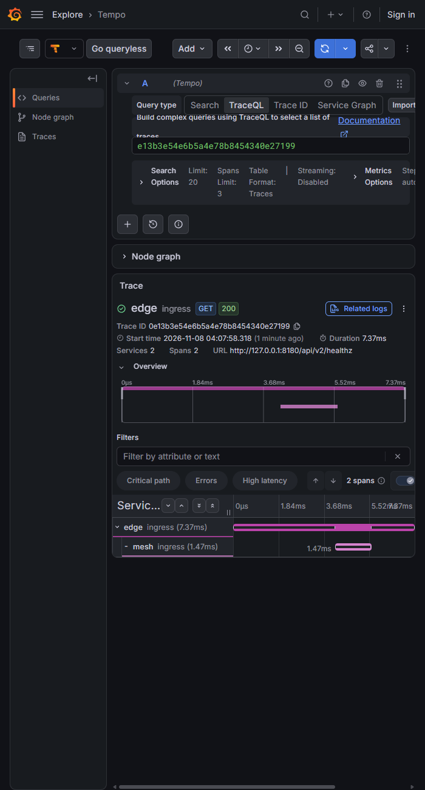

# Прогресс: платформа v2

## План 1 «Фундамент» — готов, кроме двух шагов за владельцем

Репозиторий `D:\senim-platform`, ветка `main`, 14 задач плана, все прошли ревью. Ничего не отправлено на GitHub.

### Что сделано

| Область | Итог |
|---|---|
| Репозиторий и web | Старый web перенесён в `apps/web` с полной историей (418 коммитов). Правила для агентов (`CLAUDE.md`), ADR-010 про микросервисы и gRPC. |
| Конфигурация | `pkg/config`: окружения dev/staging/prod, секреты только в base64, в prod запрещены моки и DEMO_MODE, ключи должны различаться. |
| Логи | `pkg/logging`: JSON, `trace_id`, маскирование ИИН, IBAN, телефонов и чувствительных ключей, в том числе внутри вложенных структур. |
| Контракты | `buf`: Go и TypeScript из одних `.proto`, общий `ErrorDetail`, конверт событий `Envelope`, health-протокол gRPC для web. |
| mTLS | `pkg/tlsx` и `tools/devcerts`: свой dev-CA, сертификат на каждый сервис, клиент без сертификата и чужой CA отклоняются. |
| Каркас сервиса | `pkg/server`: gRPC по mTLS, health, `/healthz` и `/readyz`, плавная остановка с паузой для балансировщика, перехват паник, OpenTelemetry. |
| Роли БД | `pkg/dbx`: на каждый сервис своя база и две роли (owner для миграций, app для работы). App-роль не умеет DDL и TRUNCATE; журнальные таблицы только на добавление; чужая база недоступна. Миграции goose. |
| События | `pkg/outbox`, `pkg/inbox`: событие пишется в той же транзакции, релей публикует в JetStream, потребитель обрабатывает без двойного эффекта. Проверено падением посреди публикации и двумя релеями сразу. |
| Каркас identity | `services/identity`: serve, migrate, healthcheck, образ distroless 38 МБ. |
| Web → mesh | `apps/web/src/platform/rpc.ts`: gRPC-клиент по mTLS, дедлайн 5 с, вне dev только https. Проверка пути `/api/v2/healthz`. |
| Стенд | `docker compose` (профили core, full, storage): Postgres, NATS, 2 реплики identity, Envoy mesh (балансировка, ретраи, список разрешённых клиентов), Envoy edge (заголовки безопасности, лимит запросов), web. В `full` ещё Grafana/Tempo и ClamAV. Дымовой тест на Go. |
| CI | `.github/workflows/v2.yml`: proto, Go с `-race`, web, сборка образов с SBOM и сканом, дымовой тест. |

### Чем проверено

Тесты (Windows, `go test ./...`, без `-race`: на этой машине нет gcc):

- `pkg/config` 18 тестов, `pkg/logging` 18, `pkg/tlsx` 7, `tools/devcerts` 3, `pkg/server` 12 и больше.
- `pkg/dbx` 13 тестов на настоящем Postgres 17 (testcontainers), `tools/dbinit` 1.
- `pkg/outbox` 8 и `pkg/inbox` 7: на настоящих Postgres и NATS.
- `services/identity` 2 теста: поднимается по mTLS, health SERVING, таблицы доступны app-роли.
- `apps/web`: 46 тестов по `rpc`, `env`, `healthz`; typecheck и lint чистые.
- `go vet ./...`, `go tool golangci-lint run ./...` и `buf lint`: 0 замечаний. `govulncheck`: 0 достижимых уязвимостей.
- `actionlint` по workflow CI: без замечаний. Конфиги Envoy (edge и mesh): `--mode validate` OK.

Дымовой тест на живом стенде (через временный обход, см. «Ждёт владельца»):

- 20 запросов через mesh: 20/20 успешны, по 10 на каждую из двух реплик identity.
- Клиент без сертификата отклонён (`tls: certificate required`), с сертификатом web принят, с сертификатом edge отклонён.
- Профиль `full` проходит тот же тест.

Память в простое, `docker stats`:

| Профиль | Итого | Бюджет |
|---|---|---|
| core | 272 МиБ | 3 ГБ |
| full | около 2,33 ГиБ | 6 ГБ |

В core: identity около 8 МиБ на реплику, mesh 18, edge 17, web 107, postgres 30, nats 5.

Трассировка в Grafana: edge (корень) → mesh → identity как апстрим. У web пока нет своего OTel, поэтому его спана нет.

### Решения, принятые контроллером (без вашего ответа)

| Решение | Цена, если ошибся |
|---|---|
| Метод выполнения: subagent-driven (вы дали добро, метод не выбирали). | Больше токенов. |
| Работа прямо в `main` нового репозитория, без пуша. | Позже вынести в ветку. |
| Health-протокол: вендорим `proto/thirdparty/grpc/health/v1/health.proto` и генерируем только для TS второй конфигурацией `buf.gen.thirdparty.yaml`; в Go используется `connectrpc.com/grpchealth`. | Небольшая перегенерация. |
| `dev.vars` с паролями БД создаёт задача 7, задача 11 дополняет. | Ничего. |
| `dbx.Migrate(ctx, ownerDSN, service, migrations, platformSchemas...)`; `outbox.Schema` и `inbox.Schema` — экспортируемые SQL-строки, применяются до миграций сервиса. | Придётся переделать API миграций в плане 2. |
| Health-вызов из web ставит заголовок `x-senim-target: identity`. | Ничего. |
| `v2:test` = `go test ./...` без `-race` (на Windows нет gcc); `-race` гоняет CI. | Гонки найдёт CI, а не локальный запуск. |
| Директива `go` в `go.mod` = 1.26.7 (минимум, который требуют инструменты), а не 1.25 из спеки. | Ничего. |
| `next typegen` должен идти перед `typecheck` в `apps/web` (и в CI). | Красный CI, если забыть. |
| Образ identity 38 МБ вместо 30 МБ из плана; бюджет теперь до 40 МБ на Go-сервис. | Ничего по функциям. |
| CN-список разрешённых вызывающих (interceptor) обязателен до любого RPC, двигающего деньги (план 3). | Если пропустить: один взломанный сервис может звать любой другой. |
| Отдельный MinIO вынесен из `core` в профиль `storage`; образ S3 выберет план 4 (файлы). | Ничего для плана 1. |
| Трассировка в Grafana для плана 1: edge → mesh (identity как апстрим); OTel в web позже. | Нет спанов web. |
| Для https-only mesh staging приравнен к prod. | Ничего. |

### Отложенные мелочи

Перед планом 2 обязательно:

- `pkg/config`: `DEMO_MODE` понимает только точное `true`; `TRUE` и `1` проскочат в prod. Разбирать через `strconv.ParseBool`, а непонятное значение в prod считать ошибкой.
- `pkg/config`: `Distinct` сравнивает строки, а не декодированные байты.
- `pkg/logging`: тест `TestRedactsKeysCaseInsensitiveAndSubstring` нестабилен (время в логе может содержать проверяемые цифры, например 888).
- `pkg/dbx`: опечатки маркера append-only (`senim:append_only`, `SENIM:APPEND-ONLY`) молча ничего не значат и журнал остаётся изменяемым. Сделать поиск регистронезависимым и ловить `append_only`.
- `pkg/server`: health отвечает SERVING на любое имя сервиса. Для неизвестного вернуть NotFound (через `Options.Services`) и добавить тест. Исправить до копирования шаблона сервиса.
- `services/identity`: тест не доказывает, что релей подключён. Опубликовать одну строку outbox и увидеть её в потоке; остановить NATS и увидеть `/readyz` 503.
- Восстановить в `CLAUDE.md` потерянные детали инвариантов: `signedAt`, режим показа имени исполнителя (ADR-006), пометка «тестовые» у демо-сделок, запрет `freedompay` в prod, указатель на `features.ts`.
- События (задача 8; в план 2): у потребителя нет `MaxDeliver`/`BackOff` и пути в мёртвые письма; нет очистки (retention) потока, outbox и inbox; источник события не привязан к вызывающему сервису.

Позже:

- Config: нет тестов staging; слабая проверка в тесте с не-base64; не документирована неоднозначность raw/base64 в dev; ошибка провайдера выводит значение.
- Logging: исключение для ключей `*_id` пропускает любое значение; `[]byte` не сканируется; паника в пользовательском `MarshalJSON` не ловится; `remoteaddr`/`ipaddr` строчными не ловятся.
- Proto: вендорный `health.proto` — урезанная копия, перевзять точно из апстрима; thirdparty линтится слабым правилом и не исключён из `breaking`; `echo.proto` генерируется и в `apps/web/src/gen`; `.gitattributes` не знает `*.woff2`, `*.heic`, `*.ico`, `*.webp`; README: «проверено на 1.27» заменить на «минимум Go 1.26.7».
- mTLS: на каждом сертификате IP SAN 127.0.0.1; вывод devcerts не атомарный; тесты TLS сверяют строки, а не типы; `MkdirAll` не ужимает права существующего каталога; не проверяется парность ключа и сертификата CA.
- Server: `ready()` без кэша; общий `shutCtx` у probe-сервера; гонка за свободный порт в тестах; `DrainDelay == 0` нельзя задать явно; проверка дренажа с запасом 400 мс может мигать в CI; нет теста фильтра трассировки health.
- dbx и outbox: платформенные схемы применяются до advisory-блокировки; крайний случай `REVOKE EXECUTE` на функциях расширений; при зависшем NATS без разрыва 60 с на пачку меньше, чем 100 × 5 с таймаутов, и откат теряет учёт сбоев (безопасно); `CREATE TABLE IF NOT EXISTS` не умеет менять колонки (нужны `ALTER ... ADD COLUMN IF NOT EXISTS`).
- identity: живая, но неработающая отправка не снимает готовность; `.dockerignore` без `*.vars.local`, `**/*.pem`, `**/*.key`, `deploy`; остановка телеметрии без таймаута; `nats.Connect` без `RetryOnFailedConnect`; неиспользуемые поля `Env`/`Stream`; пакет назван `internal`, тест лежит не на месте; базовые образы без привязки к digest.
- web: проверка https через `startsWith` в двух местах (сделать общую функцию с разбором URL); старый web работает под owner-ролью `web` без деления на app/owner; тест https в rpc читает файлы-заглушки; 4 предупреждения lint о лишних `eslint-disable` в сгенерированном `src/gen`.
- CI: `scan-action` v6 → v7 и `only-fixed: true`; триггер push без фильтра веток даёт двойные запуски; smoke пересобирает образы; нет `timeout-minutes`; исключение G304 глобальное; actions закреплены на мажорах, а не на SHA.

### Ждёт владельца

1. Перезапустить Docker Desktop. Сейчас монтирование папок сломано: `mkdir /run/desktop/mnt/host/d: file exists`. Потом в `D:\senim-platform`:
   `npm run v2:certs && npm run v2:up && npm run v2:smoke`.
   Проверка «из чистого клона» не выполнена из-за этой ошибки (повторена из клона 2026-11-08: та же ошибка монтирования, `mkdir /run/desktop/mnt/host/c: file exists`). Живой стенд проверен только через временный обход с именованным томом, он не входит в репозиторий. Заодно проверить, что ключи с правами 0644 читаются внутри контейнеров.
2. Создать удалённый репозиторий на GitHub и сделать пуш (агент пушей не делает). Тогда CI v2 впервые запустится, в том числе сборка образов, скан и дымовой тест.

Из чистого клона уже проверено без Docker: `go build ./...`, `go vet ./...`, `npm run v2:lint` (0 замечаний), `go test` для `pkg/config`, `pkg/logging`, `pkg/tlsx`, `pkg/server`, `tools/...` — всё зелёное. Тесты с testcontainers (dbx, outbox, inbox, identity) в клоне не запускались; они зелёные на задачах 7–9.
