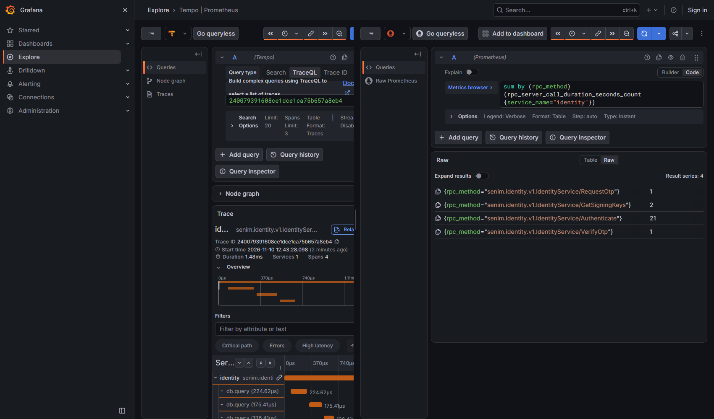

# Прогресс: платформа v2

## Репозиторий и CI

Удалённый репозиторий — `github.com/CemeteryPlaya/senim-platform` (приватный, создан владельцем 09.11.2026), `main` отправлен туда 09.11.2026.

Первый прогон CI (`c4e5ab4`, run 42619829699) — красный:

| Задача | Итог |
|---|---|
| proto, go (`-race`, govulncheck), образ identity | зелёные; `go` в job — 1.27.3 из toolchain |
| web | 2 из 2271 тестов: «двойная оплата» и «две встречные цены». На медленном раннере вызовы не перекрылись. Оплата: повтор после `PAID_HOLD` получал CONFLICT вместо той же операции — исправлено (`86262b8`). Торг: вторая цена законно становилась встречной — тест переписан на инвариант, индекс проверен отдельно |
| образ web | critical CVE-2026-5450 в glibc Debian 12 (bookworm, «won't fix») — база сменена на `node:24-trixie-slim` (`8256429`) |
| smoke | не запускался (ждёт образы) |

Повторный прогон (`8256429`, run 42689679917, 10.11.2026) — **все 6 задач зелёные**, включая образ web (скан без critical) и дымовой тест `smoke` на живом стенде в CI.

Предупреждения прогона (на потом): actions `checkout@v4`, `setup-go@v5`, `setup-node@v4`, `scan-action@v6`, `build-push-action@v6`, `setup-buildx-action@v3` написаны под Node 20 и запускаются принудительно на Node 24 — обновить мажоры; у job `go` не восстановился кэш (`tar` exit 2), на итог не влияет.

## План 1 «Фундамент» — готов, кроме шага за владельцем

Репозиторий `D:\senim-platform`, ветка `main`, 14 задач плана, все прошли ревью.

### Что сделано

| Область | Итог |
|---|---|
| Репозиторий и web | Старый web перенесён в `apps/web` с полной историей (418 коммитов). Правила для агентов (`CLAUDE.md`), ADR-010 про микросервисы и gRPC. |
| Конфигурация | `pkg/config`: окружения dev/staging/prod, секреты только в base64, в prod запрещены моки и DEMO_MODE, ключи должны различаться. |
| Логи | `pkg/logging`: JSON, `trace_id`, маскирование ИИН, IBAN, телефонов и чувствительных ключей, в том числе внутри вложенных структур. |
| Контракты | `buf`: Go и TypeScript из одних `.proto`, общий `ErrorDetail`, конверт событий `Envelope`, health-протокол gRPC для web. |
| mTLS | `pkg/tlsx` и `tools/devcerts`: свой dev-CA, сертификат на каждый сервис, клиент без сертификата и чужой CA отклоняются. |
| Каркас сервиса | `pkg/server`: gRPC по mTLS, health, `/healthz` и `/readyz`, плавная остановка с паузой для балансировщика, перехват паник, OpenTelemetry. |
| Роли БД | `pkg/dbx`: на каждый сервис своя база и две роли (owner для миграций, app для работы). App-роль не умеет DDL и TRUNCATE; журнальные таблицы только на добавление; чужая база недоступна. Миграции goose. |
| События | `pkg/outbox`, `pkg/inbox`: событие пишется в той же транзакции, релей публикует в JetStream, потребитель обрабатывает без двойного эффекта. Проверено падением посреди публикации и двумя релеями сразу. |
| Каркас identity | `services/identity`: serve, migrate, healthcheck, образ distroless 38 МБ. |
| Web → mesh | `apps/web/src/platform/rpc.ts`: gRPC-клиент по mTLS, дедлайн 5 с, вне dev только https. Проверка пути `/api/v2/healthz`. |
| Стенд | `docker compose` (профили core, full, storage): Postgres, NATS, 2 реплики identity, Envoy mesh (балансировка, ретраи, список разрешённых клиентов), Envoy edge (заголовки безопасности, лимит запросов), web. В `full` ещё Grafana/Tempo и ClamAV. Дымовой тест на Go. |
| CI | `.github/workflows/v2.yml`: proto, Go с `-race`, web, сборка образов с SBOM и сканом, дымовой тест. |

### Чем проверено

Тесты (Windows, `go test ./...`, без `-race`: на этой машине нет gcc):

- `pkg/config` 18 тестов, `pkg/logging` 18, `pkg/tlsx` 7, `tools/devcerts` 3, `pkg/server` 12 и больше.
- `pkg/dbx` 13 тестов на настоящем Postgres 17 (testcontainers), `tools/dbinit` 1.
- `pkg/outbox` 8 и `pkg/inbox` 7: на настоящих Postgres и NATS.
- `services/identity` 2 теста: поднимается по mTLS, health SERVING, таблицы доступны app-роли.
- `apps/web`: 46 тестов по `rpc`, `env`, `healthz`; typecheck и lint чистые.
- `go vet ./...`, `go tool golangci-lint run ./...` и `buf lint`: 0 замечаний. `govulncheck`: 0 достижимых уязвимостей.
- `actionlint` по workflow CI: без замечаний. Конфиги Envoy (edge и mesh): `--mode validate` OK.

Дымовой тест на живом стенде (через временный обход, см. «Ждёт владельца»):

- 20 запросов через mesh: 20/20 успешны, по 10 на каждую из двух реплик identity.
- Клиент без сертификата отклонён (`tls: certificate required`), с сертификатом web принят, с сертификатом edge отклонён.
- Профиль `full` проходит тот же тест.

Память в простое, `docker stats`:

| Профиль | Итого | Бюджет |
|---|---|---|
| core | 272 МиБ | 3 ГБ |
| full | около 2,33 ГиБ | 6 ГБ |

В core: identity около 8 МиБ на реплику, mesh 18, edge 17, web 107, postgres 30, nats 5.

Трассировка в Grafana: в трассе пути два спана — edge (корень) и mesh. «identity» на снимке — только имя апстрим-кластера в спане mesh, а не спан самого identity: health (единственный RPC identity) из трассировки исключён. Спан RPC identity и метрика `rpc.server.duration` в Grafana не проверены (в Tempo видны лишь отдельные корневые спаны `db.query` релея outbox) — проверить на первом настоящем RPC плана 2. У web пока нет своего OTel, поэтому его спана тоже нет.

### Решения, принятые контроллером (без вашего ответа)

| Решение | Цена, если ошибся |
|---|---|
| Метод выполнения: subagent-driven (вы дали добро, метод не выбирали). | Больше токенов. |
| Работа прямо в `main` нового репозитория, без пуша. | Позже вынести в ветку. |
| Health-протокол: вендорим `proto/thirdparty/grpc/health/v1/health.proto` и генерируем только для TS второй конфигурацией `buf.gen.thirdparty.yaml`; в Go используется `connectrpc.com/grpchealth`. | Небольшая перегенерация. |
| `dev.vars` с паролями БД создаёт задача 7, задача 11 дополняет. | Ничего. |
| `dbx.Migrate(ctx, ownerDSN, service, migrations, platformSchemas...)`; `outbox.Schema` и `inbox.Schema` — экспортируемые SQL-строки, применяются до миграций сервиса. | Придётся переделать API миграций в плане 2. |
| Health-вызов из web ставит заголовок `x-senim-target: identity`. | Ничего. |
| `v2:test` = `go test ./...` без `-race` (на Windows нет gcc); `-race` гоняет CI. | Гонки найдёт CI, а не локальный запуск. |
| Директива `go` в `go.mod` = 1.26.7 (минимум, который требуют инструменты), а не 1.25 из спеки. | Ничего. |
| `next typegen` должен идти перед `typecheck` в `apps/web` (и в CI). | Красный CI, если забыть. |
| Образ identity 38 МБ вместо 30 МБ из плана; бюджет теперь до 40 МБ на Go-сервис. | Ничего по функциям. |
| Удостоверение вызывающего — XFCC от mesh и `AllowedPeers` (ADR-011) — сделано до плана 2; таблица прав «кто какой метод» — план 3 (первые методы с деньгами). | Если пропустить таблицу прав: один взломанный сервис может звать любой метод другого. |
| Отдельный MinIO вынесен из `core` в профиль `storage`; образ S3 выберет план 4 (файлы). | Ничего для плана 1. |
| Трассировка в Grafana для плана 1: edge → mesh (identity — только имя апстрима в спане mesh); OTel в web позже. | В трассе пути нет спанов web и identity; спан RPC и метрики Go-сервиса не проверены до плана 2. |
| Для https-only mesh staging приравнен к prod. | Ничего. |

### Отложенные мелочи

Финальная волна исправлений (после финального ревью, до плана 2) — сделано:

- Удостоверение сервиса через mesh (ADR-011): mesh передаёт вызывающего в XFCC, сервис принимает TLS только от `AllowedPeers` (identity — mesh и он сам), `server.Caller(ctx)`; edge больше не получает сертификат CA.
- NATS (ADR-012): TLS с клиентским сертификатом, учётная запись на сервис, публикация только в `senim.<сервис>.>`; конфиг генерирует `tools/natsconf`; inbox отвергает событие, если источник конверта не совпадает с субъектом.
- Готовность identity — только база; NATS и релей — в лог при смене состояния и в метрики `senim.outbox.pending` / `senim.outbox.oldest_age` (видны в Prometheus профиля full). Тест identity доказывает, что релей подключён: обрыв NATS — `/readyz` 200, возврат — событие уходит в поток.
- `/api/v2/healthz` — 503 без SERVING; у кластеров mesh нет «режима паники»; потолок сообщения 4 МиБ в сервисах и на mesh; явный `POOL_MAX_CONNS` (4) и тайм-ауты роли `<svc>_app` (15 с / 30 с); OTLP-эндпоинт — URL; `toolchain go1.27.3` и образ на том же патче; единый список сервисов `tools/services` с тестом конфигов; `buf breaking` на push сравнивает с коммитом до пуша.
- MUST-FIX из журнала: `DEMO_MODE` через `strconv.ParseBool`, `Distinct` по байтам, стабильный тест маски, маркер append-only ловит регистр и опечатки, health — NotFound на чужое имя, детали инвариантов в `CLAUDE.md`.
- Документация: правило «Unavailable только без побочного эффекта» (`pkg/server`), границы «ровно один раз» у inbox (`pkg/inbox`).

Существующий dev-стенд после этой волны: `npm run v2:down`, удалить тома `senim-v2_pg-data` и `senim-v2_nats-data`, затем `npm run v2:certs` и `npm run v2:up` — иначе роли `<svc>_app` останутся без тайм-аутов, а NATS не получит сертификат `nats`.

В план 2 (решение контроллера):

- ~~Конфиг сервиса в prod: `sslmode=verify-full` для Postgres и TLS для OTLP (M3).~~ Сделано в плане 2 (Task 3).
- ~~Права app-роли на DELETE и EXECUTE (маркер или отдельная роль для очистки, M7).~~ Сделано в плане 2 (Task 2, маркер `senim:app-delete`; очистка — Task 10). Право EXECUTE (крайний случай для функций расширений) этим не закрыто.
- ~~`pkg/rpcclient` — Go-клиент mesh (mTLS из `TLS_*`, дедлайн, traceparent).~~ Сделано в плане 2 (Task 8).
- Потоки JetStream в prod создаёт инфраструктура, а не сервис: сейчас у сервиса есть `STREAM.CREATE|UPDATE` на свой поток (план 7; до него — защита в inbox по имени потока). Перенесено в план 7: без прод-инфраструктуры решать нечем.
- ~~Первый запуск CI: убедиться, что `go version` в job печатает 1.27.3 (иначе задать `go-version: 1.27.3`), и что `-race` зелёный.~~ Проверено 10.11.2026: 1.27.3, `-race` зелёный.
- События, частично: очистка опубликованного outbox identity сделана (план 2, Task 10). `MaxDeliver`/`BackOff`, путь в мёртвые письма, очистка потока и inbox, права консьюмеров NATS в `tools/natsconf` перенесены в план 6: потребителей событий пока нет (первый — аудит).
- ~~Спан RPC identity и метрика `rpc.server.duration` в Grafana.~~ Проверено в плане 2: спаны RPC и метрика есть (метрика называется `rpc_server_call_duration_seconds`); спан identity — отдельная трасса со ссылкой на спан mesh, а не потомок (см. раздел «План 2»).

Позже:

- Config: нет тестов staging; слабая проверка в тесте с не-base64; не документирована неоднозначность raw/base64 в dev; ошибка провайдера выводит значение.
- Logging: исключение для ключей `*_id` пропускает любое значение; `[]byte` не сканируется; паника в пользовательском `MarshalJSON` не ловится; `remoteaddr`/`ipaddr` строчными не ловятся.
- Proto: вендорный `health.proto` — урезанная копия, перевзять точно из апстрима; thirdparty линтится слабым правилом и не исключён из `breaking`; `echo.proto` генерируется и в `apps/web/src/gen`; `.gitattributes` не знает `*.woff2`, `*.heic`, `*.ico`, `*.webp`; README уже называет минимум Go 1.26.7 и toolchain.
- mTLS: на каждом сертификате IP SAN 127.0.0.1; вывод devcerts не атомарный; тесты TLS сверяют строки, а не типы; `MkdirAll` не ужимает права существующего каталога; не проверяется парность ключа и сертификата CA.
- Server: `ready()` без кэша; общий `shutCtx` у probe-сервера; гонка за свободный порт в тестах; `DrainDelay == 0` нельзя задать явно; проверка дренажа с запасом 400 мс может мигать в CI; нет теста фильтра трассировки health.
- dbx и outbox: платформенные схемы применяются до advisory-блокировки; крайний случай `REVOKE EXECUTE` на функциях расширений; `CREATE TABLE IF NOT EXISTS` не умеет менять колонки (нужны `ALTER ... ADD COLUMN IF NOT EXISTS`).
- identity: `.dockerignore` без `*.vars.local`, `**/*.pem`, `**/*.key`, `deploy`; остановка телеметрии без таймаута; старт без NATS невозможен (`EnsureStream` при запуске; после старта сбой NATS готовность не снимает); неиспользуемые поля `Env`/`Stream`; пакет назван `internal`, тест лежит не на месте; базовые образы без привязки к digest.
- web: проверка https через `startsWith` в двух местах (сделать общую функцию с разбором URL); старый web работает под owner-ролью `web` без деления на app/owner; тест https в rpc читает файлы-заглушки; 4 предупреждения lint о лишних `eslint-disable` в сгенерированном `src/gen`.
- CI: `scan-action` v6 → v7 и `only-fixed: true`; триггер push без фильтра веток даёт двойные запуски; smoke пересобирает образы; нет `timeout-minutes`; исключение G304 глобальное; actions закреплены на мажорах, а не на SHA.

### Ждёт владельца

1. Docker Desktop перезапущен владельцем 08.11.2026; живой стенд с настоящими bind mounts проходит `npm run v2:certs && npm run v2:up && npm run v2:smoke` (в финальной волне — с чистыми томами `pg-data` и `nats-data`). Проверка из чистого клона git по-прежнему не делалась.
2. ~~Создать удалённый репозиторий на GitHub и сделать пуш.~~ Сделано 09.11.2026; итог CI — раздел «Репозиторий и CI».

Из чистого клона уже проверено без Docker: `go build ./...`, `go vet ./...`, `npm run v2:lint` (0 замечаний), `go test` для `pkg/config`, `pkg/logging`, `pkg/tlsx`, `pkg/server`, `tools/...` — всё зелёное. Тесты с testcontainers (dbx, outbox, inbox, identity) в клоне не запускались; они зелёные на задачах 7–9.

## План фронтенда v2 «B + A» — готов, кроме шагов за владельцем

План `docs/superpowers/plans/2026-11-08-frontend-v2.md` (в `mvp-scale-arna`), спека `docs/superpowers/specs/2026-11-08-frontend-v2-design.md`, макеты `docs/design/v2/b-plus-a.html` и `master-screens.html`. Работа — в `apps/web`, ветка `main`, 11 задач, каждая прошла ревью. Новых экранов и серверной логики почти нет: это смена вида. Деньги, статусы, маскирование контактов, флаги — без изменений.

### Что сделано

| Задача | Коммиты | Итог |
|---|---|---|
| 0. Исправление установки PWA | `1a3d088` | Подтянуто из `mvp-scale-arna` (ветка `fix/pwa-install`, в её `main` ещё не влита). |
| 1. Токены | `1a3d088..9a7b746` | Серый фон `#f3f5f7` и белые карточки; `sunken` темнее фона; пары контраста в тесте. |
| 2. Навигация по ролям | `9a7b746..69c1cf0` | `navFor`: вкладки заказчика «Главная / Сделки / + Заявка / Чат / Профиль», мастера «Заявки / Заказы / Чат / Финансы / Профиль», замерщика, оператора (без вкладок, группы разделов). |
| 3. Каркас | `69c1cf0..4c2fd06` | Боковое меню 240 px на десктопе, нижняя панель с подписями и действием роли на телефоне и планшете, `StickyAction` (одно действие экрана; фокус не уходит под кнопку). |
| 4. Компоненты I | `4c2fd06..098704a` | Плитки категорий, плашка защиты денег, «метка — значение», сводка плитками, чипы фильтров. |
| 5. Компоненты II | `098704a..a6ab274` | Карточка работы и заявки, ход сделки из 5 шагов (шаг — по статусу сделки; серый вид при открытом споре — по данным спора, в списках — `hasOpenDispute`), зеркальный расчёт мастера, отметка о подписи ЭЦП, полноэкранный шаг. |
| 6. Вкладка «Чат» | `a6ab274..fad4c0b` | Список диалогов по откликам и сделкам, маска контактов до оферты сохраняется. |
| 7. Экраны заказчика | `fad4c0b..cc206ca` | Главная, мастер заявки шагами, заявки и отклики, экран сделки с одной заливной кнопкой шага. |
| 8. Экраны мастера | `cc206ca..51746ac` | Входящие со сводкой, заявка с откликом и «Вы получите», заказы, финансы по месяцам. |
| 9. Замерщик и оператор | `51746ac..2acf0f4` | Сводка и очереди оператора без заливных кнопок, таблицы прокручиваются внутри, меню по группам; экраны замерщика (за флагом). |
| 10. Гость, вход, служебные | `2acf0f4..0310f1f` | Лендинг, вход и регистрация шагами, профиль, уведомления, документы по ссылке, витрина компонентов; защита от «кракозябр» в исходниках (тест). |
| 11. Финальная проверка | `0310f1f..4a8e07d` | Общий проход по отложенным пунктам (ниже) и отчёт. |
| Ревью всей ветки | `bb84fb0..` | Одна заливная кнопка на экране отклика («Отправить» чата — обводкой) и на телефоне («+ Заявка» панели — обведённая); `hasOpenDispute` в списке сделок; `aria-current` у кнопки действия в боковом меню; мёртвый код; одно число сделок на странице мастера; e2e фокуса на экране отклика. |

Задача 11 исправила то, что ревью задач 7–10 отложили на общий проход: контакты на экране сделки показываются один раз; заголовок «Моя сделка» выглядит как ссылка; плашка защиты на узком экране ставит значок над текстом; в плитках-сводках «₸» не отрывается от суммы; шапка на 320 px и 200 % не наезжает на логотип; полноэкранный шаг не растягивается на десктопе; у оператора на `/deals` и `/deals/[id]` подсвечены «Сделки», боковое меню плотнее; на главных оператора и замерщика нет «Назад», которая вела по кругу; заголовки лендинга и экранов на 320 px и 200 % не рвутся посреди слова.

### Чем проверено

Финальный прогон 09.11.2026 на `main` после правок по ревью ветки (Windows, Postgres `senim-pg` на 5442, базы `senim_v2web_test` и `senim_v2web_e2e`):

- `npm run check` в `apps/web` (typecheck + lint + все тесты vitest, unit и интеграционные на настоящей базе): typecheck и lint без ошибок, **186 файлов, 2271 тест — все зелёные** (из них unit — 1551).
- `npm run test:e2e` (Playwright, Pixel 7 + Desktop Chrome): **147 сценариев — 144 прошли, 3 пропущены** (по замыслу: два новых — только для телефона, один прежний), 0 упавших; 77 на телефоне, 70 на десктопе; 20,8 мин.
- Клавиатура и шрифт 200 % (главная заказчика, сделка, отклик мастера, оператор/деньги; 390×844 и 1440×900): Tab проходит от «Перейти к содержанию» до подвала, фокус всегда виден и не уходит под нижнюю панель или закреплённую кнопку, прокрутки вбок нет.
- Снимки 390×844 и 1440×900 ключевых экранов сверены с макетами; отчёты и снимки задач — в `mvp-scale-arna/.superpowers/sdd/2026-11-08-frontend-v2/`.

### Принятые отличия от макетов

- Кнопка в боковом меню («+ Заявка») мятная, а «+ Заявка» нижней панели — обведённая (белая с зелёной рамкой), а не заливные: заливная главная кнопка на экране одна — у самой страницы.
- «Войти» гостя на десктопе — в боковом меню, не в шапке (иначе их две).
- Поиска «Поиск работ и мастеров» в шапке нет: поиска в продукте нет.
- Переключатель роли «Мастер ▾» — на странице «Профиль», не в шапке.
- Главная заказчика: сверху приветствие и «Оставить заявку», есть блок «Мои заявки»; чипы — диапазоны цены (чипов «Проверенные» и «Рядом» нет — нет данных).
- Карточка работы — страница исполнителя с закреплённой «Хочу похожее»; число сделок — строкой «Сделок на платформе», без отдельного бейджа.
- Мастер: нет чипа «Рядом» и «Заказчик №…» (нет данных). Строка «+18 % к октябрю» в финансах есть (`versusPrevious`), но в демо-данных нет выплат прошлого месяца — на демо её не видно.
- На телефоне ход сделки — пять полосок и строка «Шаг N из 5: …»; подписи шагов — с ширины 34rem.
- На 390 px при 200 % и на 320 px название в шапке скрыто визуально (остаётся в имени ссылки), правая часть шапки может уйти второй строкой.
- Текст, кнопки и контраст крупнее макета: основной текст 18 px, кнопки 56 px, контраст ≥ 4,5:1 (правила проекта).

### Ждёт владельца

1. ~~Создать удалённый репозиторий на GitHub и сделать пуш.~~ Сделано 09.11.2026; итог CI — раздел «Репозиторий и CI».
2. Влить `fix/pwa-install` в `main` репозитория `mvp-scale-arna` (здесь исправление уже подтянуто — коммит `1a3d088`): тогда следующие `git subtree pull` из `main` пойдут без расхождений.
3. Проверить установку PWA на настоящих телефонах: Android (Chrome — пункт «Установить приложение» и системный диалог) и iPhone (Safari — подсказка «Поделиться → На экран „Домой“»). Автотесты эмулируют только Chromium.
4. Решено контроллером на ревью ветки (можно отменить): «+ Заявка» в нижней панели заказчика — обведённая «таблетка» (белая, рамка 2 px, зелёные «+» и подпись), чтобы на телефоне рядом с главной кнопкой экрана не было второй заливной. Вернуть заливку как в макете — в `apps/web/src/app/_shell/ShellNav.tsx` (`TabCell`) заменить `border-2 border-primary bg-surface text-primary` на `bg-primary text-on-primary` и снять проверку «заливная зелёная кнопка на экране одна» в `e2e/30-shell.spec.ts`.
5. Экраны замерщика за флагом `preContractFlows` (в e2e он выключен): проверены снимками в задаче 9 на отдельном сервере с включённым флагом, e2e на них нет. Когда флаг будут включать — добавить e2e замерщика.
6. Подтвердить исключение из правила «„Назад“ видна всегда»: на главных экранах ролей (`/`, `/executor/requests`, `/operator`, `/measurer`) «Назад» нет — возвращаться некуда (кнопка вела на `/`, а оттуда сразу обратно); переходы — через меню каркаса. Если нужно иначе — решить, куда она должна вести.
7. Действия торга (принять цену, предложить свою) на экране отклика у заказчика и на заявке у мастера стоят в блоке «Цена», а не в закреплённом слоте `StickyAction`: на телефоне главная кнопка торга не закреплена у нижнего края. Отложено — решить, нужно ли закреплять.
8. Из `apps/web/docs/OWNER_TODO.md`, что касается интерфейса: №15 (загрузка фото с настоящего iPhone, HEIC), №27 (экран сделки с TalkBack и VoiceOver), №13 (настоящие фото для лендинга), №24 (итоговое название — `src/config/brand.ts`). Остальные пункты файла (банк, SMS, ЭЦП, хостинг, юрист) — без изменений.

## План 2 «identity» — готов, кроме шагов за владельцем

План `docs/superpowers/plans/2026-11-10-platform-v2-02-identity.md`, решение — ADR-013. Go-сервис `identity` владеет пользователями, кодами входа, сессиями, ролями и внутренним токеном; `web` входит, выходит, переключает и выдаёт роли только через gRPC. 15 задач, 24 коммита до итогового (`2f7d9d4..6715c66`), каждая прошла ревью.

### Что сделано

| Область | Итог |
|---|---|
| Контракт | `senim.identity.v1.IdentityService`: `RequestOtp`, `VerifyOtp`, `Authenticate`, `SignOut`, `SignOutEverywhere`, `SwitchRole`, `GrantRole`, `GetSigningKeys`, демо-методы; события аудита `senim.events.v1`; коды ошибок в `ErrorDetail` (добавлены `invalid_request`, `auth_unavailable`). |
| Идемпотентность | `pkg/idem`: ключ и результат хранятся, повтор даёт тот же ответ; `Lookup` ждёт вызов в полёте; право app-роли на DELETE только по маркеру в схеме (M7 плана 1). |
| Хранилище и конфиг | Схема пользователей, сессий, кодов, лимитов; роли БД; строгий конфиг prod: `sslmode=verify-full`, TLS для OTLP, проверка DSN через `pgconn` (M3 плана 1). |
| Вход по коду | Код 6 цифр, 5 минут, 5 попыток; лимиты на номер, IP, префикс и общий потолок; `VerifyOtp` идемпотентен при обрыве связи; доставка — только мок (`OtpSender`). |
| Сессии и роли | Простой 30 минут, 7 суток абсолютно (сотрудник 8 часов); выход, выход везде, смена и выдача роли; отозванная роль не действует даже в помнящей её сессии. |
| Внутренний токен | JWT EdDSA, 5 минут, `kid`; публикация ключей `GetSigningKeys`; прежний ключ на время ротации. |
| Клиент и проверка | `pkg/rpcclient` (mTLS, дедлайн, traceparent), `pkg/authz` (проверка токена по ключам identity, обновление без блокировки проверок). |
| Демо | Сид персон и «Сбросить демо» только при `DEMO_MODE`, только от `web`. |
| Сроки хранения | Очистка кодов, сессий, лимитов, идемпотентности и опубликованного outbox под advisory-блокировкой; метрика `senim.retention.deleted`. |
| Сборка и mesh | Образ, compose, маршрут через mesh, дымовой тест входа на живом стенде; CI с `-race` зелёный. |
| Web | Клиент identity, проекция пользователя в `User` старой базы, вход, выход, роли и демо через gRPC; плашка «сервис недоступен» вместо английской страницы; подделка identity в тестах; старый код `Session`/`OtpCode` убран. |
| E2E | Весь набор e2e идёт против стенда v2; сид и «Сбросить демо» через identity. |

### Чем проверено

- `go vet ./...`, `go tool golangci-lint run ./...`, `go tool buf lint` — 0 замечаний. `go test ./...` — все пакеты зелёные (304 тест-функции в `pkg`, `services`, `tools`; на настоящих Postgres 17 и NATS через testcontainers, без `-race`; `-race` — в CI). `govulncheck`: 0 достижимых уязвимостей.
- `npm --prefix apps/web run check`: typecheck и lint чистые, vitest — **191 файл, 2383 теста, все зелёные** (на настоящей базе `senim_v2web_test`).
- E2E против стенда v2 (коммит `6715c66`, Task 14): **147 сценариев — 144 прошли, 3 пропущены (по замыслу), 0 упавших**, 20,8 мин. Заново на финальном коммите не гонялся: после Task 14 менялись только тексты, env и шаблоны уведомлений.
- Дымовой тест `npm run v2:smoke` на живом стенде профиля `full` (`npm run v2:up:full`): PASS (10 тестов: вход через mesh, балансировка `Authenticate` по репликам, edge не может звать identity, прямой вызов web мимо mesh отвергнут, вызывающий переживает mesh, клиент без сертификата и NATS без учётной записи отклонены, лимит сообщения, бюджет памяти core).
- CI: run 42754996097 на `f52c54a` — 6 из 6 зелёные (go с `-race`, smoke входа); прогон на финальном `main` — после пуша контроллером.
- Память identity в простое: 10,4 и 10,9 МиБ на реплику (бюджет 64 МиБ), весь `core` 220,7 МиБ (бюджет 3 ГБ).

Трассировка в Grafana (профиль `full`, после дымового теста; закрывает пункт «Спан RPC identity и метрика» плана 1):

- Спаны RPC identity есть: `senim.identity.v1.IdentityService/Authenticate` (а также `RequestOtp`, `VerifyOtp`, `GetSigningKeys`), у каждого дочерние `db.query` (у `Authenticate` три, всего в трассе 4 спана, около 1,5 мс).
- Метрика есть, но называется `rpc_server_call_duration_seconds` (`_count`, `_sum`, `_bucket`; `service_name="identity"`, `rpc_method="senim.identity.v1.IdentityService/…"`), а не `rpc.server.duration`: так её отдаёт otelconnect. На снимке счётчик по методам: `Authenticate` 21, `GetSigningKeys` 2, `RequestOtp` 1, `VerifyOtp` 1.
- Спаны mesh и identity лежат в **разных трассах**: поиск «mesh и identity в одной трассе» даёт 0. Спан identity — корень новой трассы со ссылкой (span link) на спан mesh `ingress` (проверено: идентификатор ссылки совпадает со спаном mesh в Tempo). Причина: серверный перехватчик otelconnect без `WithTrustRemote` не делает входящий контекст родителем, а только ссылается на него. Единой трассы edge → mesh → identity пока нет; чтобы получить её, нужен `WithTrustRemote` в `pkg/server` (внутри mesh это допустимо, на публичной границе — нет) и OTel в `web`. Не делалось: вне объёма задачи.
- Спана `web` по-прежнему нет (у web нет OTel).

### Решения, принятые контроллером (без вашего ответа)

| Решение | Цена, если ошибся |
|---|---|
| Работа прямо в `main` без worktree; пуш после Task 11 и в конце плана. | Откат плана — диапазоном `git revert`; возможный красный CI посреди плана. |
| `idem.Lookup` ждёт незавершённый вызов с тем же ключом (своя короткая транзакция, сигнатура с `*pgxpool.Pool`). | Лишняя короткая транзакция на каждый изменяющий вызов; `Lookup` нельзя звать, держа транзакцию `Do` (второе соединение пула). |
| Новый код `invalid_request` (пустой или длинный ключ, неразборчивый `client_ip`). | Ещё один код в таблице web. |
| После отказа по лимиту — повторный `Lookup` и сохранённый ответ; порядок «Lookup, лимиты, Do» оставлен. | Редкий ложный «слишком часто» при гонке одного ключа внутри окна лимитов. |
| `SignOutEverywhere` для известной, но истёкшей сессии — успех без изменений; web сначала проверяет сессию. | При прямом вызове без проверки «выход везде» молча ничего не делает. |
| `rpcclient.New` возвращает `*connect.Client`; `authz.Interceptor` — `connect.ServerInterceptor`; код `auth_unavailable`, когда ключей нет и identity недоступен; `Verifier.WithClock` для тестов. | Интерфейсы плана в документе устарели. |
| Task 10 может менять `pkg/outbox` (маркер app-delete в `outbox.Schema`). | Ноль. |
| `V2_ENABLED` не обязателен в `env.ts`: `identity()` без флага падает с понятной ошибкой. | Неверно настроенный стенд узнаёт о проблеме при первом входе, а не при старте. |
| Подделка identity временно читала старую таблицу `Session` (до Task 13, убрано). | Ничего после Task 13. |
| В корневом layout `UNAVAILABLE` от identity — гость с плашкой «сервис недоступен», cookie не трогать; плюс `app/global-error.tsx` на русском. | На время сбоя вошедший видит шапку гостя. |
| `GrantRole` в регистрации исполнителя — случайный `idempotency_key`; выдача роли идемпотентна по смыслу. | Ноль (план был неверен: фиксированный ключ давал `idempotency_key_reused`). |
| Прежняя сессия браузера отзывается после успешного `VerifyOtp`, не до. | Ноль (план был неверен: неверный код не должен выбрасывать из сессии). |
| `signOutEverywhere` для гостя — успех без вызова и удаление cookie. | Гость не видит «войдите» при прямом вызове. |
| Трейлер `Co-Authored-By` пишет модель, делавшая коммит (у исполнителей — Sonnet). | Ноль. |
| Вход по Telegram Gateway и SMS — план 6 (`notify`); в плане 2 только мок, прод не стартует. | Пилот ждёт план 6. |
| ПДн, KYC, согласия и 2FA операторов — план 2б до плана 3. | Деньги оператора в плане 3 без повторной 2FA, если 2б пропустить. |
| Ротация ключа подписи: сначала публиковать новый публичный ключ, потом подписывать. | Иначе проверяющий видит неизвестный `kid` (для плана 7). |

### Отложенные мелочи

Контракт и ядро:

- `events/v1` импортирует `identity/v1` ради `Role` (риск цикла); у `Authenticate` и `GetSigningKeys` нет `NO_SIDE_EFFECTS`; `OtpGlobalLimitReached.date` — `Timestamp` для календарного дня (лучше `"YYYY-MM-DD"`); `RoleSwitched.from` — ключевое слово Python.
- `pkg/idem`: `DELETE` заявки после SQL-ошибки в `fn` молча падает (25P02) без теста; `Lookup` на каждый промах делает INSERT и ROLLBACK; `waitLockWaiters` считает любые ожидания в базе.
- Схема: дубли ролей `{CLIENT,CLIENT}` проходят CHECK; у `sessions.active_role` нет CHECK; нет положительного теста полной prod-конфигурации; нечитаемый `sslrootcert` даёт сообщение про «полную проверку» вместо причины.

Обработчики identity:

- `Send` идёт внутри открытой транзакции (медленный провайдер держит соединение пула); блок `Lookup`, `InTx`/`Do`, ошибки повторён в трёх файлах; ветка повторного `Lookup` после лимита не покрыта тестом; `VerifyOtp` не проверяет формат кода (паритет со старым `otp.ts`).
- Нет тестов: заблокированный в `SwitchRole`/`GrantRole`; `GrantRole` с отозванной или простаивающей сессией; отсутствие токена в логах; подпись только текущим ключом при заданном прежнем.
- Токен: проверка «ключ не задан» недостижима (`Public()` паникует раньше); `issueAccessToken` читает часы второй раз (`exp < iat` в гонке); проверка «сид не в ответе» почти ничего не доказывает.
- `authz`: поддельный `kid` в стационарном режиме даёт `Unavailable` (Envoy ретраит дважды, метрику `auth_unavailable` можно накрутить); у устаревших ключей нет предельного возраста.
- Демо: `TestDemoRequiresWebCaller` проверяет только `ResetDemo`; повтор `ResetDemo` и `SeedUsers` после выключения `DemoMode` не доказан; подтесты игнорируют свой `t`; `SeedUsers` блокирует строки в порядке запроса (взаимоблокировка двух сидов).
- Сроки хранения: нет теста `retentionLoop`; индексы под очистку неполные; тест сверки схем не сравнивает индексы и умолчания; `CREATE INDEX` на большом outbox блокирует запись (для prod-выката).
- Smoke и сборка: `randomPhone` с префиксом `+770000` упирается в потолок 50 в сутки (после ~50 запусков на одном стенде); таблица разрешённых вызывающих продублирована в тесте; `operator` дважды в списке.
- `store/sessions.sql.go`: убедиться, что `go tool sqlc generate` даёт тот же файл; `TestVerifyConcurrentSameKeyWaitsForFirstCall` ждёт через `sleep`.

Web:

- Оболочка не отличает «identity лежит» от «web сломан» (оба `UNAVAILABLE`); публичные страницы, читающие пользователя сами, при сбое падают в `error.tsx`.
- Блокировка в identity не доходит до `User.blockedAt` старой базы: нужен путь событий (план 2б или 6).
- `asBrowser` в тестах: запись cookie идёт в общий jar, чтение из своего; нет теста «Сбросить демо» при недоступном `SignOut`; `seedCall` подсказывает «запустите стенд» на любую не-RPC ошибку; `playwright.config` читает умолчания из `*.vars.example`; JSDoc `seed.ts`; `const user = { id }` в `seedExecutors`.
- Упоминания `startSession` остались в `apps/web/docs/adr/004` и `apps/web/.claude/agents` (поддерево демо, не трогали). Переменные `OTP_DAILY_*` убраны из `env.ts` и README; в файле-примере переменных `apps/web` (хук закрывает путь) и в `apps/web/docs/bank/04-security-and-data.md` (поддерево демо) они остались.

### Ждёт владельца

1. План 2б (ПДн в `identity`, KYC, согласия, 2FA операторов) — до плана 3; подтвердить порядок.
2. Пилотный вход: Telegram Gateway и SMS появляются в плане 6 (`notify`), до него прод-вход заблокирован проверкой конфига. Нужны договор и токен провайдера.
3. Проверить вручную сессию с 30 минутами простоя до пилота: автотесты проверяют границу на часах, но не живое ожидание в браузере.
4. Пуш и прогон CI на финальном `main` — после финального ревью (делает контроллер).
