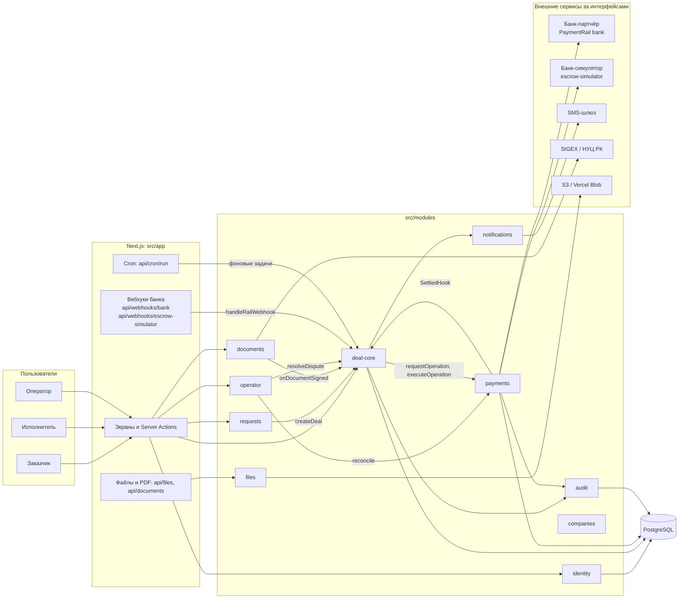
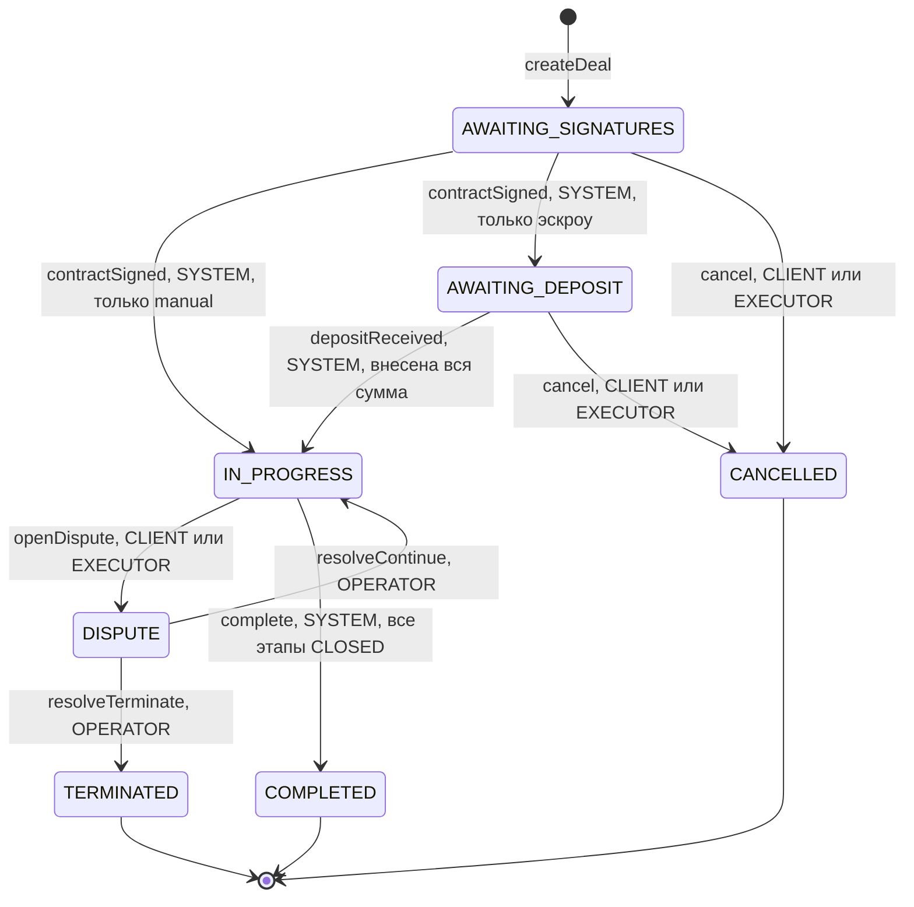
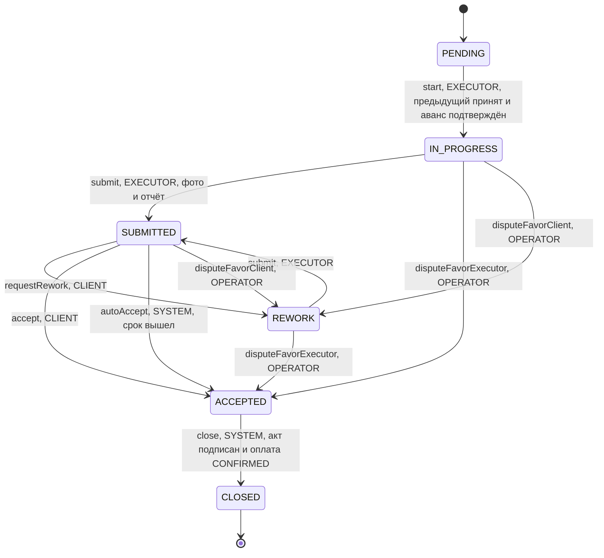
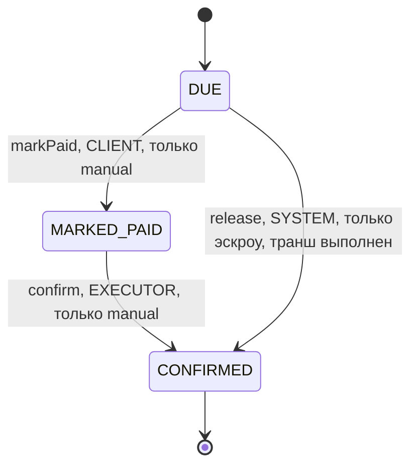

# 02. Архитектура

Модульный монолит на Next.js 16 (App Router, Server Actions), TypeScript, PostgreSQL через Prisma 7. Один деплой; модули разделены границами, которые проверяет линтер. Решение и его причины — [ADR-001](../adr/001-modular-monolith.md).

## Стек

| Слой | Что используется |
|---|---|
| Приложение | Next.js 16.4, React 19, TypeScript 5, Tailwind CSS 4 |
| Данные | PostgreSQL 17 (локально — Docker, порт 5442), Prisma 7 с `@prisma/adapter-pg`, клиент генерируется в `src/generated/prisma` |
| Проверка входа | zod 4 — на каждом входе на сервер и для переменных окружения |
| Документы | `pdf-lib` + `@pdf-lib/fontkit` (кириллица), SHA-256 байтов PDF |
| Фото | `sharp`: пережатие в JPEG без метаданных (EXIF с геолокацией отбрасывается) |
| Тесты | Vitest (модульные и интеграционные на отдельной БД), Playwright (сквозные сценарии) |
| CI | GitHub Actions: `npm ci`, `typecheck`, `lint`, `test` (`.github/workflows/check.yml`) |
| Развёртывание | Демо — Vercel (функции, Cron, Blob); рабочее окружение — облако в РК (план в [04](04-security-and-data.md)) |

## Структура кода

```
src/app/                    маршруты и экраны, без бизнес-логики
src/modules/<имя>/          модуль; наружу — только index.ts (и client.ts для клиентских компонентов)
src/verticals/furniture/    всё мебельное: типы, стили, шаблоны этапов, правила сегмента
src/platform/               db, env, errors, logger, crypto, jobs, rate-limit, action, http, demo-gate
src/ui/                     дизайн-токены и базовые компоненты
src/i18n/ru/                тексты интерфейса по зонам
src/jobs.ts                 сборка обработчиков фоновых задач из модулей
src/proxy.ts                пароль демо-стенда (бывший middleware)
```

Правила границ (`eslint.config.mjs`, правило `no-restricted-imports`):

- импорт из другого модуля — только через его `index.ts`; внутренности чужого модуля недоступны;
- модули не импортируют экраны (`src/app`);
- `deal-core` не импортирует `src/verticals`: шаблоны этапов получает параметром, поэтому ядро сделки не знает, что это мебель, и переносится в другую вертикаль без изменений.

Межмодульные вызовы — функции из `index.ts`; транзакция передаётся параметром `tx`, поэтому действие, затрагивающее несколько модулей, фиксируется целиком или не фиксируется вовсе.

## Модули

| Модуль | Ответственность | Наружу (основное) |
|---|---|---|
| `identity` | Вход по SMS-коду, сессии, роли и проверки прав, регистрация исполнителя, демо-персоны, ФИО и ИИН заказчика перед договором | `requireUser`, `requestOtp`, `verifyOtp`, `can`/`authorize`, `actorOf` |
| `companies` | Профиль исполнителя, портфолио, каталог, анонимность («Исполнитель №N»), чат с маской контактов, отзывы и рейтинг | `publicExecutorView`, `maskContacts`, `recalculateRating` |
| `requests` | Заявки (тендер и прямой запрос), отклики, выбор, замер, переход к договору | `agreeToContract` (вызывает `deal-core.createDeal`) |
| `deal-core` | Сделка, этапы, оплата этапа, акты, споры, автоприёмка, повтор денежных операций. Не знает про мебель | `createDeal`, `onDocumentSigned`, `resolveDispute`, `handleRailWebhook`, `onPaymentSettled`, `DEAL_TRANSITIONS` и др. |
| `payments` | `PaymentRail` (`manual` / `escrow-simulator` / `bank`), журнал денежных операций, вебхуки, досылка, сверка, банк-симулятор | `requestOperation`, `executeOperation`, `receiveWebhook`, `reconcile`, `activeRailMode` |
| `documents` | PDF договора и актов, хэши, версии, подпись ЭЦП (`SignatureProvider`: `mock`, порт `sigex`), проверка подписи на сервере | `createContract`, `createStageAct`, `completeSigning`, `withdrawContract` |
| `files` | `StorageProvider` (`local`, `s3`, `vercel-blob`), загрузка по подписанной ссылке, пережатие фото, перцептивный хэш | `fileUrl`, `attachFiles`, `canReadFile` |
| `notifications` | Уведомления в приложении, `SmsProvider` (`mock`, `http`), SMS по важным событиям | `notify`, `notifyOperators`, `smsProvider` |
| `operator` | Модерация, справочники, сегменты, споры, журнал аудита, отчёт и сверка, сброс демо, переключатель режима оплаты, страница показа банку | `getBankDemo`, `setPaymentRail`, `resetDemoData` |
| `ai` | Помощник по заявке и иллюстрация помещения (`AiProvider`: `mock`, `gateway`), вычистка персональных данных до отправки, лимиты и учёт расхода | — |
| `audit` | Журнал событий только на добавление | `recordAudit`, `listAuditEvents`, `scopeHistory` |

`payments` не импортирует `deal-core`: об итоге денежной операции он сообщает через хук `SettledHook`, который передаёт вызывающая сторона (`deal-core.onPaymentSettled`). Так `PaymentRail` можно заменить или вынести, не трогая ядро сделки.

## Компоненты и потоки данных



Основные потоки:

1. **Заявка → сделка.** `requests.agreeToContract` в одной транзакции переводит заявку в `CONTRACTING` и вызывает `deal-core.createDeal`: создаются сделка, этапы, оплаты этапов, PDF договора (`documents.createContract`), запись в журнал и уведомления сторонам. Режим оплаты берётся из `payments.activeRailMode()` и фиксируется в сделке.
2. **Подпись → начало работ.** Когда обе стороны подписали договор, `documents` вызывает хук `deal-core.onDocumentSigned` и `requests.onDealDocumentSigned` в одной транзакции: сделка уходит в работу (`manual`) или в ожидание пополнения (эскроу), заявка закрывается.
3. **Действие стороны → деньги.** Приёмка этапа, автоприёмка, решение по спору и отмена создают денежную операцию в журнале (`payments.requestOperation`) в транзакции перехода; вызов банка идёт после фиксации (`payments.executeOperation`). Подробно — [03](03-escrow-integration.md).
4. **Банк → платформа.** Вебхук приходит в `/api/webhooks/<режим>`, проверяется подпись, событие записывается с уникальным `externalEventId` и обрабатывается в той же транзакции; итог передаётся в `deal-core.onPaymentSettled`.
5. **Уведомления.** `notifications.notify` вызывается в той же транзакции, что и изменение; для важных видов событий там же ставится задача отправки SMS.

## Правила изменения состояния

Каждое действие, меняющее сделку или заявку, устроено одинаково (`docs/agents/PHASE_B_RULES.md`, `src/modules/deal-core/state.ts`):

1. Вход на сервер (Server Action или route handler) разбирается zod-схемой (`action()` из `src/platform/action.ts`), первой строкой обработчика — `requireUser(...роли)`.
2. Транзакция (`transaction()`, ожидание до 5 с, таймаут 15 с) начинается с блокировки строки сделки `SELECT … FOR UPDATE` (`lockDealRow`). Её берут `deal-core`, `payments` и `documents`, поэтому изменения одной сделки идут строго по очереди.
3. Переход ищется в таблице переходов (`resolveTransition`): событие, из каких статусов, в какой, кто может, условие. Нет строки — «сейчас нельзя»; не та роль — «не ваше действие».
4. Условное обновление `updateMany({ where: { id, status: <ожидаемый> } })` с проверкой, что изменена ровно одна строка (`expectOneUpdated`). Двойной клик даёт один переход: второй запрос получает «состояние уже изменилось».
5. В той же транзакции — `recordAudit()` и уведомления.

## Статусные машины

Таблицы — `src/modules/deal-core/transitions.ts` (`DEAL_TRANSITIONS`, `STAGE_TRANSITIONS`, `PAYMENT_TRANSITIONS`). Ниже — те же таблицы в виде диаграмм; в подписи стрелки — событие и кто его вызывает.

### Сделка



Решение по спору: `FAVOR_CLIENT` и `FAVOR_EXECUTOR` — сделка продолжается (`resolveContinue`); `TERMINATE` и `PARTIAL` — расторжение (`resolveTerminate`). Переход `DISPUTE → COMPLETED` не используется: сделка завершается обычным путём, когда закрыты все этапы (ADR-002, «Уточнения»).

### Этап



`SUBMITTED → ACCEPTED` решением спора (`disputeFavorExecutor`) тоже разрешён; на диаграмме он совпадает со стрелкой `accept`. Действия сторон над этапом возможны, только пока сделка `IN_PROGRESS`; решения оператора — только пока сделка в `DISPUTE`. Этап без суммы закрывается по одному подписанному акту.

### Оплата этапа



Момент оплаты (`isPayable`): аванс (`ON_START`) — когда этап может начаться (сделка в работе, предыдущий этап принят); оплата после приёмки (`ON_ACCEPTANCE`) — после `ACCEPTED`. В тот же момент в эскроу-режимах `deal-core` запрашивает транш с ключом `release:<stageId>`. Отметки «Я оплатил» и «Получил оплату» во время спора разрешены: спор об оплате может разрешиться сам.

### Счёт сделки (эскроу)

Статус счёта `EscrowAccount.status` не хранится как отдельная машина переходов, а вычисляется из сумм движений одной функцией `escrowStatusOf` (`src/modules/payments/escrow-status.ts`):

| Условие | Статус |
|---|---|
| ничего не раскрыто, внесено меньше суммы договора | `OPENED` |
| ничего не раскрыто, внесено не меньше суммы договора | `FUNDED` |
| есть раскрытые транши, остаток больше нуля | `PARTIALLY_RELEASED` |
| внесено больше нуля, остаток ≤ 0, были транши | `CLOSED` |
| внесено больше нуля, остаток ≤ 0, траншей не было | `REFUNDED` |

## Данные

Основные таблицы (`prisma/schema.prisma`): `User`, `Session`, `OtpCode`, `ExecutorProfile`, `Request`, `Offer`, `Measurement`, `Deal`, `Stage`, `StagePayment`, `Dispute`, `Document`, `Signature`, `StoredFile`, `Message`, `Notification`, `EscrowAccount`, `PaymentOperation`, `BankWebhookEvent`, `AuditEvent`, `Job`, `RateLimitBucket`, `PlatformSetting`.

Таблицы, важные для банка:

| Таблица | Назначение | Ключевые ограничения |
|---|---|---|
| `EscrowAccount` | Счёт сделки у рельса: номер у банка (`externalId`), реквизиты, суммы внесено / раскрыто / возвращено, статус | один счёт на сделку (`dealId` уникален) |
| `PaymentOperation` | Журнал денежных операций платформы: `DEPOSIT`, `RELEASE`, `REFUND`; статус `PENDING`/`SUCCEEDED`/`FAILED`; ссылка банка `externalRef` | `idempotencyKey` уникален |
| `BankWebhookEvent` | Входящие события банка: тело, время приёма и обработки, ошибка | `externalEventId` уникален |
| `AuditEvent` | Журнал аудита: кто, что, над чем, до и после, `scope` | только добавление (триггер БД), сквозной номер `seq` |

Деньги хранятся целыми тенге (`Int`). Миграции — `prisma/migrations/`.

## Фоновые задачи

Очередь — таблица `Job` (`src/platform/jobs/index.ts`). Задача ставится в той же транзакции, что и изменение, которое её порождает; повторная постановка с тем же `dedupeKey` не создаёт дубль. Задачи забираются атомарно (`FOR UPDATE SKIP LOCKED`), зависшая дольше 10 минут забирается снова. При ошибке — повтор с паузой 30 с × 2^(n−1), но не больше часа; по умолчанию 5 попыток, затем статус `FAILED` с текстом ошибки без персональных данных. Все обработчики идемпотентны.

| Задача | Когда ставится | Что делает |
|---|---|---|
| `deal-core.autoAcceptStage` | при сдаче этапа, на срок `AUTO_ACCEPT_DAYS` | принимает этап, если заказчик молчит; при споре, повторной сдаче или досрочной приёмке ничего не делает |
| `deal-core.settlePayment` | при записи денежной операции | отправляет операцию в банк; сбой банка — повтор планировщиком |
| `deal-core.openEscrowAccount` | после подписи договора в эскроу-режиме | открывает счёт сделки у рельса |
| `payments.resendPending` | ежедневно | досылает в банк `RELEASE`/`REFUND`, зависшие в `PENDING` дольше 15 минут |
| `files.cleanupOrphans` | ежедневно | удаляет загруженные, но не прикреплённые файлы |
| `notifications.sendSms` | при важном уведомлении | отправляет SMS |
| `requests.measurementReminder` | при назначении замера | напоминание о замере |
| `ai.visualize` | по запросу заказчика | иллюстрация помещения |

Запуск очереди:

- **Vercel:** `vercel.json` вызывает `GET /api/cron/run` раз в сутки (`0 2 * * *`, план Hobby не позволяет чаще). Маршрут проверяет `Authorization: Bearer <CRON_SECRET>`, ставит ежедневные задачи и разбирает очередь проходами в пределах 15 секунд (лимит функции — 60 с). Для автоприёмки и досылки в рабочем режиме нужен запуск чаще — например, `*/15 * * * *` на плане Pro или cron в облаке РК (`docs/OWNER_TODO.md`, п. 5).
- **Локально:** `npm run jobs` (один проход) или `npm run jobs -- --watch` (каждые 10 секунд).

Деньги не ждут cron: после фиксации действия операция отправляется в банк сразу в том же запросе (`settleDeal`), а задача `deal-core.settlePayment` нужна на случай сбоя.

## Окружения

| | Локально | Демо (Vercel) | Рабочее (облако в РК, план) |
|---|---|---|---|
| База | Postgres в Docker, порт 5442 | Postgres провайдера | Управляемый Postgres в РК |
| Файлы | `local` (папка `./storage`) | `vercel-blob` (приватное хранилище) | `s3` (S3-совместимое хранилище в РК) |
| Фоновые задачи | `npm run jobs` | Vercel Cron → `/api/cron/run` | cron облака → `/api/cron/run` |
| `DEMO_MODE` | `true` | `true`, сайт под паролем | `false` |
| Оплата | `manual` или симулятор | `manual`, симулятор для показа | `manual`; `bank` — после соглашения с банком |

Код один для всех окружений; различаются только переменные окружения (полный список — `.env.example` и раздел «Переменные окружения» в `README.md`). В `NODE_ENV=production` приложение не стартует без ключей шифрования, секретов ссылок и cron, без `TRUST_PROXY=true`, а вне демо-режима — с моками SMS и подписи (`src/platform/env.ts`).
