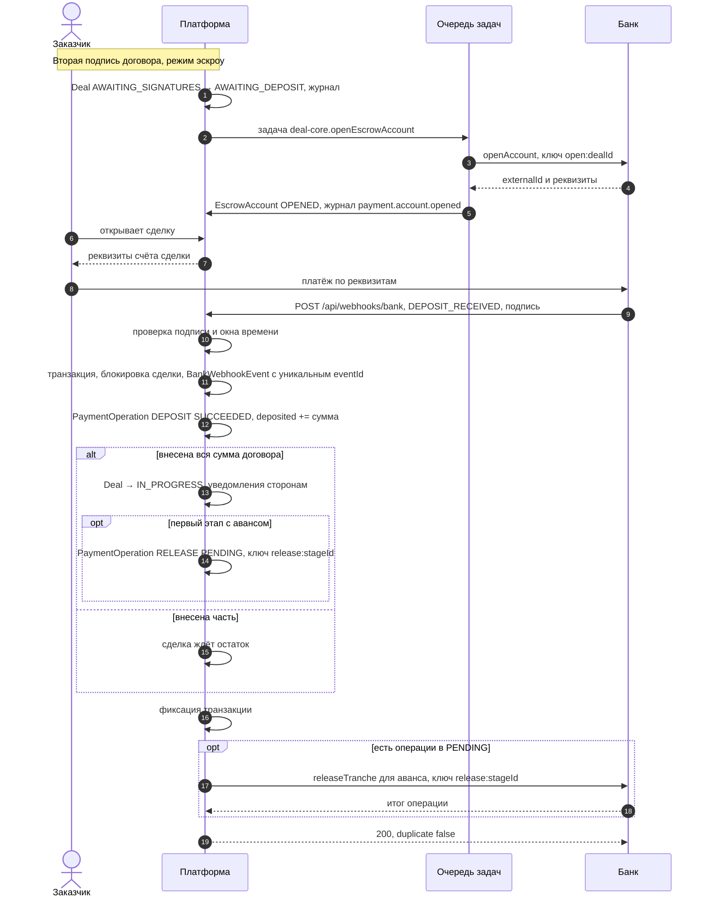
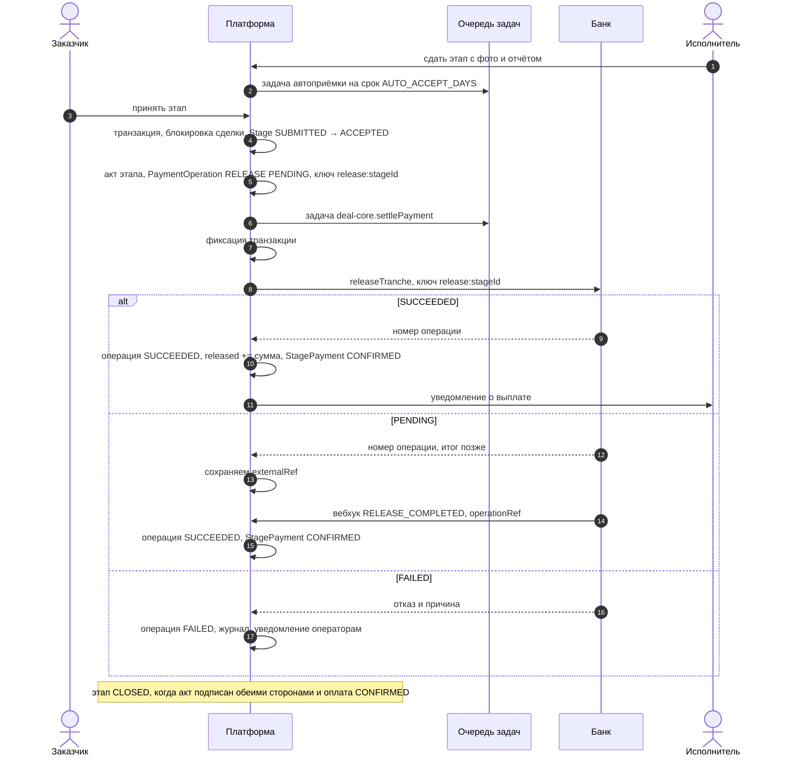
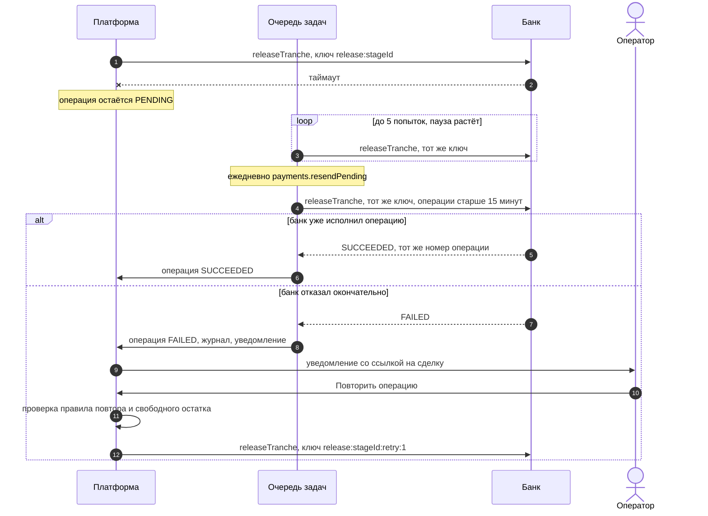
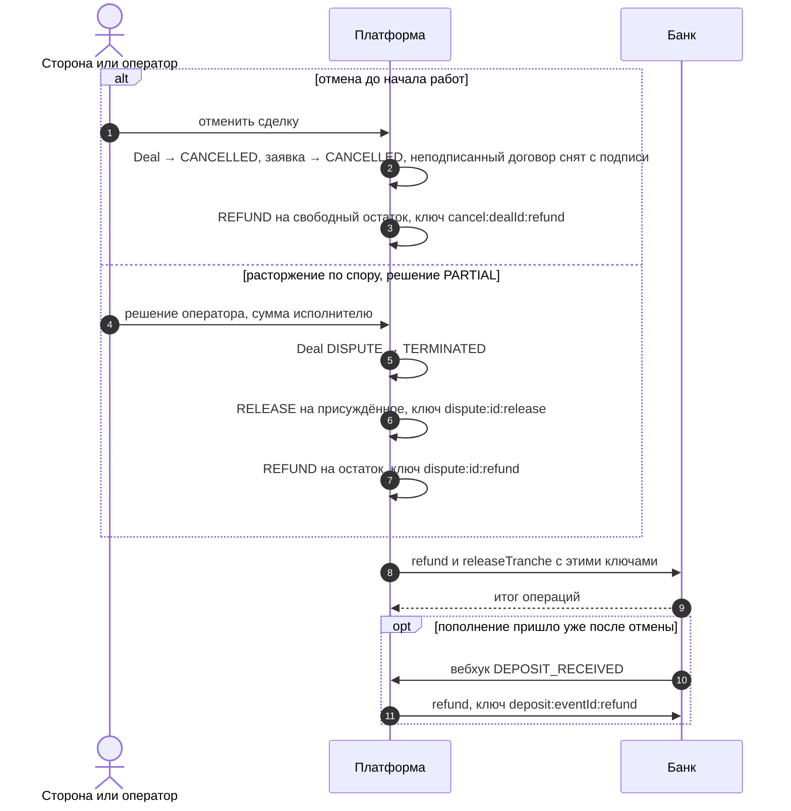
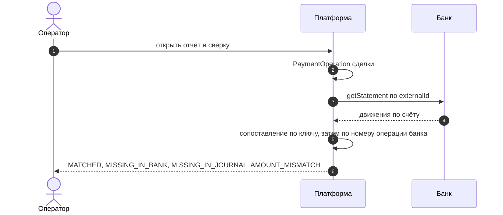

# 03. Интеграция с эскроу банка: наши требования

Документ описывает, что платформе нужно от банка для эскроу по сделкам и как устроена наша сторона интеграции. **Здесь нет утверждений о конкретном API Freedom Bank или другого банка**: только требования платформы, точка подключения в коде и поведение, которое уже реализовано и проверено на встроенном симуляторе банка. Формат вызовов, авторизация и коды ответов банка будут приведены к спецификации банка в одном файле адаптера.

## 1. Модель

- **Один эскроу-счёт на сделку.** Счёт открывается после того, как обе стороны подписали договор, и идентифицируется у банка номером (`externalId`). Как именно банк реализует «счёт сделки» (отдельный счёт, субсчёт, виртуальный счёт с назначением платежа), решает банк; платформе нужен номер, по которому банк различает деньги конкретной сделки, и реквизиты для пополнения.
- **Деньги клиентов не проходят через счёт платформы.** Заказчик пополняет счёт сделки в банке; банк раскрывает транши исполнителю и возвращает остаток заказчику. Платформа только передаёт банку распоряжения по событиям сделки и получает от банка уведомления.
- **Транш — по этапу.** Сумма каждого этапа зафиксирована в договоре. Когда этап принят (заказчиком, автоприёмкой или решением оператора по спору), платформа просит банк раскрыть сумму этапа исполнителю. Аванс (`ON_START`) раскрывается в момент, когда этап может начаться.
- **Возврат.** При отмене сделки до начала работ — всё внесённое; при расторжении по спору — остаток счёта за вычетом присуждённого исполнителю.
- **Сделка начинается после полного пополнения.** Пополнять можно частями; сделка переходит в работу, когда внесено не меньше суммы договора.
- **Суммы — целые тенге** (`Int` в БД, `amount: number // ₸` в интерфейсе). Если банк работает в тиынах, перевод делает адаптер.

## 2. Точка подключения: `PaymentRail`

Контракт — `src/modules/payments/rail.ts`. Ядро сделки (`deal-core`) не знает, кто держит деньги: оно работает с журналом операций, а журнал — с рельсом.

```ts
export type RailMode = "manual" | "escrow-simulator" | "bank";

export interface PaymentRail {
  readonly mode: RailMode;
  /** Нужен ли шаг пополнения счёта до начала работ. В manual — нет. */
  readonly requiresDeposit: boolean;
  openAccount(input: OpenAccountInput): Promise<{ externalId: string; requisites: Requisites }>;
  getRequisites(externalId: string): Promise<Requisites>;
  releaseTranche(input: TrancheInput): Promise<OperationResult>;
  refund(input: RefundInput): Promise<OperationResult>;
  getStatement(externalId: string): Promise<StatementEntry[]>;
  /** Проверяет подпись вебхука (HMAC) и разбирает тело. Неверная подпись — исключение. */
  parseWebhook(input: { headers: Headers; rawBody: string }): Promise<RailWebhookEvent>;
}

export type OperationResult =
  | { status: "SUCCEEDED"; externalRef: string }
  | { status: "PENDING"; externalRef: string } // итог придёт вебхуком
  | { status: "FAILED"; externalRef?: string; error: string };
```

Реализации (`src/modules/payments/rails/`):

| Файл | Режим | Состояние |
|---|---|---|
| `manual.ts` | `manual` | Денежных операций нет; любой вызов, кроме выписки, — ошибка «в режиме прямой оплаты деньги не проходят через счёт» |
| `escrow-simulator.ts` | `escrow-simulator` | Полная учебная модель банка. «Книги банка» хранятся отдельно от журнала платформы (`PlatformSetting`, ключ `escrow-simulator:account:<номер>`), поэтому сверка сравнивает два независимых источника. Идемпотентен по ключу, не уходит в минус, пополнение приходит только подписанным вебхуком |
| `bank.ts` | `bank` | Заглушка: каждый метод отвечает «Эскроу-счёт банка-партнёра ещё не подключён» (`UNAVAILABLE`), маршрут вебхука — HTTP 503 |

**Подключение банка** — это реализация `bankRail` в `rails/bank.ts` по спецификации банка и переменные окружения `PAYMENT_RAIL=bank`, `BANK_API_URL`, `BANK_WEBHOOK_SECRET` (их наличие при `PAYMENT_RAIL=bank` уже проверяет `src/platform/env.ts`; если банку нужны другие учётные данные, они добавляются туда же). Журнал операций, вебхуки, досылка, сверка, статусные машины и экраны не меняются: на симуляторе они работают через тот же интерфейс.

## 3. Операции, которые нужны от банка

| # | Операция | Метод `PaymentRail` | Когда вызывает платформа | Что передаём | Что ждём в ответ |
|---|---|---|---|---|---|
| 1 | Открыть счёт сделки | `openAccount` | После второй подписи договора в эскроу-режиме: задача `deal-core.openEscrowAccount`, а если она ещё не выполнилась — при открытии экрана сделки | `dealId`, номер сделки, сумма договора, ключ `open:<dealId>` | Номер счёта у банка (`externalId`) и реквизиты |
| 2 | Реквизиты для пополнения | `getRequisites` | Показ заказчику на экране сделки | `externalId` | `bankName`, `bik`, `iban`, `beneficiary`, `paymentPurpose` (по назначению платежа банк сопоставляет пополнение со сделкой) |
| 3 | Уведомление о пополнении | вебхук `DEPOSIT_RECEIVED` → `parseWebhook` | Банк зачислил деньги на счёт сделки | — | `eventId`, `externalId`, `amount`, `operationRef` (номер операции у банка), `occurredAt` |
| 4 | Раскрыть транш исполнителю | `releaseTranche` | Этап стал к оплате; решение по спору с выплатой исполнителю | `externalId`, `dealId`, `stageId` (нет — выплата по спору), сумма, ключ идемпотентности | `SUCCEEDED` / `PENDING` / `FAILED` со ссылкой банка |
| 5 | Вернуть заказчику | `refund` | Отмена до начала работ; расторжение по спору; пополнение пришло после отмены | `externalId`, `dealId`, сумма, основание (сейчас — ключ операции), ключ идемпотентности | `SUCCEEDED` / `PENDING` / `FAILED` |
| 6 | Итог операции | вебхуки `RELEASE_COMPLETED`, `REFUND_COMPLETED`, `OPERATION_FAILED` | Банк завершил операцию, принятую ранее в `PENDING` | — | `eventId`, `externalId`, `amount`, `operationRef` = наш ключ идемпотентности или ссылка банка, `occurredAt` |
| 7 | Выписка по счёту | `getStatement` | Сверка в отчёте оператора; страница показа банку | `externalId` | Список движений: ссылка банка, вид (`DEPOSIT`/`RELEASE`/`REFUND`), сумма, время, наш ключ идемпотентности (для списаний) |

### Требования к операциям

1. **Идемпотентность по нашему ключу** для открытия счёта, транша и возврата: повтор с тем же ключом возвращает результат уже выполненной операции и не двигает деньги второй раз. Ключ должен действовать всё время жизни счёта: операцию в `PENDING` мы досылаем раз в сутки, пока не получим итог.
2. **Отличать окончательный отказ от временной недоступности.** Окончательный отказ (недостаточно средств, счёт закрыт, реквизиты неверны) — `FAILED`, повтор с тем же ключом даст тот же отказ. Временный сбой (таймаут, перегрузка, 5xx) — исключение в адаптере, после которого мы повторяем с тем же ключом.
3. **Номер операции банка** (`externalRef`) в ответе на транш и возврат, в вебхуках и в выписке.
4. **Вебхук об итоге** каждой операции, принятой в `PENDING`, и о каждом пополнении. В `operationRef` — наш ключ идемпотентности (предпочтительно) или номер операции банка, полученный в ответе.
5. **Стабильный `eventId`**: повторная доставка того же события — с тем же `eventId`. По нему мы отсекаем дубли; новое значение `eventId` для того же пополнения дало бы второе зачисление в журнале платформы (его покажет сверка, но не предотвратит).
6. **Выписка с нашими ключами.** Для траншей и возвратов — наш ключ идемпотентности; для пополнений — номер операции, совпадающий с `operationRef` из вебхука. По ним мы сопоставляем выписку с журналом.
7. **Получатели денег.** Текущий интерфейс не передаёт реквизиты получателя в каждой операции: предполагается, что получатель траншей (исполнитель) и получатель возврата (заказчик) закреплены за счётом сделки при открытии по договору. Если банк требует реквизиты в каждой операции, расширим `TrancheInput`/`RefundInput`. Банковские реквизиты исполнителя платформа сейчас **не собирает** — это нужно добавить в анкету исполнителя вместе с подключением банка (вопрос к банку ниже).

## 4. Идемпотентность на нашей стороне

Каждая денежная операция платформы — строка `PaymentOperation` с уникальным `idempotencyKey`. Запись создаётся через `createMany(..., skipDuplicates)`: повторный запрос с тем же ключом ничего не создаёт и не ставит вторую отправку в банк.

| Ключ | Операция | Откуда |
|---|---|---|
| `open:<dealId>` | открытие счёта | `payments.ensureEscrowAccount` (счёт к тому же уникален по сделке) |
| `release:<stageId>` | транш по этапу | `deal-core.paymentBecameDue`: приёмка, автоприёмка, решение спора в пользу исполнителя, начало сделки (аванс) |
| `dispute:<disputeId>:release` | выплата исполнителю по решению `PARTIAL` | `deal-core.resolveDispute` |
| `dispute:<disputeId>:refund` | возврат остатка заказчику при `TERMINATE` или `PARTIAL` | `deal-core.resolveDispute` |
| `cancel:<dealId>:refund` | возврат внесённого при отмене до начала работ | `deal-core.cancelDeal` |
| `deposit:<eventId>` | зачисление (запись по вебхуку, не вызов банка) | `payments.receiveWebhook` |
| `deposit:<eventId>:refund` | возврат пополнения, пришедшего после отмены или расторжения | `deal-core.onPaymentSettled` |
| `<исходный>:retry:<n>` | повтор отклонённой банком операции оператором | `deal-core.retryPaymentOperation` |

Правила:

- **Один транш на этап.** Ключ `release:<stageId>` один, каким бы путём ни пришла приёмка. Двойное нажатие «Принять этап» даёт одну приёмку и одну операцию: второй запрос ждёт блокировку строки сделки и получает «состояние уже изменилось». Это покрыто интеграционными тестами с параллельными вызовами.
- **Повтор отказа — новый ключ.** По старому ключу банк вернёт тот же отказ, поэтому повтор создаёт `<исходный>:retry:<n>`. В семействе ключей `release:<stageId>[:retry:n]` не бывает больше одной операции в `PENDING` или `SUCCEEDED`.
- **Повтор — только пока он нужен.** Правило одно для сервиса и для кнопки на экране (`src/modules/deal-core/retry-policy.ts`): транш этапа — если сделка в работе или в споре, этап `ACCEPTED`, оплата `DUE` и по этапу нет открытого спора; операции спора — если спор решён и решение их требует; возврат при отмене — если сделка отменена. Иначе повтор отправил бы деньги вопреки решению по спору. Пополнение не повторяется: его делает заказчик в банке.
- **Распределяется только свободный остаток:** внесено − перечислено − возвращено − транши и возвраты в `PENDING` (`escrowAvailable`). Отмена и расторжение не возвращают заказчику сумму транша, который вот-вот уйдёт исполнителю; повтор не проходит, если свободных средств не хватает.
- Ключи состоят из префикса, идентификаторов (`cuid`) и суффиксов, символы `[a-z0-9:_-]`; в `deposit:<eventId>` входит `eventId` банка. Если у банка есть ограничения на длину или набор символов ключа, адаптер преобразует ключ детерминированно.

## 5. Подписи запросов

### Входящие: банк → платформа

Эндпоинты — `POST /api/webhooks/bank` и `POST /api/webhooks/escrow-simulator` (описание — [openapi.yaml](openapi.yaml)). Общий обработчик — `src/app/api/webhooks/_handle.ts`.

Схема подписи, реализованная для симулятора (`src/modules/payments/webhook-signature.ts`) и предлагаемая по умолчанию для банка:

| Элемент | Значение |
|---|---|
| Заголовок времени | `x-senim-timestamp`: Unix-время в секундах |
| Заголовок подписи | `x-senim-signature`: `v1=<hex(HMAC-SHA256(secret, "<timestamp>.<тело запроса>"))>` |
| Секрет | общий секрет, выданный банку: `BANK_WEBHOOK_SECRET` (для симулятора — `ESCROW_SIMULATOR_WEBHOOK_SECRET`, 32+ символа) |
| Что подписывается | метка времени, точка и тело запроса **байт в байт, как отправлено** (без переформатирования JSON) |
| Окно времени | ±5 минут от времени сервера; старый запрос не переиграть |
| Сравнение | за постоянное время (`timingSafeEqual`) |
| Повторная доставка | с новой меткой времени и новой подписью, `eventId` прежний |
| Размер тела | до 64 КБ; больше — 413 до разбора и проверки подписи |

Пример для проверки реализации (секрет тестовый; значения получены функцией `signWebhook` проекта и проходят `verifyWebhookSignature`):

```
секрет:            test-secret-not-for-production-0001
x-senim-timestamp: 1793438105
тело:              {"eventId":"evt_3f9a1c2b7d4e5f60","type":"DEPOSIT_RECEIVED","externalId":"SIM-15-A1B2C3","amount":460000,"operationRef":"SIMOP-9F8E7D6C5B","occurredAt":"2026-10-31T09:15:00.000Z"}
подписываемая строка: 1793438105.<тело>
x-senim-signature: v1=08aabfce6a7de6ea6d36afea83697cdfaadc1f6fcfede84ca160b7d48013c0cf
```

Если у банка своя схема подписи уведомлений (другие заголовки, асимметричная подпись, взаимный TLS), она реализуется в `bankRail.parseWebhook` — остальной код не меняется. Пути вебхуков не закрыты паролем демо-стенда: их защищает подпись. Ограничение по IP-адресам банка, если банк его даёт, настраивается на уровне хостинга.

### Исходящие: платформа → банк

Клиент API банка ещё не написан: формат авторизации определит спецификация банка. Наши требования к себе и к каналу:

- только TLS; учётные данные (токен, сертификат клиента, ключ подписи запросов) — в переменных окружения или хранилище секретов облака, не в коде;
- каждый вызов транша и возврата несёт ключ идемпотентности операции;
- таймаут, обрыв соединения и 5xx считаются «итог неизвестен»: адаптер бросает исключение, операция остаётся `PENDING`, повтор идёт с тем же ключом (раздел 7).

## 6. Соответствие статусов

### Итог операции банка → журнал платформы

| Банк сообщил | `OperationResult` | `PaymentOperation.status` | Что происходит в сделке |
|---|---|---|---|
| Операция исполнена | `SUCCEEDED` + номер банка | `SUCCEEDED` | Суммы счёта пересчитаны; транш этапа → оплата этапа `CONFIRMED`, этап закрывается, если акт подписан; уведомление исполнителю |
| Операция принята, итог позже | `PENDING` + номер банка | остаётся `PENDING`, сохраняется `externalRef` | Ждём вебхук; раз в сутки досылаем с тем же ключом |
| Окончательный отказ | `FAILED` + причина | `FAILED` | Запись `payment.operation.failed` в журнал, уведомление всем операторам; оплата этапа остаётся `DUE`; повтор — оператором с новым ключом |
| Временный сбой, таймаут | исключение в адаптере | остаётся `PENDING` без `externalRef` | Повтор задачей с тем же ключом |

### Вебхук → журнал и сделка

| `type` | Обработка (`payments.receiveWebhook` → `deal-core.onPaymentSettled`) |
|---|---|
| `DEPOSIT_RECEIVED` | Операция `DEPOSIT` в `SUCCEEDED` с ключом `deposit:<eventId>`, `deposited` += сумма. Сделка в `AWAITING_DEPOSIT` и внесена вся сумма — переход в `IN_PROGRESS` (аванс первого этапа сразу запрашивается траншем). Сделка отменена или расторгнута — автоматический возврат этого пополнения |
| `RELEASE_COMPLETED`, `REFUND_COMPLETED` | Операция находится по `operationRef` (наш ключ или номер банка) и становится `SUCCEEDED`, дальше — как в таблице выше |
| `OPERATION_FAILED` | Операция становится `FAILED`, дальше — как в таблице выше |
| Итог по операции, которой нет в журнале или которая уже завершена | Событие сохраняется и отмечается обработанным, состояние не меняется; расхождение покажет сверка |
| Событие по неизвестному счёту | Событие сохраняется с ошибкой «Счёт сделки не найден», ответ 200 (повтор не поможет). Экрана оператора для таких событий пока нет — они видны в таблице `BankWebhookEvent` |

### Статусы сущностей

| Сущность | Статусы | Как связаны с банком |
|---|---|---|
| `Deal` | `AWAITING_SIGNATURES` → `AWAITING_DEPOSIT` → `IN_PROGRESS` → `COMPLETED`; `CANCELLED`, `DISPUTE`, `TERMINATED` | `AWAITING_DEPOSIT` есть только в эскроу; выход из него — пополнение на всю сумму |
| `StagePayment` | `DUE` → `CONFIRMED` (эскроу) | `CONFIRMED` — только по выполненному траншу; отметок сторон в эскроу нет |
| `EscrowAccount` | `OPENED`, `FUNDED`, `PARTIALLY_RELEASED`, `CLOSED`, `REFUNDED` | вычисляется из сумм внесено / раскрыто / возвращено (`escrowStatusOf`) |
| `PaymentOperation` | `PENDING`, `SUCCEEDED`, `FAILED` | см. таблицы выше |

Состояния счёта на стороне банка, которых нет в нашей модели (блокировка, арест, закрытие банком), сейчас не обрабатываются — вопрос к банку ниже.

## 7. Обработка сбоев

Денежная операция выполняется в **два шага** (ADR-002, «Уточнения»):

1. **Запись.** В транзакции действия (приёмка, решение спора, отмена) создаётся `PaymentOperation` в `PENDING` и ставится задача `deal-core.settlePayment`. Если транзакция откатилась, операции нет вовсе.
2. **Вызов банка.** После фиксации операция сразу отправляется в банк в том же запросе (`settleDeal`). Результат фиксируется в новой транзакции под блокировкой сделки. Сбой банка не ломает действие пользователя: этап уже принят, операция ждёт в журнале.

| Ситуация | Что делает платформа |
|---|---|
| Банк недоступен при отправке | Исключение; операция в `PENDING` без `externalRef`. Задача `deal-core.settlePayment` повторяет вызов с тем же ключом: до 5 попыток с паузами 30 с, 1, 2 и 4 мин. Задачи выполняет `/api/cron/run` (или `npm run jobs`), поэтому реальная частота повторов зависит от расписания cron |
| Все попытки задачи исчерпаны | Ежедневная задача `payments.resendPending` отправляет каждую `RELEASE`/`REFUND` в `PENDING` старше 15 минут снова, с тем же ключом |
| Банк принял операцию (`PENDING`), вебхук с итогом потерялся | Та же ежедневная досылка: банк по ключу возвращает итог выполненной операции, а не исполняет её второй раз |
| Банк отклонил операцию | `FAILED`, запись в журнал и уведомление операторам со ссылкой на сделку. На экране сделки у оператора кнопка «Повторить операцию» видна ровно тогда, когда повтор разрешён правилом; повтор — с ключом `:retry:<n>` |
| Ошибка при обработке вебхука | Транзакция откатывается вместе с записью события; ответ не 2xx (непредвиденная ошибка — 500), банк доставляет снова |
| Повторная доставка вебхука | Ответ 200 с `duplicate: true`, состояние не меняется |
| Неверная подпись или просроченная метка времени | Ответ 401, событие не записывается |
| Пополнение после отмены сделки | Автоматический возврат с ключом `deposit:<eventId>:refund` |
| Двойное нажатие, параллельные запросы | Блокировка строки сделки + условное обновление: один переход, одна операция |
| На счёте не хватает средств | Банк отвечает отказом (`FAILED`); оператор видит операцию и решает вопрос со сторонами |

Ошибки и предупреждения пишутся в лог без персональных данных (раздел «Логи» в [04](04-security-and-data.md)).

## 8. Сверка

`payments.reconcile(dealId)` (`src/modules/payments/reconcile.ts`, чистая функция сопоставления — `reconcile-entries.ts`) сравнивает журнал платформы (`PaymentOperation`) с выпиской банка (`getStatement`). Сопоставление — по ключу идемпотентности, иначе по номеру операции банка (так находятся пополнения).

| Результат | Значение |
|---|---|
| `MATCHED` | Операция есть в обоих источниках, вид и сумма совпадают |
| `MISSING_IN_BANK` | В журнале есть, в выписке нет (например, операция ещё в пути) |
| `MISSING_IN_JOURNAL` | В выписке есть, в журнале нет; или журнал считает операцию отклонённой, а банк деньги двинул |
| `AMOUNT_MISMATCH` | Сумма или вид расходятся |

Отклонённая операция, которой нет в выписке, — норма и в отчёт не попадает. Результат сверки показывается в отчёте оператора (`/operator/report`) по каждой сделке со счётом; на странице показа банку (`/bank-demo`) — операции журнала рядом с выпиской симулятора.

## 9. Диаграммы последовательности

### Открытие счёта и пополнение



Операции, записанные при обработке вебхука, отправляются в банк до ответа на вебхук (`deal-core.handleRailWebhook` → `settleDeal`). Сбой этой отправки не меняет ответ: событие уже принято, операция ждёт повтора в журнале.

### Транш по этапу



### Сбой банка, досылка и повтор оператором



### Отмена и расторжение



### Сверка



## 10. Что сделать при подключении банка

1. Получить спецификацию API банка и доступ к тестовому контуру.
2. Реализовать `bankRail` в `src/modules/payments/rails/bank.ts`: вызовы, авторизация, разбор ответов, перевод статусов банка в `OperationResult` (раздел 6), проверка подписи уведомлений в `parseWebhook`.
3. Добавить учётные данные банка в `src/platform/env.ts` и `.env.example`.
4. Покрыть адаптер тестами на поддельном клиенте банка по образцу `documents/providers/sigex.ts` (порт + логика вокруг него) и прогнать сквозной сценарий на тестовом контуре банка.
5. Добавить сбор банковских реквизитов исполнителя, если банк их требует (раздел 3, п. 7).
6. Настроить запуск фоновых задач не реже раза в 15 минут.
7. Включить `PAYMENT_RAIL=bank` для новых сделок; старые сделки остаются в своём режиме.

## 11. Вопросы к банку

1. Как банк оформляет счёт сделки (отдельный счёт, субсчёт, виртуальный счёт) и кто его владелец; нужен ли трёхсторонний договор (банк, заказчик, исполнитель) и как он подписывается.
2. Как задаются получатели траншей и возврата: при открытии счёта или в каждой операции; какие реквизиты исполнителя и заказчика нужны и как банк их проверяет (KYC сторон).
3. Поддерживает ли банк ключ идемпотентности для открытия счёта, траншей и возвратов; сколько он хранится; есть ли ограничения на формат ключа.
4. Какие итоговые статусы и коды отказов у операций; как отличить окончательный отказ от временного сбоя.
5. Схема подписи уведомлений и запросов: общий секрет HMAC, асимметричная подпись, взаимный TLS; как меняются ключи.
6. Гарантии доставки уведомлений: повторы, их расписание, стабильность идентификатора события.
7. Формат выписки: есть ли в ней наш ключ или номер операции банка; как часто доступна.
8. Частичное пополнение, переплата сверх суммы договора, возврат остатка при завершении сделки: что делает банк со счётом после последнего транша.
9. Состояния счёта на стороне банка (блокировка, арест, закрытие) и уведомления о них.
10. Минимальная и максимальная сумма, комиссии банка и кто их оплачивает; работа в тенге или тиынах.
11. Срок открытия счёта: синхронно в ответе или позже уведомлением.
