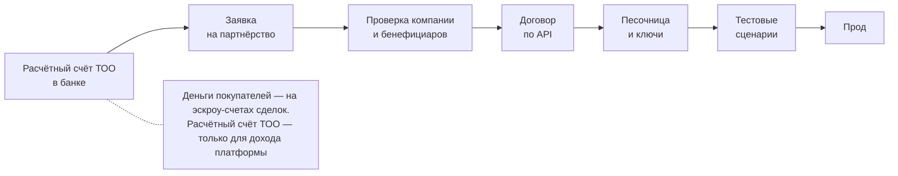

# 06. Банки и API эскроу в Казахстане: что известно

Состояние на **03.11.2026**. Документ нужен, чтобы выбрать банк для пилота и знать, о чём спрашивать. У каждого факта указан источник. Если факт не подтверждён публичной документацией или письмом банка, это сказано прямо. API ни одного банка здесь не описывается и не додумывается: наши требования к банку — в [03-escrow-integration.md](03-escrow-integration.md), предлагаемый контракт — в [openapi.yaml](openapi.yaml).

Правило для любого варианта ниже: **деньги покупателя никогда не проходят через счета ТОО.** Они лежат на эскроу-счёте сделки в банке. На счёт ТОО поступает только доход платформы (защита сделки 2% и гарантия оплаты и клиента 4%), который банк раскрывает со счёта сделки после подписанного акта. Схема, в которой деньги покупателя зачисляются на баланс ТОО или на баланс мерчанта-ТОО, не подходит независимо от банка.

## Сводка

| Банк | Эскроу-продукт | Публичный API эскроу | Что у нас в коде | Статус для пилота |
|---|---|---|---|---|
| Freedom Bank | Есть, подтверждён банком | Нет | Провайдер `manual`: оператор проставляет статусы денег по банковским документам | **Основной: пилот на `manual` с реальными деньгами в банке** |
| Банк ЦентрКредит (БЦК) | Есть: открытие бесплатно, обслуживание 12 000 ₸/мес | Продукт Escrow API есть на портале, операции не описаны | Провайдер `bcc` — только интерфейс и TODO, в коде пока не заведён | Резервный |
| Alatau City Bank | Публично не найден | Business API есть; документации по эскроу не нашли | Клиент в прежнем репозитории `escrowkz` (`bank-alatau.ts`), в этот проект не переносился | Заблокирован на ключах и ЭЦП |
| Halyk Bank | Публично не найден | Не найден | — | Нет данных |
| Kaspi Bank | Публично не найден | Не найден | — | Нет данных |
| Freedom Pay (платёжная организация, не банк) | Нет; приём платежей и выплаты | Есть: приём и выплаты | Провайдер `freedompay`, только `APP_ENV=staging` | Только песочница, см. раздел «Freedom Pay» |

## Freedom Bank

**Источник:** Technical Handover (`docs/tz/technical-handover.md`, раздел 6) и ТЗ MVP v1.0, п. 10: продукт подтверждён банком. Публичной страницы продукта и публичной документации мы не проверяли.

| Что | Значение | Источник |
|---|---|---|
| Продукт | Эскроу-счёт по трёхстороннему договору | Handover |
| Плательщик | Физическое лицо (покупатель) | Handover |
| Открытие счёта | 0 ₸ | ТЗ п. 10, Handover |
| Обслуживание | 0 ₸ | ТЗ п. 10, Handover |
| Раскрытие | По расписке | ТЗ п. 10, Handover |
| API | **Нет** | Handover |
| Контакт | В работе (проект ответа банка) | Handover |

**Как подключаемся.** Без API банк подключается через провайдер `manual` (подробно — [03-escrow-integration.md](03-escrow-integration.md), раздел 4):

1. Платформа создаёт операцию журнала денег в статусе `PENDING`.
2. Деньги движутся в банке: покупатель пополняет эскроу-счёт сделки, банк раскрывает его по пакету документов.
3. Оператор платформы подтверждает каждую операцию кнопкой и прикладывает номер, дату и скан банковского документа. Кнопки: «Деньги поступили на счёт в банке», «Выплачено мастеру», «Доход платформы получен», «Возврат покупателю».
4. Для раскрытия платформа формирует пакет: акт приёмки с подписями сторон и расписку на раскрытие. Шаблон расписки помечен «требует юридической проверки».

**Не подтверждено и нужно уточнить у банка:** кто инициирует открытие счёта; может ли покупатель-физлицо открыть счёт и пополнить его онлайн; можно ли одним раскрытием разделить деньги на мастера и платформу; как выглядит расписка и кто её подписывает; сроки раскрытия и возврата; какой документ банк выдаёт по каждой операции. Полный список — раздел «Вопросы к банку».

## Банк ЦентрКредит (БЦК)

### Что видно публично

**Портал разработчика `developer.bcc.kz`** (проверено 03.11.2026):

- В каталоге есть продукт **Escrow API** с описанием «Сервис по работе со счетами эскроу».
- По данным владельца проекта, версия продукта — **1.0.1**. На странице продукта (`developer.bcc.kz/ru/product/5474`) при нашей проверке была указана версия **1.0.0**. Расхождение не объяснено; проверить при получении доступа.
- На странице продукта перечислены три метода: `POST /ext/deals`, `GET /ext/deals/{id}` и `PUT /ext/deals/{id}`. Для каждого указан лимит «100 вызовов за 1 час» (тариф Default Plan). **Параметров, тел запросов и ответов на странице нет.** Что делают методы, по ним понять нельзя, поэтому операции считаем публично не описанными и ничего на этих путях не строим.
- Доступ — после регистрации на портале. По данным владельца проекта, через кнопку «Получить доступ»; при нашей проверке на странице продукта была кнопка выбора тарифа «Выбрать». Контакт на портале — `oapi@bcc.kz`.

**Страница продукта `bcc.kz/business/current-account/escrow-account/`** (проверено 03.11.2026):

| Что | Как на странице |
|---|---|
| Открытие эскроу-счёта | Бесплатно |
| Обслуживание | 12 000 ₸ в месяц. Списывается с текущего счёта **получателя** через месяц после зачисления денег на эскроу-счёт; других комиссий нет |
| Кто открывает | Получатель денег подаёт заявку на открытие; плательщик подтверждает её и пополняет счёт в интернет-банкинге |
| Пополнение | Онлайн, со счёта в БЦК или из другого банка |
| Раскрытие | Банк замораживает деньги до подтверждения выполнения обязательств; после подтверждения плательщиком банк открывает получателю доступ к деньгам |
| API, частичное раскрытие, возврат, тип плательщика | На странице не упоминаются |

### Что известно со слов банка и из Handover (публично не подтверждено)

- Handover (раздел 6): «Escrow API на рефакторинге»; эскроу-счёт БЦК — резервный вариант.
- Путь подключения к Open API, по словам банка: заявка или письмо на `oapi@bcc.kz` → менеджер связывается в течение 1–3 рабочих дней → документы и тестовый доступ → заявление о присоединении к типовому договору по API → тесты → прод. По словам банка, цикл обычно занимает до месяца.

### Что это значит для нас

- Модель БЦК двусторонняя: у счёта один получатель. Обслуживание оплачивает получатель, и, судя по странице, у него должен быть текущий счёт в БЦК. Для нашей модели нужно раскрытие на двух получателей (мастер и платформа) и возврат покупателю; на странице это не описано.
- В коде провайдер `bcc` пока не заведён: в `PaymentProviderName` (`src/modules/payments/provider.ts`) и в `PAYMENT_PROVIDER` (`src/platform/env.ts`) есть только `mock`, `manual` и `freedompay`. По ADR-009 до получения документации у `bcc` будет только интерфейс и TODO, без вызовов на перечисленные пути.
- Следующий шаг (за владельцем, `docs/OWNER_TODO.md`, п. 22): письмо на `oapi@bcc.kz` с запросом документации Escrow API и вопросами из раздела «Вопросы к банку».

## Alatau City Bank

- **Источник:** Handover, разделы 2 и 6. В прежнем репозитории `escrowkz` написан клиент Business API (`bank-alatau.ts`, песочница). Он заблокирован на получении API-ключей и подписи ЭЦП через NCALayer.
- В этот проект клиент не переносился, провайдера `alatau` нет.
- Публичной документации по эскроу у Alatau City Bank мы не нашли (поиск 03.11.2026). Есть ли у банка эскроу-продукт для платформ, не подтверждено.

## Halyk Bank и Kaspi Bank

- Публичных API эскроу не найдено (поиск 03.11.2026).
- Halyk ePay и Kaspi Pay — сервисы **приёма платежей**, не эскроу. При приёме платежа деньги зачисляются мерчанту; если мерчант — ТОО платформы, это нарушает правило «деньги покупателя не проходят через счета ТОО». Поэтому как замена эскроу они не подходят.
- В публичных материалах Halyk описывает партнёрские API (BaaS: платежи, идентификация, выпуск карт, интеграция с учётными системами); эскроу среди них не упоминается. Узнать о продукте можно только запросом в банк.

## Freedom Pay

Подробно — [07-freedompay-integration.md](07-freedompay-integration.md) (документ ведёт другой исполнитель). Freedom Pay — платёжная организация. В коде провайдер `freedompay` работает только при `APP_ENV=staging`; при любом другом `APP_ENV` приложение не стартует (проверка в `src/platform/env.ts`).

Два ограничения по публичной документации `docs.freedompay.kz`, из-за которых `freedompay` не используется с реальными деньгами:

1. **Двухстадийный холд держится ограниченный срок.** При `pg_auto_clearing=0` сумма блокируется на карте покупателя. Если за 5 дней не вызвать подтверждение или отмену, платёж автоматически подтверждается или отменяется, в зависимости от настроек мерчанта. Срок можно изменить для мерчанта (`docs.freedompay.kz/doc-782024`). Заказ мебели длится неделями, поэтому холд на карте не может держать деньги до подписания акта.
2. **Одностадийная оплата зачисляет деньги мерчанту.** При `pg_auto_clearing=1` сумма списывается сразу после авторизации и поступает мерчанту. Если мерчант — ТОО платформы, это нарушает железное правило.

**Вывод:** `freedompay` остаётся только в staging, пока Freedom Pay письменно не подтвердит схему, в которой деньги покупателя не зачисляются на баланс ТОО (например, зачисление на эскроу-счёт или номинальный счёт). Это записано в `docs/OPEN_QUESTIONS.md`, № 41, и в `docs/OWNER_TODO.md`, п. 18.

## Типовой путь получения доступа к API банка

> **Это типовой путь, а не порядок конкретного банка. Уточнять у каждого банка.**

Часто требуется:

- ЭЦП юридического лица для подписи запросов к API (в РК — ключи НУЦ, подпись через NCALayer или серверную библиотеку);
- белый список IP-адресов, с которых платформа вызывает API (у рабочего окружения должен быть постоянный исходящий адрес — учесть при выборе хостинга в РК, [04-security-and-data.md](04-security-and-data.md), раздел 10);
- взаимный TLS или отдельный сертификат клиента;
- отдельные учётные данные для песочницы и прода.

## Вопросы к банку

Один список для любого банка. Ответы определяют, какой провайдер подключать и что менять в адаптере.

1. **Выписка и уведомления по счёту сделки.** Есть ли выписка по каждому эскроу-счёту (через API или файлом) и уведомления (вебхуки) о зачислении, раскрытии и возврате? Какой идентификатор операции в них приходит и можно ли передать наш ключ операции?
2. **Частичное раскрытие и раздел.** Можно ли одним распоряжением раскрыть счёт на двух получателей: мастеру X − 4% и платформе 6% от X? Можно ли при споре раскрыть часть мастеру, часть платформе, а остаток вернуть покупателю?
3. **Возврат.** Как вернуть покупателю всю сумму (отмена после оплаты) или остаток (спор)? На карту или счёт плательщика? Сроки?
4. **Подтверждение раскрытия документом.** Какой документ банк выдаёт по каждому зачислению, раскрытию и возврату (номер, дата)? Какой документ банк принимает от сторон для раскрытия (расписка, акт, их форма, подписи)? Нужна ли ЭЦП?
5. **Заморозка при споре.** Может ли банк раскрыть счёт по документам сторон без платформы? Нужно ли сообщать банку об открытом споре?
6. **Сроки.** Открытие счёта, зачисление, раскрытие, возврат — сколько времени занимает каждая операция? Есть ли предельный срок жизни счёта?
7. **Тарифы.** Открытие, обслуживание, раскрытие, возврат: сколько стоит и с кого списывается (покупатель, мастер, платформа)?
8. **Кто инициирует открытие счёта:** покупатель, мастер или платформа? Сколько счетов можно открыть на одного мастера одновременно?
9. **Плательщик.** Может ли плательщиком быть физическое лицо, которое не является клиентом банка? Можно ли открыть счёт и пополнить его онлайн, без визита в отделение? Какие способы пополнения есть (перевод, карта)?
10. **Получатели.** Нужен ли мастеру и платформе счёт в этом банке? Какие реквизиты и проверки (KYC) нужны для мастера-ИП, мастера-ТОО и самозанятого?
11. **Идемпотентность.** Поддерживает ли API ключ идемпотентности (наш ключ на каждую операцию), сколько он хранится, есть ли ограничения на его формат?
12. **Безопасность канала.** Как подписываются запросы и уведомления (ЭЦП юрлица, HMAC, взаимный TLS)? Нужен ли белый список IP? Как меняются ключи?
13. **Тестовый контур.** Есть ли песочница с теми же операциями? Каков порядок перехода на прод?
